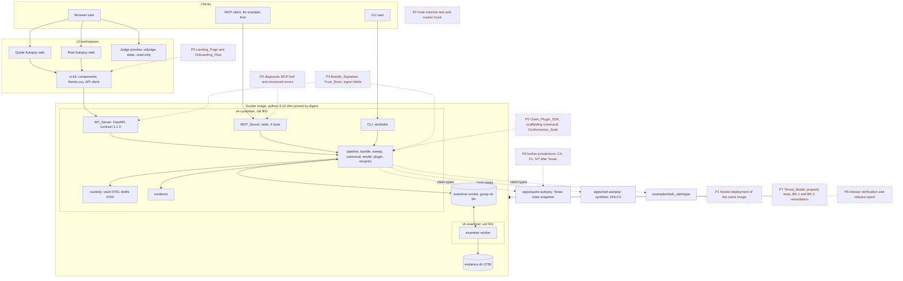
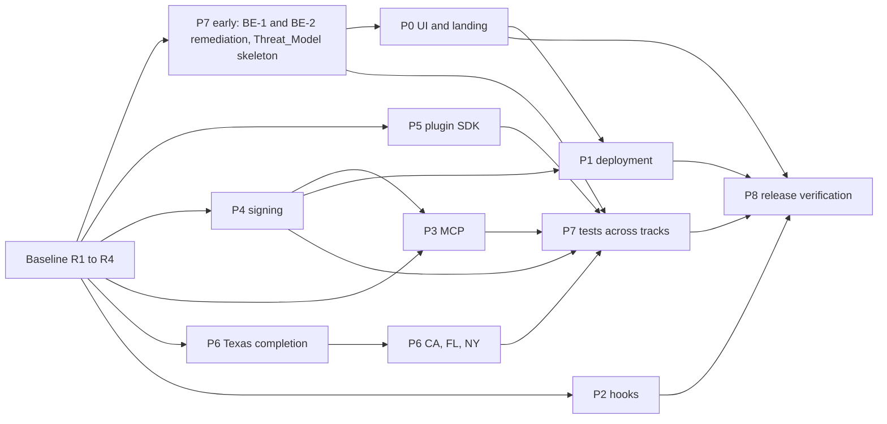
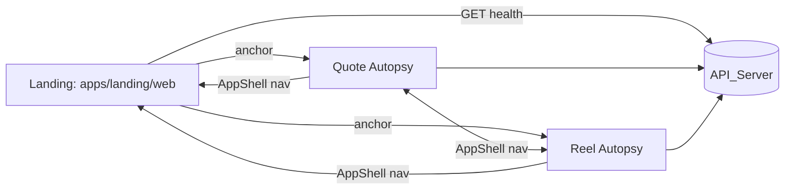
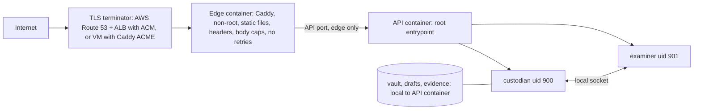

# Design Document: VerdictKit Next Phase

## Document status

This design is written in sections. Sections D0 (foundations), D1 (P0 UI/UX, conditionally approved, decisions in D1.16), D2 (P1 secure public deployment, conditionally approved, decisions in D2.12) and D3 (P2 agent hooks and Windows compatibility, conditionally approved, decisions in D3.13) are written. Sections D4 to D10 are listed in the table of contents at the end of this file and are PENDING. This file is not a complete design and must not be accepted as one.

## D0. Foundations

### D0.1 Scope and status

**What D0 covers.** D0 fixes the shared ground for the nine tracks P0 to P8 in `requirements.md`: the existing architecture, the environments in which work can be run, the invariants that every track must preserve, the accepted baseline exceptions, the build order, the trust boundaries, the maintainer decisions already recorded, and the unresolved items. It makes no per-track design decisions. Those belong to D1 to D10.

**Status labels.** Every statement about the future in this design carries one of these labels, or is plain description of the existing repository.

| Label | Meaning |
|---|---|
| DESIGNED | Written in this design. No code or test exists for it. |
| IMPLEMENTED | Code exists on the Phase_Branch. It has not been run to a recorded result. |
| VERIFIED | An Execution_Record with Outcome_Class `SUCCEEDED` exists in `docs/next-phase/EXECUTION_EVIDENCE.md` for the current Release_Candidate (Requirement 3.9). |
| UNVERIFIED | Not run in this phase, or run without captured evidence (Requirement 3.4). |

**Current status.** Nothing in this phase is implemented. Every planned item in this document is DESIGNED at most. The baseline run on commit `84df25c68198e496889b5892a03555ec7d2d860a` (branch `feature/kiro-next-phase`) is the only recorded execution result. Its summary is in D0.5.

**Roles.** Kiro owns the engineering work: specs, implementation, tests and evidence. ChatGPT and Claude are independent reviewers only. They do not edit the repository and do not own any deliverable.

**Rules inherited from the requirements.** Commits only on the Phase_Branch (1.1). Frozen_Release refs and Submission_Artifacts files are not modified (1.2, 1.8). New phase documents go under `docs/next-phase/` (1.8). Release tags, merges, pushes and publication are left to the repository owner (14.13).

### D0.2 Architecture overview

The diagram shows components that exist at commit `84df25c`, taken from the Core module listing, the `Dockerfile`, `deploy/entrypoint.sh` and the track register. Planned additions are drawn with dashed borders and carry the track identifier. No component is added beyond those that the requirements name.



Facts behind the diagram, each read from a repository file:

- The image runs two OS users, `vk-custodian` (uid 900) and `vk-examiner` (uid 901), plus the group `vk-ipc` (gid 902). The vault directory is mode 0700 owned by the custodian. The evidence directory is mode 750, owner custodian, group examiner (`Dockerfile`, `deploy/entrypoint.sh`).
- The entrypoint starts each process through `setpriv --no-new-privs` with `env -i` and an explicit environment. `VK_VAULT_KEY` is passed to the custodian and is not passed to the examiner (`deploy/entrypoint.sh`).
- The entrypoint subcommands are `gate-isolation`, `gate-case`, `gate-startup`, `gate-http`, `serve` and `verdictkit`. The `serve` subcommand requires `VK_VAULT_KEY` and fails if it is unset.
- The Core modules are `bundle`, `canonical`, `cli`, `envprint`, `mcp_server`, `model`, `pipeline`, `plugin`, `sweep` and the packages `api`, `custody`, `evidence`, `examiner`.
- `bundle.py` defines `AUTHENTICITY = {"status": "NOT_ESTABLISHED", "note": "Bundles are unsigned in v1."}`. No signing code exists.
- `mcp_server.py` registers the four tools with the server version string `0.1.0`. `api/server.py` sets `Cache-Control: no-store` and `X-Content-Type-Options: nosniff`. The `/api/v1/health` response includes `contractVersion`, `status`, `isolationMode`, `judgeMode` and `engineVersion`. It does not include a commit SHA.
- The CI workflow `p0-integration.yml` has two jobs on `ubuntu-latest`. Its triggers are pull requests to `master`, pushes to `master` and manual dispatch. `m3b-api-checks.yml` triggers on pushes and pull requests to `master`. Neither triggers on a push to `feature/kiro-next-phase`.

### D0.3 Environment matrix

| Environment | What it provides | What can be run | UNVERIFIED or blocked |
|---|---|---|---|
| Windows development host | PowerShell. Python 3.12.10, uv 0.13.9, Node 24.14.1, npm 11.11.0, git 2.51.0. Docker Desktop 29.9.3 with the Linux engine (`linux/amd64`), executable at `C:\Program Files\Docker\Docker\resources\bin\docker.exe`, which is not on `PATH`. A WSL Ubuntu distribution exists and does not have `uv` installed. | Lockfile check, `ruff`, pytest, Vitest, `npm` typecheck and build, `docker build`, and the container gates through the full path to `docker.exe`. All of these were run in the baseline. | Browser E2E (`scripts/ui_e2e.sh` needs Linux tools and port 8000, which `splunkd.exe` holds). `scripts/gate_nov22.sh`. The five tests that skip on Windows. Per-test Linux pytest evidence for BE-1 and BE-2. Hook execution inside Kiro. |
| Linux container | The repository image. Isolation_Mode `ENFORCED` through two OS users, the authenticated socket and the 0700 vault. Run with `--network none` in the baseline. | `gate-isolation`, `gate-startup`, `gate-http`, `gate-case` and offline replay all exited 0 in the baseline. | The image does not contain `ui/`, so `tests/ui/test_judge_preview.py` cannot validly run in it (four named failures, `FileNotFoundError`). The pytest exit code of the combined MCP and preview run was not captured. |
| CI (`ubuntu-latest`) | Two workflows with the `security-and-regression`, `web-ui` and `intake-and-custody` jobs. The `web-ui` job installs Playwright 1.63.0 and runs `scripts/ui_e2e.sh`. | Nothing has been run on CI in this phase. | Every CI result is UNVERIFIED for this phase. The workflows trigger on `master`, so a pull request to `master` is needed before they run. Creating that pull request is an owner action (14.13). |

**Design rule: configurable test ports (1.17).** Every port used by a local test, server or browser E2E run is set through an environment variable or command-line option with a documented default. Nothing in this phase stops, kills or reconfigures a process that the phase did not start. The process holding port 8000 on the development host (`splunkd.exe`, PID 5780 at baseline) is left running. Any new test or script that needs a port reads it from configuration and does not assume 8000, 4173 or 4174. Changing the existing `scripts/ui_e2e.sh` to take its ports from configuration is DESIGNED work for D1 and D8, and is not done.

**Host-class rule (1.5, 1.6, 1.12).** Container gates run only on a Linux_Docker_Host. A check that fails for a host-specific reason is recorded as a Baseline_Exception for that host and stays UNVERIFIED for the other host class until it has a per-test listing (`-rA`) and a captured pytest exit code.

### D0.4 Invariant-protection matrix

The first column lists the invariants from Requirement 2 and the neighbouring requirements. The second lists how tracks could weaken each one. The third names the design guard, by requirement identifier. Each guard is DESIGNED. The mechanism for each is specified in D1 to D10.

| Invariant | How tracks could threaten it | Design guard |
|---|---|---|
| Decimal arithmetic (2.1) | P0 UI converts a decimal string to a binary float for display. P5 scaffold template emits `float`. P6 new jurisdiction rules computed with float. P4 or P7 test data uses float. | UI renders the supplied decimal string unchanged (5.6). Scaffold output contains no float type, literal or conversion (11.5), and the Conformance_Suite checks no float in examination output (11.9). Acceptance tests for P6 use Decimal expected values (12.12). |
| Determinism (2.2, 10.7) | P4 adds signature bytes or a timestamp to the verdict. P3 adds diagnostics to the verdict path. P5 plugin reads wall-clock time. P2 or P8 scripts introduce unseeded values. | The Verdict_Hash excludes signature material (10.6). Unsigned Bundles stay byte-identical to baseline (10.5). Signed Bundles are byte-identical under a fixed clock and key (10.7). Scaffold reads no wall-clock time (11.5). New tests run under the `ci` Hypothesis profile with derandomization (13.7). |
| Answer-blind examination (2.3) | P5 plugins that can read outcomes. P3 diagnostics or error text that echoes outcome values. P4 puts the signing key in the examiner environment. P1 deploys with a changed environment. | Plugins stay behind the Answer_Blind boundary (11.15) and the blinding check runs in the Conformance_Suite (11.8). Signing key is read only in the Custodian (10.18). MCP error messages exclude exception text and input values (9.3, 9.14). Deployment keeps `VK_VAULT_KEY` out of the Examiner environment (7.9). |
| Fail-closed controls (2.4) | P3 changes error signalling and a failure turns into a pass. P4 reports trust on a bad signature or bad Trust_Store. P6 asserts a rule from an unverified source. P1 downgrades isolation to deploy. P2 treats an untrusted workspace as passing. | Missing or ambiguous signature input yields `INVALID` or `UNSUPPORTED_ALGORITHM` (10.30). A bad Trust_Store gives `NOT_EVALUATED` and never `TRUSTED` (10.17). Unverified source gives `UNVERIFIED` and no numeric rule (12.5). A target that cannot provide `ENFORCED` is rejected (7.8, 7.18). Untrusted-workspace hook runs are recorded `UNVERIFIED` (8.11). Verdicts `INDETERMINATE` and `BLOCKED` stay normal results (9.19). |
| Enforced Linux isolation (2.5, 2.6, 2.7) | P1 hosting target without distinct OS users. P4 key handling. P0 or P1 headers or proxies that bypass the socket. P7 tests run outside the container. | Judge mode starts only with `ENFORCED` and prints `VK_STARTUP_OK isolation=ENFORCED` once (7.7, 2.5). Judge mode refuses to start otherwise (2.6, 7.8). Isolation tests are marked `isolation` and run in the container gate (13.8). |
| Offline reproducibility (2.8) | P4 verification fetches keys or revocation data. P6 loader fetches rules at verification time. P3 diagnostics open network connections. | Signature verification is offline (10.19). The rules snapshot is packaged in the repository and verification gives the same outcome with no network (12.16). Diagnostics open only the configured examiner socket (9.4). Offline replay is part of the release scenario (14.5, 14.6). |
| LLM fence (2.9, 2.12) | P5 scaffold or P3 tooling imports an LLM client library. P6 derives rule values from a model response. | Scaffold contains no LLM client import (11.5). Rule values come only from Official_Source snapshots, never from model responses (12.6). `tests/contract/test_llm_fence.py` runs on every change to files under `verdict-integrity.md` (2.12). |
| Frozen release (1.2, 1.3, 14.14) | Any track that commits, rebases or tags on the wrong ref. P1 deployment workflow that pushes. Edits to Submission_Artifacts to apply a correction. | Work only on the Phase_Branch (1.1). Refusals are recorded (1.3). Corrections go in new files under `docs/next-phase/` (1.8, 15.8). Start-to-end check of each ref against its own recorded value, including the tag object and the peeled commit of `v1.0.0-submission` (14.14). |
| Evidence integrity (3, 4.9, 15, 16) | Counts from memory. A duplicate or lock-collision record counted as a test result. A capability described without a `SUCCEEDED` record. Credits estimated. Checkboxes ticked without evidence. | Counts come only from CANONICAL rows of the Execution_Index (1.14, 1.15, 14.8). Capability statements need a `SUCCEEDED` record for the Release_Candidate (3.9, 3.10). Credits are `NOT_AVAILABLE` unless read from a Kiro usage record (16.2). A `tasks.md` checkbox is checked only if the record shows every linked criterion `SUCCEEDED` (4.9). |

### D0.5 Accepted baseline exceptions

The baseline run on commit `84df25c68198e496889b5892a03555ec7d2d860a`, Windows host, 2026-11-24, gave two failures in the full `pytest -m "not isolation"` run: 444 passed, 2 failed, 5 skipped, 4 deselected. The two failures are the only accepted exceptions. Neither permits a release (Glossary, Baseline_Exception).

| | BE-1 | BE-2 |
|---|---|---|
| Test | `tests/contract/test_mcp_server.py::test_verify_replay_and_explain_roundtrip` | `tests/ui/test_judge_preview.py::JudgePreviewTests::test_case_outcome_get_to_offline_backend` |
| Observed failure | Assertion at `test_mcp_server.py:30`: `oct(bundle.parent.stat().st_mode & 0o777) == "0o700"` gives `0o777` on Windows. | `TimeoutError: timed out` in `http.client`, client timeout 2 seconds. Reproduced when run alone (7 passed, 1 failed). |
| Established | Reproduced at the same assertion. `Path.chmod(0o700)` does not set POSIX permission bits on Windows. The failure also appears in the contract run, the MCP run and the core hook command run. The historical Linux audit recorded this test as passed in image `verdictkit:submission`. | Reproduced on Windows. It was not reported as failing in the historical audit. |
| Not established | Linux pass in this phase. No per-test listing and no pytest exit code were captured. A pass is inferred only from the test's absence in a failure list of 4 named failures in a combined run. | **The root cause.** No trace, timing instrumentation or Linux comparison exists. The closed-local-port hypothesis in the baseline report is a hypothesis only and is not asserted here. A longer timeout is not accepted as a verified fix. |
| Status | ACCEPTED_BASELINE_EXCEPTION, for baseline continuation only | ACCEPTED_BASELINE_EXCEPTION (provisional) |
| Mandatory remediation before the final release | Keep the Linux POSIX mode assertion unchanged. Add platform-appropriate Windows security handling that tests the same property. Do not remove, weaken, skip or mark the original assertion (13.11). | Add instrumentation that records connection and response timing. Establish the root cause on Windows and on Linux from a full checkout. Fix the cause (13.12). |
| Closing evidence | Per-test listing (`-rA`) and captured pytest exit code on Windows and on a Linux_Docker_Host (13.13). | Same (13.13). |

**No other failure is permitted.** Any other failing test on any host is a new regression, is recorded `FAILED`, and needs a new maintainer decision by identifier before it can be accepted (1.13). No contract test is modified to loosen an assertion, marked `xfail` or marked `skip` (2.11). Until BE-1 is remediated, Windows runs may show exactly that one contract failure and no other (2.11). The release is not marked verified while either exception stands (14.10).

**Linux evidence for BE-1 and BE-2 is indirect and UNVERIFIED.** The only Linux data in this phase is one combined run in the image with summary `4 failed, 10 passed`. The command ended in a pipe through `tail`, so the recorded exit code (0) belongs to `tail`. The four named failures are in the judge-preview file because `ui/` is absent from the image, which makes that run an invalid environment for BE-2. See `BASELINE_REPORT.md` section 7 and ledger records E-025a and E-025b.

### D0.6 Dependency ordering

**Build sequence (DESIGNED).**

1. **Baseline and evidence discipline.** Done for the baseline run (`BASELINE_REPORT.md`). Applies to every later step (R1 to R4).
2. **P7 foundations, part 1.** BE-1 and BE-2 remediation work starts early because later tracks need a clean contract suite on Windows. The Threat_Model skeleton is created here and is extended as each track lands.
3. **P0 UI and landing page.** Needs the existing API contract 1.1.0 only. No dependency on P4 at first.
4. **P5 plugin SDK.** Independent of P4. Needs `plugin.py`, the stub example and the contract tests.
5. **P4 signing.** Changes the Bundle, CLI output, API contract and UI fields. It comes before P3 diagnostics fields and P8.
6. **P3 MCP interoperability.** Needs P4 for the signature fields in `replay_bundle` and `explain_verdict` (9.8). The error-signalling and diagnostic work in P3 does not depend on P4 and can start earlier.
7. **P6 regulatory.** Texas completion (retrieve 7 TAC §84.205 or record it `UNVERIFIED`) first (12.11, 12.17). Then California, Florida and New York in that order (12.18).
8. **P1 deployment.** Needs P0 for what is served, P4 for the final API contract and headers, and a Linux_Docker_Host. Hosting provider choice is a decision inside D2.
9. **P2 hooks and Windows.** Matcher and marker work can be done in the repository early. Execution evidence is owner-run in a disposable checkout (8.15 to 8.18) and does not block other tracks.
10. **P7 completion.** Property and adversarial tests for P3, P4, P5 and P6 are added as each lands. Final Threat_Model rows close after P6.
11. **P8 release verification.** Last. Reruns every baseline step and every new test on the exact Release_Candidate head commit (14.1, 14.2, 14.16).



**Independently testable.** P0 (against the existing API), P2 (matcher test, marker hook), P5 (scaffold and Conformance_Suite on existing claim types), P6 Texas completion, and the BE-1 and BE-2 remediation in P7 can each be tested without another track. The error-signalling and diagnostic parts of P3 can be tested without P4. P4 is testable on its own through the Core functions, with CLI and API fields added after.

**Cross-track interfaces.**

| Interface | Producer | Consumer | Governing requirement |
|---|---|---|---|
| Signature members, `signature_validity`, `signer_trust`, authenticity fields | P4 | P3 (9.8), P0 UI display (10.20), P1 contract, P7, P8 | 10.4, 10.8, 10.20, 10.21 |
| API contract version and `api/openapi.yaml` | P4, P1 (health fields) | P0 UI client, P3, P8 | 10.21, 7.13 |
| `ClaimType` protocol and Conformance_Suite | P5 | P7 property (e), P8, existing apps | 11.7, 11.11, 13.5 |
| Rules snapshot and loader | P6 | Quote_App UI (retrieval date), P7 | 12.2, 12.7, 12.14 |
| Execution_Records and `tasks.md` checkboxes | all tracks | P8 release report | 4.4, 4.9, 14.12 |
| `/api/v1/health` with commit SHA | P1 | P8 provenance | 7.13, 14.17 |
| Port configuration for tests | P0, P7 | all browser and server tests | 1.17 |

### D0.7 Trust boundaries

Boundaries marked existing are present at `84df25c`. Boundaries marked DESIGNED come from the requirements and are not implemented.

| Principal or boundary | What crosses | Control | State |
|---|---|---|---|
| Maintainer to repository | Commits, documents, decisions | Phase_Branch only. Frozen_Release refs refused for push, merge, force-update, delete or re-point (1.1, 1.3). Tags, merges, pushes and publication are owner actions (14.13). | Rule DESIGNED. Tags verified at baseline start. |
| Kiro agent to repository and tools | File edits, shell commands, MCP calls, sub-agent runs | Attribution in the ledger only from output captured inside Kiro (3.6, 3.7). Hooks configured read-only (8.8). New durable rules as new steering files only (4.8). | DESIGNED |
| Custodian (uid 900) to Examiner (uid 901) | Blinded task out, examination result back, over the authenticated Unix socket | Examiner never receives claimed outcomes (2.3). Examiner environment is an explicit allowlist without `VK_VAULT_KEY`. Vault is 0700 custodian. `--no-new-privs`. | Existing. Enforced in the image. |
| Signing key to Custodian only | Ed25519 private key supplied by the operator | Read only in the Custodian. Never in the Examiner environment, a Bundle, a log, an API response or an MCP result. Never generated, stored, logged or committed for production (10.18, 10.25). | DESIGNED |
| Trust_Store (operator-supplied local file) to verifier | Key id, public key, status `ACTIVE`, `ROTATED` or `REVOKED`, validity interval | Read only from a local operator file. The public key embedded in a Bundle is not trusted without a Trust_Store entry. A malformed file gives `NOT_EVALUATED` (10.16, 10.17, 10.27). | DESIGNED |
| API client to API_Server | HTTP JSON, bundle upload | 256 KiB JSON cap, 8 MiB bundle cap, in-process rate limit, 24 h TTL, `Cache-Control: no-store`, `nosniff` (existing). CSP, Referrer-Policy and HSTS where TLS terminates are DESIGNED (7.5, 7.6, 7.11). | Part existing, part DESIGNED |
| MCP client to MCP_Server | stdio tool calls | Read-only mode refuses network acquisition (9.6). Size caps (9.7). Errors carry codes, no paths, no exception text (9.3). Only no-write, no-network tools in `autoApprove` (9.9). | Part existing (`VK_MCP_READONLY`), rest DESIGNED |
| Bundle recipient to Bundle | `.vkb` zip | Integrity, reproducibility and authenticity reported separately. Offline replay unless `--allow-refetch` (2.8). Unsigned Bundle never described as authenticated (10.32). Signature validity, signer trust, integrity and verdict correctness are four separate results (10.33). | Existing integrity and replay. Signing DESIGNED. |
| Regulatory sources to Quote_App | Retrieved bytes from official domains | Domain must be on the jurisdiction's official list. Retrieved bytes must contain the excerpt. Identical bytes from two URIs are rejected. Hash recomputed on load (12.1, 12.3, 12.4, 12.7). | Texas existing. Others DESIGNED. |
| Hosting provider to deployment | Image, secrets, network | Portable Docker image (7.16). `VK_VAULT_KEY` from the secret store (7.9). Targets that cannot give `ENFORCED` are rejected without weakening isolation (7.18). | DESIGNED. No deployment exists. |
| Disposable hook-test checkout to Kiro | Reviewed read-only hook commands, hook output | Separate checkout opened as trusted by the maintainer. The main workspace is not marked trusted for this. No credentials or keys in it. Commands reviewed before running (8.16 to 8.18). | DESIGNED. Owner-run. |
| Historical_Audit directories to repository | Derived counts, hashes, event names | Read-only. No raw logs copied. Corrections written to new files (15.1 to 15.3, 15.8). | Existing practice, recorded in `HISTORICAL_EVIDENCE_RECONCILIATION.md` |

### D0.8 Maintainer decisions recorded

These are decisions made in review. They are DESIGNED. None is implemented.

1. **Landing page title.** The Landing_Page carries the title "VerdictKit — Evidence Verification Workspace". The apps keep the names "Quote Autopsy" and "Reel Autopsy" (6.11).
2. **Deployment.** The deployment is a portable Docker image that runs unchanged on any Linux_Docker_Host and does not depend on one provider's proprietary service for isolation (7.16). AWS ECS Fargate is evaluated as one candidate only, as a recorded design decision, with no infrastructure provisioned and no charge incurred (7.17). A target that cannot give `ENFORCED` is rejected (7.18).
3. **Hook verification.** Hook execution is verified in a separate disposable checkout that the maintainer opens as trusted. The main repository workspace is not marked trusted for this (8.16). Hooks are a development guardrail. Runtime guarantees come from code and CI (8.7).
4. **MCP error behaviour.** Execution errors return `isError` true with a structured `error` object. A legitimate verdict, including `INDETERMINATE` and `BLOCKED`, returns `isError` false with the baseline success shape. Existing contract tests are not edited or loosened. Claim validation is not relaxed for any client (9.13, 9.16, 9.19).
5. **Signing.** Ed25519 with the identifier `ed25519`. Keys are externally provisioned. The envelope carries a key identifier (SHA-256 of the raw public key). The Trust_Store is versioned and records `ACTIVE`, `ROTATED` and `REVOKED` status. The envelope binds the manifest hash, bundle format version, protocol identifier and version, algorithm and key id, using a domain-separated signing input. Only the signature members the design names explicitly are exempt from the unlisted-member integrity rule, with no wildcard or prefix exemption (10.24 to 10.31).
6. **Plugin SDK.** A scaffolding command and a reusable Conformance_Suite. Scaffolding writes only inside its target directory and modifies nothing under `core/src/verdictkit/`. `ClaimType` signatures stay unchanged unless the core design is updated first (11.6, 11.14).
7. **Regulatory order.** Complete Texas first, including 7 TAC §84.205 or its recording as `UNVERIFIED`. Then California, Florida and New York in that order. A jurisdiction is added only when its rules meet criteria 12.1 to 12.16 (12.17, 12.18).
8. **P7 scope.** A Threat_Model with one row per threat and a test per control. Five Hypothesis properties (13.5). Adversarial tests for the seven named malformed-input kinds (13.6, 13.14). BE-1 and BE-2 remediation (13.11 to 13.13).
9. **P8 scope.** Rerun of every baseline step plus the new tests on the exact Release_Candidate head. Signed-bundle end-to-end scenario with `ESTABLISHED` asserted only with a Trust_Store entry. Release provenance recorded. No tag, merge, push or publication by the agent (14.1, 14.16 to 14.18, 14.13).

### D0.9 Open items and blockers

| Item | State | What would resolve it |
|---|---|---|
| Browser E2E (`scripts/ui_e2e.sh`) | UNVERIFIED. Linux-only script. Port 8000 is held by `splunkd.exe` and that process is not to be stopped. | Linux CI run, or a host with Linux tooling and the ports free or configurable (1.17). |
| `scripts/gate_nov22.sh` | UNVERIFIED. Not run. | Linux runner. |
| Five tests skipped on Windows (one symlink test, four Linux peer-credential tests) | UNVERIFIED as Linux pytest cases. | Linux pytest run from a full checkout. |
| Automatic Kiro hook execution | UNVERIFIED. Kiro logged four hooks registered and `hooks.v2.executionDisabledUntrustedWorkspace`. No execution event was found. | Owner-run test in the disposable trusted checkout, with output captured from Kiro (8.15). |
| Public deployment | None exists. No hosted demonstration is available. | P1 work and an Execution_Record per 7.13. |
| Kiro credits for this phase | `NOT_AVAILABLE`. No usage record is accessible to the agent. The historical total (92.95176173134327494 credits) belongs to the earlier work and is kept separate (16.4). | Maintainer reads the Kiro usage view. |
| BE-1 remediation | Open. | See D0.5 and 13.11. |
| BE-2 remediation | Open. Root cause NOT established. | See D0.5 and 13.12. |
| Per-test Linux evidence for BE-1 and BE-2 | UNVERIFIED. | `-rA` listing and captured pytest exit code on Linux from a full checkout (13.13). |
| CI on this branch | UNVERIFIED. Workflows trigger on `master`. | Owner opens a pull request to `master`. |
| Not established from the historical record | Which Kiro component removes empty arrays and objects from tool arguments. Whether any hook has fired. Per-claim-type successful verdict counts through Kiro. Isolation `ENFORCED` through Kiro MCP. | Controlled probes and Kiro-captured output in P3 and P2. |
| Hosting target and cost | Undecided. | D2 decision record (7.17). |

### D0.10 Requirement traceability for D0

| D0 section | Requirements supported |
|---|---|
| D0.1 Scope and status | 3.4, 3.9, 4.1, 1.1, 1.2, 1.8, 14.13 |
| D0.2 Architecture overview | 4.2, 2.7, 2.9, 7.16, 10.3 |
| D0.3 Environment matrix | 1.4, 1.5, 1.6, 1.12, 1.16, 1.17, 14.3, 14.4 |
| D0.4 Invariant-protection matrix | 2.1 to 2.12, 1.2, 3 and 4.9 |
| D0.5 Accepted baseline exceptions | 1.7, 1.12, 1.13, 1.18, 2.11, 13.11 to 13.13, 14.10 |
| D0.6 Dependency ordering | 4.1, 4.2, 4.3, 9.8, 12.17, 12.18, 14.1, 14.2 |
| D0.7 Trust boundaries | 2.3, 2.8, 7.9, 8.16 to 8.18, 9.3, 10.16 to 10.18, 12.1, 15.1 to 15.3 |
| D0.8 Maintainer decisions | 6.11, 7.16 to 7.18, 8.16, 9.13, 9.16, 9.19, 10.24 to 10.31, 11.6, 11.14, 12.17, 12.18, 13, 14 |
| D0.9 Open items | 1.17, 3.4, 8.11, 8.15, 14.19, 16.2 |

Every D0 component in the diagram maps to at least one requirement above. No D0 component is unmapped (4.2).

## D1. P0 Professional UI/UX modernization

### D1.1 Scope and status

**Covers.** The unified landing page and onboarding (R6), the shared UI_Kit modernization of Quote_App and Reel_App (R5), the accessibility criteria 7.1 to 7.4 of R7, and the UI side of invariants 2.1, 2.3, 2.4, 2.8, 2.9, port configuration (1.17) and the authenticity display rules (10.20, 10.32, 10.33).

**Does not cover.** Response headers 7.5 and 7.6 and hosting (D2). Signature fields and their values (D5). The `ui/judge` preview (DD-10). Any change to API contract 1.1.0, `core/`, `api/` or `tests/contract`.

**Notes for other tracks.** Quote findings that rely on a regulatory snapshot must show its retrieval date (12.14). That display is owned by D7. D1 only reserves the place in `FindingCard`.

**Status.** Everything in D1 is DESIGNED. Nothing is IMPLEMENTED. Nothing is VERIFIED. Every acceptance criterion in D1.13 is UNVERIFIED until an Execution_Record exists.

### D1.2 Inspected baseline and gaps

Files read at commit `84df25c`: `ui-kit/src/{index.ts, types.ts, api.ts, components.tsx, theme.css, api.test.ts, components.test.tsx}`, `ui-kit/package.json`, both apps' `src/App.tsx`, `intake.ts`, `intake.test.ts`, `index.html`, the quote app's `main.tsx`, `examples.json`, `vite.config.ts`, `package.json`, `ui/judge/*`, root `package.json`, `scripts/ui_e2e.sh`, `tests/ui/e2e_browser.cjs`, and the authenticity and reproducibility schemas in `api/openapi.yaml`.

**Existing structure.** Root npm workspaces: `ui-kit`, `apps/quote-autopsy/web`, `apps/reel-autopsy/web`, with `typecheck`, `test` and `build` run through `--workspaces --if-present`. The apps define no CSS of their own and import `@verdictkit/ui-kit/src/theme.css`. Both `index.html` files have `lang="en"` and a CSP meta tag. Preview ports are 4173 (quote) and 4174 (reel). Dev port 5173 is used by both apps. All are `strictPort` and hard-coded.

**Existing tests.** `ui-kit` has `api.test.ts` and `components.test.tsx` (three `VerdictView` tests and `statusTone`). Each app has `intake.test.ts` only. No package has accessibility tooling. Playwright exists only in the CI `web-ui` job.

| # | Component or file | Finding | Requirement |
|---|---|---|---|
| 1 | `EquityChart` | Converts decimal strings with `Number()` and prints min and max with `toFixed(2)`. It is the only float conversion found by searching `parseFloat`, `Number(`, `toFixed`, `toLocaleString`, `Intl`, `Math.round` in `ui-kit/src` and `apps/*/web/src`. The `intake.ts` files have none. | 5.6, 2.1 |
| 2 | `ReportView` | Shows integrity through `StatusBadge` by mapping VERIFIED to CONSISTENT and FAILED to CONTRADICTED. This reuses the verdict vocabulary for an integrity result. | 5.4, 2.4, 10.33 |
| 3 | `BundlePanel`, `types.ts` | Hard-codes "bundles are unsigned in v1". `types.ts` types authenticity as the literal `NOT_ESTABLISHED`. The text must come from the API authenticity object so P4 can extend it. The signed-case field set is PENDING D5. | 10.20, 10.32 |
| 4 | `SensitivityGrid` | Cells are colour-only spans with detail in a `title` attribute. Not identifiable in greyscale and not reachable by keyboard. | 5.4, 5.2, 7.1 |
| 5 | `DemoNotice`, `EquityChart` | `DemoNotice` shows the API notice text, but no component prints the literal `SYNTHETIC_DEMO` next to the content. `ILLUSTRATIVE` appears only in the `EquityChart` caption. | 5.3 |
| 6 | App error paragraphs | `state.error` is a plain paragraph with no role and no separate code, reason or next step. Apps print "API unavailable: ..." as plain text. The phase is printed as a raw enum ("Stage: freezing"). | 5.8, 7.1 |
| 7 | `theme.css`, apps | No `:focus-visible` style, no skip link, no header or nav landmark, no `aria-live` region, no `prefers-reduced-motion` rule. ARIA use: 3 in `ui-kit/src/components.tsx`, `role="group"` tabs and `aria-pressed` in the apps. The only landmark is `<main>`. | 7.1 |
| 8 | Apps | No empty state before the first verdict. The busy state is only the button label "Examining...". | 5.8, 6.9 |
| 9 | `api.ts` | No request timeout, so "unreachable within 10 seconds" cannot be asserted. | 6.8 |
| 10 | Both apps | No link to each other or to a landing page. | 6.1 |
| 11 | `theme.css` | Colours are custom properties. Font sizes, spacing, radii and line heights are literals inside rules. No focus token. Contrast has never been measured. Pairs to measure first: `--vk-muted` on `--vk-bg`, and white text on badge fills. | 5.1, 7.1 |
| 12 | Quote and Reel `App.tsx` | Quote clears the claimed-figure fields (`setStated({})`) after `onAccepted`. Reel clears claimed results and pasted text. This is the write-only privacy design (API contract section 0). It conflicts literally with 5.8 when a later stage returns BLOCKED or an error. Resolved by DD-9. | 5.8, 2.3 |
| 13 | `ui/judge` | Separate vanilla static preview with its own `style.css`, covered by `tests/ui/test_judge_preview.py`. Outside 5.1, which names Quote_App and Reel_App. | 5.1 |
| 14 | Reel `DEMO_FIXTURES` | Entries carry an `expect` field with the expected verdict. Onboarding must never display it as a result. | 6.5 |
| 15 | `tests/ui/e2e_browser.cjs` | Baseline assertions depend on frozen `data-testid` values and strings. See the frozen list below. | 5.9 |

**Frozen test hooks (5.9).** New markup may add elements. It must not rename or remove these.

| Hook | Asserted content |
|---|---|
| `isolation` | contains UNENFORCED or ENFORCED |
| `finding-<id>` | contains "point of failure" |
| `headline` | contains CONDITIONAL, COMPLETED, IMPOSSIBLE, NO VERDICT |
| progress `data-stage` attributes | stage order |
| `bundle-metadata` | contains VERIFIED |
| `repro-status`, `diagnostics` | present |
| `sensitivity` | contains "rounding_convention", "16 grid points" |
| `demo-notice` | count at least 2 on a synthetic verdict |
| `evidence` | contains SYNTHETIC_FIXTURE |
| `equity-chart` | contains ILLUSTRATIVE |
| `error` | contains PRIVACY_REJECTED |
| `blockers` | contains EVIDENCE_UNAVAILABLE |
| Form label "taxable base"; buttons with `data-example` and `data-fixture`; download filename ending `.vkb` | present |

### D1.3 Design decisions

| ID | Decision | Alternative rejected | Why |
|---|---|---|---|
| DD-1 | The landing page is a third npm workspace `apps/landing/web`, named `@verdictkit/landing-web`, with the same `typecheck`, `test` and `build` scripts as the apps (6.10). Root `package.json` workspaces gains one entry. | A page inside an existing app. | Keeps each app's build and E2E unchanged. |
| DD-2 | No client-side router. Landing, Quote and Reel stay three HTML documents joined by plain anchors in a shared `AppShell` header. | Single-page app with a router. | A router changes E2E URLs, adds a dependency and widens the blast radius. |
| DD-3 | Landing links come from build-time `VITE_QUOTE_URL` and `VITE_REEL_URL`, defaults `http://127.0.0.1:4173/` and `http://127.0.0.1:4174/`. The apps link back with `VITE_LANDING_URL`, default `http://127.0.0.1:4175/`. Exactly one anchor per app on the landing page (6.1). Hosted values are PENDING D2 (OD-1). | Hard-coded URLs. | Hosting paths are not decided. |
| DD-4 | Tokens live in new `ui-kit/src/tokens.css`, imported first by `theme.css`. Existing `--vk-*` names stay as aliases, so apps need no change. A mirrored `ui-kit/src/tokens.ts` holds breakpoints and the colour pairs used by the contrast test. | Rename tokens. | Renaming forces edits in every consumer. |
| DD-5 | Every status shows a visible text label, a decorative glyph (`aria-hidden`) and a tone. An unknown status renders neutral as `UNRECOGNISED <raw value>` and never takes a positive tone (2.4). | Default unknown values to a pass or fail tone. | Fail closed. |
| DD-6 | Integrity, reproducibility, authenticity and verdict are four separate labelled rows or panels. No combined "trusted" or "verified" indicator exists (10.32, 10.33). Authenticity text and tone come from the API authenticity object. Today only `NOT_ESTABLISHED` exists and renders neutral-warn with the API note. A positive tone for any other value is PENDING D5 (OD-7) and defaults to neutral. | One summary badge. | A summary would merge four different claims. |
| DD-7 | API decimals are rendered only through `DecimalText`, which prints the string unchanged. A string not matching `/^-?\d+(\.\d+)?$/` is still printed unchanged, with an adjacent "unparsed" marker. No component calls `Number`, `parseFloat`, `toFixed`, `toLocaleString` or `Intl` on an API value. Chart geometry is the one exception, in the allow-listed file `ui-kit/src/chartGeometry.ts`, which returns coordinates and never text. Chart min and max labels are chosen by the pure string helper `compareDecimalStrings` and printed as the original strings. A scan test enforces this. | Format numbers for display. | Display digits must equal supplied digits (5.6, 2.1). |
| DD-8 | `createClient` gains optional `requestTimeoutMs`, implemented with `AbortController`, default 10000 for health and unset for other calls unless a caller sets it. A timeout raises new `ApiUnavailableError`, distinct from `ApiError`. Contract 1.1.0, endpoints and shapes do not change. Existing exports stay. | Per-page `setTimeout`. | One tested mechanism for all callers (6.8). |
| DD-9 | Input retention. If the failure occurs before acceptance (`createCase` failed, `onAccepted` not called), all input is kept. After acceptance, every non-claimed field is kept, and the claimed-figure fields are shown EMPTY with a visible note that claimed figures are sealed and must be re-entered. Claimed values are never re-populated from any response. Flagged OD-6 for requirement wording. | Keep claimed values in client memory. | Claimed outcomes are write-only (2.3). |
| DD-10 | `ui/judge` is not modified. | Restyle it with the tokens. | Out of 5.1 scope. Covered by its own test. |
| DD-11 | The landing page calls `GET /api/v1/health` once on load and on explicit Retry. It shows API status, Isolation_Mode, contract version and engine version exactly as returned. The unavailable message appears within 10 seconds of the first failed request (6.8) and no verdict is ever shown. | Polling. | No hidden background traffic. |
| DD-12 | Vite configs read `VK_QUOTE_DEV_PORT`, `VK_QUOTE_PREVIEW_PORT`, `VK_REEL_DEV_PORT`, `VK_REEL_PREVIEW_PORT`, `VK_LANDING_DEV_PORT`, `VK_LANDING_PREVIEW_PORT` and `VK_API_URL`. Defaults: dev 5173 (quote), 5174 (reel), 5175 (landing); preview 4173, 4174, 4175. Reel dev port moves from 5173 to 5174, a deliberate change. `scripts/ui_e2e.sh` and `tests/ui/e2e_browser.cjs` read the same variables with unchanged defaults, and the landing preview is added to the readiness checks (1.17). The process on port 8000 is never stopped. | Keep hard-coded ports. | 1.17. |



### D1.4 Design tokens

Final colour values are not chosen in this design. The contract is: every foreground and background pair in the contrast table passes. Final values are chosen at implementation and recorded by the contrast test. Light theme only. A dark theme is out of scope.

| Group | Tokens | Rule |
|---|---|---|
| Colour | `surface`, `surface-raised`, `ink`, `ink-muted`, `line`, `accent`, status `pass`, `fail`, `warn`, `info`, `neutral`, `demo`, `focus` | Values in `tokens.css` only. |
| Type | `--vk-text-xs` 0.75rem, `sm` 0.875rem, `base` 1rem, `lg` 1.125rem, `xl` 1.375rem, `2xl` 1.75rem. Line height 1.5 body, 1.25 headings. Font stacks sans and mono. | Base size becomes 16px (from 15px). |
| Spacing | `--vk-space-1` to `--vk-space-8` on a 4px base | No raw spacing literals elsewhere. |
| Radius | `sm`, `md`, `pill` | |
| Focus | `--vk-focus-ring`: 3px solid, offset 2px, colour at least 3:1 against surface, raised surface and badge fills | Applied to every focusable element. |
| Motion | `--vk-motion-fast`, overridden to 0s under `prefers-reduced-motion` | |
| Breakpoints | `sm` 480, `md` 768, `lg` 1100 CSS px, in `tokens.ts` only. Max content width 1100px as today. | |

**Rules.** No hex colour, `px` font size or raw spacing literal outside `tokens.css` in `theme.css`, `apps/*/web/src` and `apps/*/web/index.html` (5.1). A scan test enforces it. The contrast test computes WCAG ratios in code from `tokens.ts` and fails below 4.5 for normal text, or below 3 for large text (24px, or 18.66px bold) and UI component boundaries (7.1).

**Contrast pairs to test.** `ink` on `surface`, `ink` on `surface-raised`, `ink-muted` on both, `accent` text on both, white or `ink` on each status fill, each status text on its tint, `demo` label on its background, focus ring against surface, raised surface and each badge fill, and `line` against `surface` for input boundaries.

### D1.5 Status vocabulary

A tone is an enhancement. The label text carries the meaning.

| Domain | Values | Label text | Tone | Glyph | Notes |
|---|---|---|---|---|---|
| Headline status | CONSISTENT, SUPPORTED, WITHIN_BOUND | the value | pass | check | `statusTone` behaviour is frozen. |
| | CONDITIONAL, INDETERMINATE | the value | warn | triangle | |
| | CONTRADICTED, REFUTED, IMPOSSIBLE | the value | fail | cross | |
| | null | NO VERDICT | none | dash | |
| Execution status | COMPLETED | COMPLETED | neutral | none | Not a verdict. |
| | BLOCKED, INDETERMINATE | the value | warn | triangle | Never pass tone. |
| Integrity | VERIFIED | VERIFIED | pass | check | New `IntegrityBadge`. No longer borrows verdict values. |
| | FAILED | FAILED | fail | cross | |
| Reproducibility | REPRODUCED | REPRODUCED | pass | check | |
| | REPRODUCED_ACROSS_ENV | REPRODUCED_ACROSS_ENV | pass | check | Adds the note "environment differs". |
| | DIVERGED | DIVERGED | fail | cross | |
| | UNVERIFIABLE | UNVERIFIABLE | warn | triangle | |
| | NOT_RUN | NOT_RUN | neutral | dash | |
| Authenticity | NOT_ESTABLISHED | the value plus the API note | neutral-warn | triangle | Other values PENDING D5 (OD-7). Unknown values render neutral. |
| Isolation mode | ENFORCED | ENFORCED | pass | check | |
| | UNENFORCED | UNENFORCED | warn | triangle | Keeps the existing development-mode sentence. |
| Data mode | LIVE_EVIDENCE | LIVE_EVIDENCE | neutral | none | |
| | SYNTHETIC_DEMO | literal `SYNTHETIC_DEMO` | demo | flask | |
| Key record role | ILLUSTRATIVE | literal `ILLUSTRATIVE` | demo | flask | |
| API availability | checking, available, unreachable | "Checking API...", "API available", "API unreachable" | neutral, pass, warn | dot | `ApiStatusBadge`. |
| Any other value | any | `UNRECOGNISED <raw value>` | neutral | dash | Fail closed (DD-5). |

### D1.6 Landing page and onboarding

**Landing contents, in order.**

1. Header with the title "VerdictKit — Evidence Verification Workspace" as the document title and the `h1` (6.11).
2. Purpose text block of 1 to 100 words. The implementation test counts words.
3. Exactly two app cards, Quote Autopsy and Reel Autopsy. Each has one anchor, one sentence, and a data-mode line. Quote: constructed worksheets and user-submitted figures. Reel: `SYNTHETIC_DEMO` data only, and a real claim is BLOCKED.
4. "Release boundaries" block, always visible (6.2): Reel data is synthetic; external regulatory checks cover only jurisdictions with a verified Source_Snapshot, today Texas finance only, as the Quote app text states; authenticity is shown from the API authenticity object, today `NOT_ESTABLISHED` (unsigned).
5. API status strip (DD-11).
6. Onboarding_Flow.
7. Footer: "INTEGRITY, REPRODUCIBILITY, AUTHENTICITY and VERDICT are reported separately."

No statistics, customer counts, accuracy figures or testimonials (6.6). A test scans landing text for a number followed by `%` and for the words customers, users, "trusted by" and accuracy.

**Onboarding_Flow.** A labelled region with exactly five steps in this order (6.3). Each has a heading, one sentence and the real stage it corresponds to, taken from `STAGE_LABEL` in `components.tsx`.

| Step | Heading | Corresponds to |
|---|---|---|
| 1 | Freeze the claim | `POST /cases` and `POST /cases/{id}/freeze`: the frozen case with `specHash` and `ledgerSeq` |
| 2 | Seal the outcome | the `commitment` in the freeze response; claimed figures are write-only and are not shown back |
| 3 | Examine blind | `TASK_BLINDED`, `EXAMINATION_STARTED`, `EXAMINATION_PROGRESS`, `EXAMINATION_COMMITTED` |
| 4 | Reveal and compare | `OUTCOMES_REVEALED`, `VERDICT_SEALED` |
| 5 | Download and replay | `BUNDLE_WRITTEN` and the bundle download and replay controls |

Steps 1 and 2 are explanatory text that cite the values the API returned for the example; whether the freeze response exposes anything beyond `specHash`, `commitment` and `ledgerSeq` for display is checked against `api/openapi.yaml` at implementation.

**Example sources (6.4).**

- Reel `SYNTHETIC_DEMO` fixture `fx_reel_supported_hold`, run through the existing `useCaseWorkflow`, labelled `SYNTHETIC_DEMO` beside the example.
- One constructed Quote example from `examples.json`, labelled "constructed worksheet, not a real dealer quote".

The verdict shown is only the API outcome rendered by `VerdictView` (6.5). Fixture `expect` strings are never rendered. Where the examples live is OD-2. D1 recommends moving `examples.json` and the minimal builders to `ui-kit/src/examples/`, with the apps re-exporting them, so no workspace imports another app.

**Failure (6.9).** If the API is unreachable or returns an error during an example, a `role="alert"` message "The verdict could not be retrieved" appears, entered inputs stay, no verdict is shown, and a Retry button is offered. The five steps are static text and stay visible when the API is down (6.8).

### D1.7 Navigation and responsive layout

**AppShell** (new, shared by all three pages):

- A skip link "Skip to main content" as the first focusable element.
- `header` landmark with brand text.
- `nav` landmark with links Overview, Quote Autopsy, Reel Autopsy, and `aria-current="page"` on the current page.
- `main` landmark with an id.
- `footer` landmark with the separation line.
- The header is not sticky (2.4.11).

**Layout rules.**

| Rule | Value |
|---|---|
| Below `md` | Single column |
| From `md` | Two columns for form and guidance where useful |
| Content max width | 1100px |
| Form grid | `minmax(min(100%, 220px), 1fr)` so nothing overflows at 320px |
| Tables | Stay inside their own overflow-x container, given `tabindex="0"`, `role="region"` and an `aria-label` so the scroll area is keyboard reachable |
| Long hashes | `word-break` |
| Touch targets below `md` | At least 44x44 CSS px for buttons and file inputs. This is a design target. The WCAG 2.2 minimum is 24x24 (2.5.8). |

**Measurement (5.7).** Widths 320, 375, 768, 1024 and 1920. Pass when `document.documentElement.scrollWidth <= clientWidth`.

**Section order in the apps** is unchanged: header, API status, mode tabs, form or demos, stage and progress, verdict, bundle, replay.

### D1.8 State handling (loading, empty, error, API unavailable)

| State | Where | Rendering | Role or announcement | Requirement |
|---|---|---|---|---|
| API checking | all pages | Neutral "Checking API..." | `role="status"`, polite | 6.8 |
| API available | all pages | Health fields as returned | `role="status"` | DD-11 |
| API unavailable | landing | Message within 10 s. Static content and both app links remain. No verdict. | `role="alert"` | 6.8 |
| API unavailable | apps | `ErrorPanel` code `API_UNAVAILABLE`, reason, next step "Check that the API server is running, then retry", Retry button | `role="alert"` | 5.8 |
| Contract mismatch | all pages | `ErrorPanel` code `CONTRACT_MISMATCH`, next step "Use a matching UI and API build" | `role="alert"` | 5.8 |
| Form initial | apps | Empty form | none | |
| Submitting or running | apps | `aria-busy` on the progress region, humanized stage text, button disabled with "Examining...", existing `RunProgress` list | polite live region | 5.8, 6.9 |
| Empty verdict area | apps | `EmptyState` "No verdict yet. Submit a claim to see one." No verdict-like markup. | none | 5.8 |
| Draft blocked | apps | `Blockers`, `ParameterLedger` and a next step | `role="alert"` | 5.8 |
| Execution BLOCKED | apps | `Blockers`, headline NO VERDICT, next step per blocker code. Reel keeps its real-claim sentence about licensed data. | `role="alert"` | 5.8 |
| Execution INDETERMINATE | apps | Headline INDETERMINATE (warn), reason, next step | `role="status"` | 5.8 |
| API error envelope | apps | `ErrorPanel`: code, reason (message), field if any, next step | `role="alert"` | 5.8 |
| Network or non-JSON failure | apps | `ErrorPanel` with code `API_UNAVAILABLE` | `role="alert"` | 5.8 |
| Replay or bundle metadata error | `BundlePanel`, `ReplayUpload` | `ErrorPanel`, uploaded file retained in the control | `role="alert"` | 5.8 |

**ErrorPanel.** Shows code, reason and next step. Next-step text comes from a static map keyed by error code, with the fallback "Review the highlighted field, then submit again" for unknown codes. Known contract codes:

| Code | Next step |
|---|---|
| `PRIVACY_REJECTED` | Remove links, handles, emails and phone numbers from the pasted text, then resubmit. |
| `EVIDENCE_UNAVAILABLE`, `EVIDENCE_RIGHTS_UNVERIFIED` | No action is possible without licensed data. The claim is recorded and no verdict is shown. |

Error text never includes stack traces, file paths or raw exception text. `describeError` keeps its current output format so the E2E check for `PRIVACY_REJECTED` still passes. The full code list is read from `api/openapi.yaml` at implementation. PENDING: the complete code-to-next-step map, because the code list was not enumerated in this design.

### D1.9 Decimal rendering and synthetic labelling

**Decimal rendering (5.6, 2.1).** `DecimalText` is used for:

- `FindingCard` numbers: Computed, Claimed, Difference, Tolerance. The `±` prefix is a separate text node.
- `ParameterLedger` values and sweep ranges (min to max, step).
- `EvidenceTable` values.
- `KeyRecords` payload strings, printed verbatim.
- `EquityChart` labels and its `aria-label`.

`EquityChart` keeps `Number()` only inside `chartGeometry.ts` for coordinates. Labels are the original strings.

**Labels (5.3, 5.5).**

- `DataModeBadge` prints the literal `SYNTHETIC_DEMO` or `LIVE_EVIDENCE` in the same container as the specimen header.
- `ILLUSTRATIVE` is printed in the `figcaption` and as a visible tag at the top of the chart container.
- The two existing `demo-notice` banners stay.
- The wording is "verified at N grid points", N being the integer from the API. The singular "grid point" for N equal to 1 is kept.
- The phrases "all values", "every value" and "any value" and similar claims never appear in UI copy. A scan over `ui-kit/src`, `apps/*/web/src` and the landing source, excluding test files, rejects them, except the existing negation "not a claim about all values", allow-listed by exact string.

### D1.10 Accessibility

| Area | Design | Requirement |
|---|---|---|
| Keyboard | Only native `button`, `a`, `input`, `select`, `textarea`. Tab order follows DOM order. No positive `tabindex`. The only `tabindex` is `"0"` on scroll regions. | 7.1 |
| Focus | Focus ring token on every focusable element. No `outline: none` without a replacement. Header is not sticky. | 7.1 |
| Labels | Every input has a visible label. The wrapped-label pattern, fieldset legends and `aria-pressed` on group buttons stay. | 7.1 |
| Status messages | `role="status"` (polite) for progress and API status. `role="alert"` for errors. | 7.1 |
| Page language | `lang="en"` on all three `index.html`. The landing file is new. | 7.1 |
| Contrast | Token contrast test (D1.4). | 7.1 |
| Error identification | `ErrorPanel` lists the field name from the API `field`. Setting `aria-invalid` on that field is DESIGNED. Matching a field by label is PENDING implementation. | 7.1 |
| Colour not sole means | Text labels and glyphs (D1.5), text `P` and `F` in `SensitivityGrid` cells with the detail visible as text. | 5.4 |
| Motion, resize, reflow | Reduced-motion override. Relative units so 200% text resize loses nothing. Reflow at 320px. | 7.1 |

**Automated scan (7.2, 7.3).** axe-core runs against each of the three pages and the Onboarding_Flow, with rule tags `wcag2a`, `wcag2aa`, `wcag21a`, `wcag21aa` and `wcag22aa`. Each scan is recorded in the Evidence_Ledger with tool name, version, URL or step, timestamp, finding count and rule ids. A scan that does not complete is recorded UNVERIFIED.

**Manual checks (7.4).** Keyboard-only and screen-reader checks are tester actions recorded with tester, date, assistive technology name and version, and result. They are UNVERIFIED until recorded.

**Tooling.** jsdom cannot evaluate colour contrast or layout. Contrast is covered by the token test and overflow by the browser E2E. Tool choice is OD-3, PENDING.

### D1.11 Security and privacy

| # | Control | Check |
|---|---|---|
| 1 | No change to API contract 1.1.0, endpoints or response shapes. The UI keeps rejecting any other `contractVersion`. | `api.test.ts` |
| 2 | Claimed outcomes and pasted text stay write-only: sent once, cleared on acceptance, never in URLs, `localStorage`, `sessionStorage`, cookies, console output, error text or analytics (2.3). D1 adds no persistence, analytics, telemetry, or fonts and scripts from other origins. | Scan test rejects `localStorage`, `sessionStorage`, `document.cookie`, `console.*` and `fetch` to absolute URLs in `ui-kit/src`, `apps/*/web/src` and the landing source. |
| 3 | Isolation is displayed, not implied. The banner shows the API `isolationMode`. The landing page never states ENFORCED unless `/health` returned it. | Component test |
| 4 | React text nodes only. No `dangerouslySetInnerHTML`, `innerHTML` or `eval`. API strings render as text. The only link built from API data is the bundle URL from `client.bundleUrl`, with `encodeURIComponent`. | Scan test |
| 5 | CSP: keep each `index.html` meta policy (`default-src 'self'`, `script-src 'self'`, `connect-src 'self'`, `object-src 'none'`, `base-uri 'none'`, `form-action 'none'`) and add the same to the landing page. The landing page has no cross-origin fetch. App links are navigation only. Health is fetched same-origin through `/api` (dev proxy now, hosting origin is D2). `'unsafe-inline'` for `style-src` exists today. Removing it is OD-4. Response headers are D2 (7.5). | Meta tag test |
| 6 | `rel="noopener noreferrer"` on any anchor with an absolute different-origin href. | Component test |
| 7 | Synthetic data is never presented as a real result: `DataModeBadge`, demo notices, onboarding labels (5.3, 6.4). | AC-5, AC-11 |
| 8 | The UI never computes a verdict, tolerance, status or pass. Tone mapping only classifies a status the API supplied (2.9). | Review and AC-4 |
| 9 | Replay semantics unchanged. The replay button text keeps "(no network)" (2.8). | Component test |

### D1.12 Files and components for future implementation

All entries are DESIGNED.

| Path | New or modify | Purpose | Requirement |
|---|---|---|---|
| `ui-kit/src/tokens.css`, `tokens.ts` | new | Tokens and contrast inputs | 5.1, 7.1 |
| `ui-kit/src/theme.css` | modify | Import tokens, focus, reduced motion, layout. Class names kept. | 5.1, 5.7 |
| `ui-kit/src/decimal.tsx` | new | `DecimalText`, `compareDecimalStrings` | 5.6 |
| `ui-kit/src/chartGeometry.ts` | new | Coordinates only. The one allow-listed float file. | 5.6 |
| `ui-kit/src/status.tsx` | new | `StatusBadge` (re-exported), `IntegrityBadge`, `ReproducibilityBadge`, `AuthenticityBadge`, `DataModeBadge`, `ApiStatusBadge`. `statusTone` unchanged. | 5.4, 10.33 |
| `ui-kit/src/shell.tsx` | new | `AppShell`, `SkipLink`, `SiteNav` | 6.1, 7.1 |
| `ui-kit/src/feedback.tsx` | new | `ErrorPanel`, `EmptyState`, `LiveStatus`, `LoadingNote` | 5.8, 6.9 |
| `ui-kit/src/components.tsx` | modify | `EquityChart`, `SensitivityGrid`, `ReportView`, `BundlePanel`, `VerdictView`, error rendering. No renamed test ids. | 5.2 to 5.6 |
| `ui-kit/src/api.ts` | modify | `requestTimeoutMs`, `ApiUnavailableError` | 6.8 |
| `ui-kit/src/types.ts` | modify | Authenticity widened to `{ status: string; note: string }`. Reproducibility status typed as the contract values plus a string fallback. | 10.20 |
| `ui-kit/src/index.ts` | modify | Export new modules | |
| `ui-kit/src/examples/` | new (per OD-2) | Shared example data and builders | 6.4 |
| `apps/quote-autopsy/web/src/App.tsx`, `apps/reel-autopsy/web/src/App.tsx` | modify | `AppShell`, `ErrorPanel`, `EmptyState`, humanized stage text, DD-9 | 5.8 |
| `apps/*/web/vite.config.ts` | modify | Ports from environment (DD-12) | 1.17 |
| `apps/*/web/index.html` | modify only if title or landmarks need it | | 7.1 |
| `apps/landing/web/` (`package.json`, `tsconfig.json`, `vite.config.ts`, `index.html`, `src/main.tsx`, `src/App.tsx`, `src/Onboarding.tsx`, `src/App.test.tsx`, `src/Onboarding.test.tsx`) | new | Landing workspace. `index.html` has the required title, `lang="en"` and a CSP meta tag. Page-specific pieces (`HeroPurpose`, `ReleaseBoundaries`, `AppCard`, `LifecycleSteps`) live here (OD-5). | 6.1 to 6.11 |
| Root `package.json` | modify | Add `apps/landing/web` to workspaces | 6.10 |
| `scripts/ui_e2e.sh`, `tests/ui/e2e_browser.cjs` | modify, additive only | Configurable ports, landing checks. No baseline check removed or skipped. | 1.17, 5.9 |
| `ui-kit/src/{tokens,decimal,status,feedback,shell}.test.*`, `source-scan.test.ts`, extended `components.test.tsx` and `api.test.ts` | new and modify | Tests in D1.13 | 5.10 |

No file in `core/`, `api/`, `tests/contract`, `ui/judge` or the Submission_Artifacts is modified by D1.

### D1.13 Test plan and measurable acceptance

Nothing below is VERIFIED. Browser-dependent criteria (AC-8, the browser part of AC-13 and AC-14, and the E2E in AC-16) run on a Linux host or in CI, because the Windows host could not run `ui_e2e.sh` (D0.3). Criteria that use jsdom only can run on Windows.

| ID | Measurable criterion | Method | Pass threshold | Req | Environment |
|---|---|---|---|---|---|
| AC-1 | No hex colour, `px` font size or raw spacing outside `tokens.css` | Vitest scan | 0 matches | 5.1 | Windows, Linux |
| AC-2 | Contrast of every pair in D1.4 | Vitest, ratios computed from `tokens.ts` | 0 pairs below 4.5 (normal) or 3 (large, UI boundary) | 5.4, 7.1 | Windows, Linux |
| AC-3 | Verdict view shows headline, every finding, confidence scope sentence and isolation without interaction | Render the three `api/examples` outcomes, assert strings with no click | All present | 5.2 | Windows, Linux |
| AC-4 | Every status in D1.5 renders a non-empty text label. An unknown value renders `UNRECOGNISED` with neutral tone. | Iterate enum values | 0 empty labels, 0 positive tones for unknown | 5.4, 2.4 | Windows, Linux |
| AC-5 | `SYNTHETIC_DEMO` and `ILLUSTRATIVE` literals in the same container as the content they qualify | Component test | Present | 5.3 | Windows, Linux |
| AC-6 | "verified at N grid points" present, forbidden phrases absent | Component test and scan | 0 forbidden matches | 5.5 | Windows, Linux |
| AC-7 | Displayed text equals the supplied string in every money and rate path. No float conversion outside `chartGeometry.ts`. | Table of at least 50 fixed strings (leading and trailing zeros, 28 or more digits, negative, `0.10`, `-0.00`, one invalid string), or fast-check if OD-3 accepts it. Scan for `Number(`, `parseFloat`, `toFixed`, `toLocaleString`, `Intl`. | 0 mismatches, 0 scan matches | 5.6, 2.1 | Windows, Linux |
| AC-8 | No horizontal scroll at 320, 375, 768, 1024, 1920 on the three pages | Playwright, `scrollWidth <= clientWidth` | 15 of 15 combinations | 5.7 | Linux CI. UNVERIFIED on Windows unless a browser is available. |
| AC-9 | `ErrorPanel` shows code, reason and next step for each contract error fixture and for network failure. Form values remain after a failed `createCase`. | Component tests | All present | 5.8 | Windows, Linux |
| AC-10 | With a fetch that never resolves and fake timers, the landing page shows the unreachable message at or before 10000 ms, no verdict element, and both app links | Vitest fake timers | Met | 6.8 | Windows, Linux |
| AC-11 | Five onboarding steps in the required order. Exactly 2 app anchors. Purpose text of 1 to 100 words. 0 statistic or testimonial matches. Title equals the required title. Onboarding verdict equals the mocked API response. Fixture `expect` strings absent from the DOM. | Component tests | All met | 6.1 to 6.6, 6.11 | Windows, Linux |
| AC-12 | Onboarding failure keeps inputs, shows an alert and no verdict. Retry works. | Component test | Met | 6.9 | Windows, Linux |
| AC-13 | axe scans of three pages and onboarding steps | axe-core, tags in D1.10, recorded per 7.2 | 0 violations. If the scan cannot run, UNVERIFIED. | 7.1 to 7.3 | jsdom units: Windows, Linux. Browser: Linux CI. |
| AC-14 | Skip link is first in tab order. Every control reachable and operable by keyboard. Focus style present in computed style. | `userEvent` for order, Playwright for computed style | Met | 7.1 | Both, as noted |
| AC-15 | Each modernized component has a unit test asserting label text and status text that fails if either is removed. Components: `StatusBadge` and the new badges, `IsolationBanner`, `DemoNotice`, `Blockers`, `ParameterLedger`, `RunProgress`, `FindingCard`, `SensitivityGrid`, `EvidenceTable`, `EquityChart`, `KeyRecords`, `Diagnostics`, `VerdictView`, `BundlePanel`, `ReplayUpload`, `ErrorPanel`, `EmptyState`, `AppShell`. | Vitest, with a mutation check that removes the text | Each test fails when its text is removed | 5.10 | Windows, Linux |
| AC-16 | `typecheck`, `test`, `build` exit 0 for `ui-kit`, quote, reel and landing. Browser E2E passes 100% of existing checks with none removed or skipped, plus new landing checks. | npm scripts, `ui_e2e.sh` | Exit 0, all checks pass | 5.9, 6.10 | npm: Windows, Linux. E2E: Linux CI. |
| AC-17 | 0 uses of `localStorage`, `sessionStorage`, `document.cookie`, `console`, `dangerouslySetInnerHTML`, `innerHTML`, `eval` in UI source | Scan | 0 matches | 2.3 | Windows, Linux |
| AC-18 | No hard-coded 4173, 4174, 4175, 8000 or 5173 in scripts or Vite configs other than documented defaults | Scan | 0 undocumented matches | 1.17 | Windows, Linux |

**Correctness properties.** PENDING D10. Candidate names only: decimal-display-identity, status-fail-closed, no-verdict-without-API-outcome, input-retention-except-sealed-claims, no-persistence-of-claimed-values.

### D1.14 Requirement traceability

| D1 sub-section | Requirements |
|---|---|
| D1.1 | 5, 6, 7.1 to 7.4, 1.17, 10.20, 10.32, 10.33, 12.14 |
| D1.2 | 5.1 to 5.9, 6.1, 6.8, 6.9, 7.1, 2.1, 2.3, 2.4, 10.20, 10.32, 10.33 |
| D1.3 | 5.1, 5.6, 5.8, 6.1, 6.8, 6.10, 10.32, 10.33, 1.17, 2.1, 2.3, 2.4 |
| D1.4 | 5.1, 5.4, 7.1 |
| D1.5 | 5.2, 5.3, 5.4, 2.4, 10.32, 10.33 |
| D1.6 | 6.1 to 6.9, 6.11, 5.3, 10.32 |
| D1.7 | 5.7, 6.1, 7.1 |
| D1.8 | 5.8, 6.8, 6.9, 7.1 |
| D1.9 | 5.3, 5.5, 5.6, 2.1 |
| D1.10 | 7.1, 7.2, 7.3, 7.4, 5.4 |
| D1.11 | 2.3, 2.8, 2.9, 2.4, 10.32 |
| D1.12 | 5.1 to 5.10, 6.10, 1.17 |
| D1.13 | 5.1 to 5.10, 6.1 to 6.11, 7.1 to 7.4, 1.17, 2.1, 2.3, 2.4 |
| D1.15 | 6.1, 5.8, 7.5, 10.20 |

Coverage of R5 and R6: 5.1 (AC-1), 5.2 (AC-3), 5.3 (AC-5), 5.4 (AC-2, AC-4), 5.5 (AC-6), 5.6 (AC-7), 5.7 (AC-8), 5.8 (AC-9), 5.9 (AC-16), 5.10 (AC-15), 6.1 to 6.6 and 6.11 (AC-11), 6.7 (AC-13, AC-14), 6.8 (AC-10), 6.9 (AC-12), 6.10 (AC-16), 7.1 to 7.4 (AC-13, AC-14), 1.17 (AC-18). Every D1 component in D1.12 maps to at least one requirement (4.2).

### D1.15 Open decisions

All items are PENDING.

| ID | Decision | Options | Recommendation | Owner or dependency |
|---|---|---|---|---|
| OD-1 | Where the apps are served in hosting and the final `VITE_*_URL` values | Subpaths of one origin; separate origins | Decide with the hosting target | D2 |
| OD-2 | Location of shared onboarding examples | Import across workspaces; move to `ui-kit`; duplicate | Move to `ui-kit/src/examples/` and re-export from the apps | Maintainer |
| OD-3 | Accessibility and property-test tooling | `vitest-axe` or `jest-axe` for jsdom; `@axe-core/playwright` in CI; `fast-check`; Playwright in `package.json` or CI only | `@axe-core/playwright` in the Linux `web-ui` job plus `vitest-axe` for jsdom units. `fast-check` optional. All as pinned devDependencies with a lockfile update. | Maintainer approval, because `package-lock.json` changes |
| OD-4 | Remove `'unsafe-inline'` from `style-src` | Remove now; remove with D2 headers; keep | Remove with D2 headers | D2 (7.5) |
| OD-5 | Location of landing-specific components | `apps/landing/web/src`; `ui-kit` | `apps/landing/web/src`, with `ui-kit` only for reused parts | Maintainer |
| OD-6 | Wording of 5.8 against write-only claimed figures | Keep DD-9 reading; amend 5.8 to except sealed claimed fields | Keep DD-9 and confirm it in review. Do not edit requirements in this phase of the design. | Independent reviewer, maintainer |
| OD-7 | Authenticity positive tone and field names | Wait for D5; define now | Wait for D5. Render neutral until then. | D5 |
| OD-8 | Whether `ui/judge` links to the landing page | Link; leave unchanged | Leave unchanged (DD-10) | Maintainer |
| OD-9 | Final token colour values | Choose at implementation | Choose to pass the contrast test and record the ratios | Implementation, contrast results |

The maintainer's decisions on OD-1 to OD-9 are recorded in D1.16.

### D1.16 Maintainer decisions on open items (conditional approval)

The maintainer approved D1 conditionally. Each decision below is DECIDED and DESIGNED. None is implemented.

| ID | Decision | Effect on D1 text |
|---|---|---|
| OD-1 | Application paths are configurable and same-origin. They are finalized in D2 (see D2.3). | DD-3 hosted URL values come from D2. Local defaults in DD-3 and DD-12 are unchanged. |
| OD-2 | Public synthetic examples may be shared through `ui-kit/src/examples/`, as D1.6 recommended. | D1.6 and D1.12 stand. |
| OD-3 | Minimal accessibility and property-testing dev dependencies are approved. Versions are exact (no ranges). The reviewer inspects the `package-lock.json` diff before merge. | Package choice stays as D1.15 recommends. `fast-check` remains optional. |
| OD-4 | Prefer a CSP without `unsafe-inline`. Actual requirements are determined in D2 (see D2.5). | D1.11 item 5 is superseded by DD2-5 where they differ. |
| OD-5 | Shared components live in `ui-kit`. Landing-specific components live in `apps/landing/web/src`. | D1.12 stands. |
| OD-6 | Preserve write-only claimed-input boundaries. Sealed claimed figures and sensitive pasted text are cleared after server acceptance. They are never persisted and never exposed through logs or error messages. | DD-9 stands. The conflict of D1.2 finding 12 with 5.8 is resolved by keeping DD-9. `requirements.md` is not edited. |
| OD-7 | Authenticity field semantics are finalized in D5. | D1 keeps neutral rendering until then. |
| OD-8 | `ui/judge` stays unchanged. | DD-10 stands. D2 does not deploy it. |
| OD-9 | Professional design tokens are chosen subject to WCAG 2.2 AA verification. | The contrast test in D1.4 and AC-2 remains the gate. |

**Clarifications that bind D1 and later sections.**

- **(a) Historical bundle isolation and current server isolation are different facts.** A Bundle's manifest `isolation_mode` (surfaced as `isolationMode` in bundle metadata) is the value recorded when the Bundle was written. `isolationMode` from `/api/v1/health` is the server state at the time of that request. The UI labels them separately, for example "Isolation recorded in this bundle" and "Server isolation now", and never uses one to imply the other. A replay result reports the replaying server's isolation separately.
- **(b) Browser request cancellation is not server execution cancellation.** DD-8 `requestTimeoutMs` with `AbortController` only stops the browser waiting. The server has no cancel endpoint. `POST /cases/{id}/runs` runs synchronously in the request thread and continues after the client disconnects, and the examiner worker finishes the task it started. UI text says "stopped waiting" and never says "cancelled", "stopped" or "aborted" about the run. A timed-out run is checked by polling `GET /cases/{id}/runs/{runId}` or `GET /cases/{id}/outcome`.
- **(c) No automatic retry of state-changing requests without safe idempotency.** Read from `api/server.py`: `POST /cases` is not idempotent (each call creates a case), `PATCH /cases/{id}` mutates, `POST /freeze` and `POST /evidence` return 409 on repeat, `POST /replays` is stateless but expensive, and `POST /runs` is idempotent per case (an existing run for the case is returned). The UI client and any proxy or edge retry only GET and HEAD automatically. A Retry button is an explicit user action. Automatic retry of POST, PATCH and PUT is forbidden at the UI, the edge and the load balancer (D2.5, DD2-7).

Traceability: OD-1 to OD-9 map to 5.1, 6.1, 6.4, 7.5, 10.20, 1.17, 2.3 and 7.1.

## D2. P1 Secure public deployment

### D2.1 Scope and status

**Covers.** Requirement 7 criteria 7.5 to 7.18, and the security items below: access policy, case ownership, resource limits, retries, logging, retention, health disclosure and image reproducibility.

**Does not cover.** Criteria 7.1 to 7.4 (accessibility), which belong to D1. D2 does not change the semantics of Isolation_Mode `ENFORCED`. No target that cannot give `ENFORCED` is accepted. Nothing in D2 downgrades, bypasses or disables an isolation control (7.18, 2.5 to 2.7).

**Status.** Everything in D2 is DESIGNED. Nothing is IMPLEMENTED or VERIFIED. No infrastructure is provisioned and no charge is incurred. Every AWS figure is an ASSUMPTION to be re-checked at provisioning.

| Cross-track note | Owner | Content |
|---|---|---|
| D1 | D1 | Base-path support in the three UI builds, meta CSP no weaker than the header, 401 message, historical and current isolation labels (D2.11 B-11). |
| D5 | D5 | Owner cookie and `commitSha` and 503 health body against contract 1.1.0 (OD-D2-3). |
| D8 | D8 | Threat_Model rows for cross-owner access, resource exhaustion, log leakage and sweeper correctness. |
| D9 | D9 | Release provenance: commit, image digest, Execution_Record (7.13, 14.17). |

### D2.2 Inspected baseline and findings

Files read: `Dockerfile`, `.dockerignore`, `deploy/entrypoint.sh`, `core/src/verdictkit/api/{server.py, __main__.py, check_startup.py, draft_store.py, run_service.py}`, `core/src/verdictkit/examiner/{worker.py, client.py, identity.py}`, `core/src/verdictkit/{bundle.py, envprint.py, evidence/store.py}`, `core/pyproject.toml`, `.github/workflows/p0-integration.yml`, `ui-kit/src/api.ts`, `apps/*/web/{vite.config.ts, index.html}`, `ui/judge/index.html`, and requirements 7.1 to 7.18.

| ID | Finding (read from file) | Consequence for public deployment |
|---|---|---|
| F-1 | `Dockerfile`: base `python:3.12-slim` and the `uv` image are pinned by sha256. `uv sync --frozen --all-packages --all-extras --group dev` installs dev dependencies and `tests/` into the same image. `apt-get update` plus install of `util-linux procps ca-certificates` is unpinned (whether `util-linux` is already in the base: UNVERIFIED). `COPY uv.lock*` is optional but `--frozen` fails if the file is absent. No HEALTHCHECK, no OCI labels, no commit build argument. No web build output and no `ui/` in the image. | Dependency set is pinned. Apt layer is not. The image has no commit identity and no static pages (D2.7). |
| F-2 | Entrypoint `serve`: requires `VK_VAULT_KEY` (`${VAR:?}` also rejects empty). `VK_JUDGE_MODE` defaults to 0, so without it the API starts with Isolation UNENFORCED and an in-process examiner. `serve` never prints `VK_STARTUP_OK` (only `--check-startup` does). The root shell stays alive as parent in `wait -n`, which contradicts the comment "no long-lived root process remains", and holds `VK_VAULT_KEY` in its environment. No signal trap. uvicorn starts with `--host 0.0.0.0` and default access logging. Children start through `setpriv --no-new-privs` with `env -i` allowlists, and only the custodian receives `VK_VAULT_KEY`. | Default is the downgrade path a public deployment must close. 7.7 is not met by `serve`. Residual R-1 (D2.11). |
| F-3 | `check_startup.isolation_enforced`: Linux only. Checks euid is `vk-custodian`, uids differ, vault dir uid and mode 0700, socket owner, group `vk-ipc`, mode 0660, group membership and a live `SO_PEERCRED` connect. Evaluated once at app creation, so `/health` reports a fixed value. At run time `_make_examiner` builds a `SocketExaminer` that re-verifies the socket and peer UID, and every `examine` re-verifies peer credentials. Failure becomes `_Unavailable` and the run fails closed (`RUN_FAILED`). | Runs already fail closed. Health does not reflect later loss of isolation (DD2-2, D2.6). |
| F-4 | Examiner worker: single-threaded accept loop (backlog 16). `RLIMIT_CPU` 300 s and `RLIMIT_AS` 2 GiB are process-lifetime limits, so cumulative CPU over many tasks can reach 300 s and kill the worker (SIGXCPU). `wait -n` then ends the container (fail closed, state lost). No per-task deadline. Client timeout is 60 s, but the worker keeps computing after the client closes. The worker prints `examiner error: {exc}` to stderr. Per-run CPU cost is UNMEASURED. | Restarts are a capacity symptom. Exception text reaches logs (DD2-9, DD2-6). |
| F-5 | `SafetyMiddleware`: in-memory per-client limiter (120/min) keyed by `request.client.host`, so behind a proxy all users share one key (uvicorn proxy headers are not enabled). Caps 256 KiB JSON and 8 MiB for paths ending `/replays`. The body is fully buffered in memory before routing. Only `X-VerdictKit-Contract`, `Cache-Control: no-store` and `nosniff` are set, and only on responses that reach `call_next`. The 429, 413 and 400 early returns do not get them. 500 handling is outside the middleware (UNVERIFIED). No CSP, Referrer-Policy, HSTS or frame protection. | 7.5 is not met today. Rate limiting is wrong behind a proxy (DD2-5, DD2-6). |
| F-6 | No authentication, authorization or ownership anywhere in `api/`. Case ids are `case_` plus a uuid4 hex (random bearer ids). No listing endpoint. Any holder of an id can read the case, outcome, bundle and events. No CORS middleware. `docs` and `openapi` routes are disabled. | A public deployment needs an access policy and ownership (DD2-3, DD2-4). |
| F-7 | `POST /runs` executes the whole run inside the request (sync handler in the thread pool) with no global run limit. SSE streams poll SQLite every 0.25 s for up to 120 s each with no connection cap. `/replays` has a 2-slot semaphore, an 8 MiB body, zip limits (4096 entries, 16 MiB per entry, 64 MiB uncompressed) and writes verified embedded evidence into the shared evidence directory when ENFORCED. `EvidenceStore` has put, get and item only, so blobs are never deleted. No case-count, evidence or bundle quota. | Resource exhaustion and unbounded storage (DD2-6, DD2-10). |
| F-8 | `draft_store`: SQLite plus AES-256-GCM, TTL at most 86400 s. Judge mode (`expire_frozen`) expires frozen cases too. Purge runs only opportunistically (at most once per 60 s, and only when a request calls `store()`), so with no traffic expired data stays on disk. Purge removes bundle files but not evidence blobs. | Retention is traffic-dependent (DD2-10). |
| F-9 | `/api/v1/health` is a static dict computed at app creation: `contractVersion`, `status` "ok", `isolationMode`, `judgeMode`, `engineVersion` "0.1.0". No commit SHA (needed by 7.13). Status is always ok. | Health is not a readiness signal (D2.6). |
| F-10 | No logging module in `api/`. uvicorn's default access log records request paths that contain case ids. `__main__` prints only fixed codes. The examiner prints exception text (F-4). | Case ids reach logs unless changed (DD2-9). |
| F-11 | `createClient(base='/api/v1')` is same-origin relative. Vite dev and preview proxy `/api`. Each app `index.html` has a meta CSP with `style-src 'self' 'unsafe-inline'` and `img-src 'self' data:`. No `style=` attributes, `<style>` blocks, `` or `url(` were found in `ui-kit/src` or `apps/*/web/src`, so `'unsafe-inline'` appears unnecessary in a production build (UNVERIFIED in a browser). A meta tag cannot set `frame-ancestors`. `ui/judge` has a stricter meta CSP and is not deployed. | CSP can be tightened (DD2-5). |
| F-12 | `p0-integration.yml` builds the image and runs `gate-isolation`, `gate-startup`, `gate-http` and `gate-case` with `--network none` on `ubuntu-latest`. No registry push, image scan, SBOM, deploy job or external smoke test. | Deployment gates are all new (D2.8). |
| F-13 | `envprint` reads `VK_IMAGE_DIGEST` but nothing sets it, so Bundles record `imageDigest` "unknown". | Digest injection is needed (D2.6). |

Each finding was read directly from the named file in the working tree on 2026-11-24 (branch `feature/kiro-next-phase`, based on commit `84df25c`). Reading is not execution: nothing in F-1 to F-13 was run, so behaviour claims such as the 500-response header handling and the worker CPU limit stay UNVERIFIED where marked.

### D2.3 Public architecture and same-origin routing



**Topology rules.**

1. The edge container mounts no vault, draft, evidence or socket volume and receives no `VK_VAULT_KEY`.
2. The examiner socket and the vault never leave the API container.
3. Only the edge port is reachable from the internet. The API port is reachable only from the edge (security group or docker network).
4. There is one API task: `desiredCount` 1, no horizontal scaling, no HA (SQLite, in-memory limiter and local socket require it). Task replacement loses all cases. This is ephemeral by design (24 h TTL) and is documented to users.
5. The edge has retries off (Caddy `reverse_proxy` with `lb_try_duration` 0 and no retry). The ALB is not configured to retry. POST and PATCH are never replayed.

| Path | Served by | Notes |
|---|---|---|
| `/` | Edge static: landing | |
| `/quote/` | Edge static: Quote Autopsy | |
| `/reel/` | Edge static: Reel Autopsy | |
| `/api/v1/*` | API | Prefix is fixed by the contract and the `ui-kit` default base. Not configurable. |
| `/quote`, `/reel` | Edge redirect to the slash form | GET only. |
| anything else | Edge 404 with headers | No SPA fallback (D1 DD-2 has no router). `ui/judge` is not served. |

**Configuration (resolves OD-1).** Build-time `VK_BASE_LANDING` (default `/`), `VK_BASE_QUOTE` (default `/quote/`) and `VK_BASE_REEL` (default `/reel/`). Each starts and ends with `/`, and they are distinct and non-overlapping except for the root. A script validates them. They feed Vite `base`, the landing links and the Caddyfile template. The landing links become same-origin relative paths in place of the hosted values of `VITE_QUOTE_URL`, `VITE_REEL_URL` and `VITE_LANDING_URL`. Local defaults from D1 DD-3 and DD-12 are unchanged.

A route check script asserts that every built HTML file references only paths under its base and no absolute `http(s)` URL. No CORS header is ever sent. A POST, PATCH, PUT or DELETE with an `Origin` header that is not `VK_PUBLIC_ORIGIN` gets 403 at the edge and in the API. D1 UI files need base-path support. This is a coordination item for D1 and does not reopen D1.

### D2.4 Hosting feasibility

**(a) What the code needs from a host.**

| Isolation primitive the code uses | Where | What a host must provide |
|---|---|---|
| Two non-root OS users plus group `vk-ipc` in one container | `Dockerfile` `useradd`, `groupadd` | Image runs as built, no uid remapping. |
| Root entrypoint with `chown` and `install` | `deploy/entrypoint.sh` | Capabilities such as CAP_CHOWN, CAP_FOWNER, CAP_DAC_OVERRIDE. Minimal set UNVERIFIED. |
| `setpriv --reuid --regid --init-groups --no-new-privs` | `deploy/entrypoint.sh` | CAP_SETUID and CAP_SETGID. |
| AF_UNIX socket with `SO_PEERCRED` | `verify_connected_peer` | Real uids visible to the kernel, no user-namespace remapping. |
| Vault 0700 uid 900, evidence 0750 | `check_startup` stat checks | Writable storage that honours POSIX owner and mode. |
| `env -i` allowlist | entrypoint | No host-injected environment reaches children. |
| No cross-uid `/proc` reads | design | Never add SYS_PTRACE. No ECS Exec or `docker exec` for non-operators. |

**(b) AWS ECS Fargate evaluation (7.17).** Source: AWS developer guide and ECS best-practices guide pages read during this design. Content was rephrased for compliance with licensing restrictions.

| Criterion | Evidence | Status |
|---|---|---|
| Capabilities | Only SYS_PTRACE can be added. Defaults are Docker's. The exact default set on Fargate was not re-verified. | UNVERIFIED |
| Container security options | `privileged`, `dockerSecurityOptions`, `ipcMode`, `devices` and `sharedMemorySize` are unsupported. None is needed and none can weaken isolation. Container-level seccomp and no-new-privileges cannot be set, so hardening relies on `setpriv --no-new-privs`. | Documented |
| tmpfs | The developer guide says unsupported. A 6 Jan 2026 AWS announcement says supported. | CONFLICTING. Design does not depend on tmpfs. |
| Volumes | Bind-mount (task ephemeral) volumes only. `dockerVolumeConfiguration` is unsupported. `/var/lib/vk`, `/run/vk` and `/tmp` use ephemeral volumes with `readonlyRootFilesystem` true. The entrypoint's `install -d` sets modes and owners at start. Whether Fargate volume mounts honour the owner and mode that the entrypoint sets is not verified. | UNVERIFIED |
| Ephemeral storage | 20 GiB default, up to 200 GiB, encrypted with a Fargate-managed AES-256 key, not durable. | Documented |
| Secrets | ECS `secrets` injects from Secrets Manager into the container environment. The root PID holds `VK_VAULT_KEY`. Children get it only through the entrypoint allowlist. | Documented |
| Init process | `initProcessEnabled` for signal forwarding and zombie reaping. Not listed as restricted. | UNVERIFIED |
| Network | awsvpc. The examiner shares the network namespace with the custodian, so egress cannot be separated per user (R-2). The examiner needs no network, and the HTTP API evidence broker is `network=False`. Security-group egress is limited to what the agent needs. | Residual risk R-2 accepted |
| Replicas | One. The design does not rely on Fargate's per-task boundary. | Decided |

**DD2-1: Fargate is a CONDITIONAL candidate.** No documented blocker was found, but no needed primitive has been verified on Fargate. Fargate is NOT accepted for judge mode until an owner-authorized one-off probe task runs the four existing gates (`gate-isolation`, `gate-startup`, `gate-http`, `gate-case`) with captured output and a recorded Execution_Record. Any failure rejects Fargate for judge mode (7.18). Forbidden workarounds: running both roles as one uid, removing the `PEERCRED` check, setting isolation by flag only, setting `VK_JUDGE_MODE=0`, adding SYS_PTRACE, privileged mode, disabling no-new-privs, and sharing the vault with the edge.

**(c) Alternative and portable reference (Plan B, 7.16).** One Linux VM (EC2 or any provider) runs Docker Engine and docker compose with the same image digest and the same entrypoint.

- API container: `--read-only`, writable named volumes or tmpfs for `/var/lib/vk`, `/run/vk` and `/tmp`, `--pids-limit`, `--memory`, `--cpus`, Docker's default seccomp and AppArmor profiles.
- Not used: `--privileged`, host PID or network, a docker socket mount, user-namespace remap.
- Capabilities: run the gates with `--cap-drop ALL` and add back only what they need (which ones: UNVERIFIED).
- Caddy edge container terminates TLS with ACME and serves static files. The host firewall allows 80 and 443, and SSH only from the operator (or SSM instead of SSH).
- Trade-offs: more control and lower cost, against host patching and Docker upgrades as an operator duty, one host and no managed replacement. ECS on EC2 is acceptable only if it passes the same four gates.

**(d) Cost assumptions.** us-east-1, 730 h per month, on-demand. NOT a quote. Re-check at provisioning. Sources: AWS Fargate and Elastic Load Balancing pricing pages and third-party summaries retrieved during this design.

| Item | Assumption | Per month |
|---|---|---|
| Fargate 1 vCPU, 2 GiB | $0.04048 per vCPU-h plus $0.004445 per GiB-h = $0.04937 per h | about $36.0 |
| ALB | $0.0225 per h | about $16.4 |
| ALB LCU | 1 LCU assumed, $0.008 per h | about $5.8 |
| Public IPv4 | $0.005 per h each: ALB across 2 AZs, task public IP | about $7.3 and $3.7 |
| Secrets Manager | 2 secrets | about $0.8 |
| Route 53 | one hosted zone | about $0.5 |
| ECR and CloudWatch Logs | 14-day retention, assumed | about $2 to $4 |
| **Fargate variant total** | | **about $73** |
| Optional WAF | web ACL, 2 rules, requests, assumed | about $8 |
| NAT gateway alternative | adds, plus data | about $33 |
| VPC interface endpoint | each | about $7.3 |
| VM variant | one small VM and disk, assumed | about $15 to $30 |

A 14-day demonstration costs about half. A budget alarm is required. The monthly cap is chosen by the owner (PENDING).

### D2.5 Security decisions

| ID | Decision | Rejected alternative | Why |
|---|---|---|---|
| DD2-2 | Public profile `VK_PROFILE=public` makes judge mode mandatory (below). | Relying on the default `VK_JUDGE_MODE=0`. | The default is the downgrade path (F-2). |
| DD2-3 | Three access tiers (below). Default is fail-closed. | Open anonymous access to case routes. | No auth or ownership exists (F-6). |
| DD2-4 | Case ownership by owner cookie (below). | Case id as the only secret. | Ids are bearer tokens that can leak through logs, history and shared links. |
| DD2-5 | CSP without `unsafe-inline` and headers on every response (below). | Keep the meta CSP of D1.11. | No inline use found (F-11). Meta cannot set `frame-ancestors`. |
| DD2-6 | Layered resource limits (below). | Rely on the 120/min limiter alone. | It is keyed wrongly behind a proxy and does not bound runs or storage (F-5, F-7). |
| DD2-7 | No automatic retry of state-changing requests. | Edge or ALB retries for availability. | POST and PATCH are not idempotent (D1.16 c). |
| DD2-8 | Secrets only in the provider secret store. | Build-time or repo-stored secrets. | 7.9. |
| DD2-9 | Privacy-safe structured logging. | Default uvicorn access log. | Paths contain case ids (F-10). |
| DD2-10 | Retention sweeps independent of traffic. | Opportunistic purge only. | Expired data stays on disk with no traffic (F-8). |

**DD2-2 Judge mode in the public profile (DESIGNED change to `deploy/entrypoint.sh`, not made now).** The profile refuses to start, with a non-zero exit and a stderr message that states isolation is unavailable or the key is missing, and with no key value printed, unless all of these hold:

- `VK_JUDGE_MODE=1`, and `VK_VAULT_KEY` is non-empty and decodes as base64 to 32 bytes.
- `VK_OWNER_BINDING=1`, and `VK_PUBLIC_ORIGIN` is an `https` origin.
- `python -m verdictkit.api --check-startup`, run as the custodian, prints `VK_STARTUP_OK isolation=ENFORCED`.

`serve` then prints that line exactly once, before the API listens (7.7, 7.8, 7.10).

**DD2-3 Access policy.**

| Tier | Routes | Control |
|---|---|---|
| P, anonymous | Static pages, `GET /api/v1/health`, `GET /api/v1/claim-types` | None. |
| D, demo | `/api/v1/cases*`, `/api/v1/replays` | HTTP Basic authentication at the edge with bcrypt-hashed credentials issued by the operator. Unauthenticated requests get 401 before any body is read. Hashes live only in the edge secret, are distributed out of band and are rotated by redeploy. On AWS an ALB rule is optional. |
| A, admin | None | No HTTP admin surface exists and none is added (no listing, no decrypt, no delete-by-id). Administration is infrastructure-only: deploy role, secret store, log read. ECS Exec is disabled. The VM variant has no SSH key and uses SSM or operator-only SSH restricted by source address. |

An optional mode `OPEN_SYNTHETIC` allows anonymous access limited to `SYNTHETIC_DEMO` fixture cases, enforced server-side by rejecting `LIVE_EVIDENCE` cases. It is DESIGNED, OFF by default, and needs a maintainer decision (OD-D2-2). The browser handles Basic authentication and a 401 body is not contract JSON. D1 `api.ts` and `ErrorPanel` must map 401 to an "access credential required" message. The UI never stores the credential (coordination item).

**DD2-4 Case ownership (DESIGNED application change in `core/src/verdictkit/api`, gated by `VK_OWNER_BINDING=1`, mandatory in the public profile).**

- At case creation the server issues a random 256-bit owner secret as cookie `vk_owner` (HttpOnly, Secure, SameSite=Strict, Path=`/api/v1`, Max-Age 86400). It stores only SHA-256 of the secret in a new table `case_owners`, purged with the case.
- Every route under `/api/v1/cases/{id}` (get, patch, freeze, evidence, runs, run, events, outcome, bundle, bundle/metadata) requires a matching cookie, compared in constant time. A mismatch returns the same 404 `NOT_FOUND` body as a nonexistent case, so there is no existence oracle.
- Case ids never appear in logs or error messages. Bundle download and SSE use same-origin requests, so the cookie is sent. The Origin check in D2.3 and SameSite=Strict give CSRF protection.
- Response body shapes are unchanged. A `Set-Cookie` header and an authorization rule are added. Whether `api/openapi.yaml` needs a `securitySchemes` entry, and whether this is a contract-version event, is OD-D2-3 (coordinate with D5, 10.21).
- Residual: a stolen cookie is a stolen session. Cases are not shareable between users by design. Replay of a downloaded Bundle is the sharing mechanism.
- Test: two cookie jars. Jar B gets the random-id 404 on every route of jar A's case, compared on status, body and headers.

**DD2-5 Headers and CSP (resolves OD-4 using F-11).** The edge sets these on every edge response, including static files, redirects and edge-generated errors. The API sets them on every API response, including early-return errors. This needs header assignment moved into a pure ASGI middleware or a `finally` path, because 429, 413 and 400 do not carry them today.

| Header | Value | Applies to |
|---|---|---|
| `Content-Security-Policy` | `default-src 'none'; script-src 'self'; style-src 'self'; img-src 'self'; connect-src 'self'; font-src 'none'; object-src 'none'; base-uri 'none'; form-action 'none'; frame-ancestors 'none'` | HTML |
| `Content-Security-Policy` | `default-src 'none'; frame-ancestors 'none'` | API responses |
| `X-Content-Type-Options` | `nosniff` | All |
| `Referrer-Policy` | `no-referrer` | All |
| `Cache-Control` | `no-store` for API, `no-cache` for HTML, `public, max-age=31536000, immutable` for content-hashed assets | By type |
| `Strict-Transport-Security` | `max-age=31536000`, no `includeSubDomains` or preload until the owner decides (7.6 needs at least 15552000) | Every HTTPS response |
| `X-Frame-Options` | `DENY` | All |
| `Permissions-Policy` | denies camera, microphone, geolocation, payment, usb | All |
| `Cross-Origin-Opener-Policy`, `Cross-Origin-Resource-Policy` | `same-origin` | All |
| `Server` and framework version headers | removed | All |

No source list has a wildcard, `unsafe-inline` or `unsafe-eval`, and there is no nonce infrastructure (7.5). `img-src data:` is dropped because no image or data URI use was found. Re-add it only if a browser E2E violation shows it is needed. Plain HTTP only redirects to HTTPS (308).

The production build under this CSP runs in the browser E2E with a `securitypolicyviolation` listener, and any violation fails the gate. The fix is to change the source (D1), not to loosen the policy. A hash-based allowance needs a recorded decision. The meta CSP in the three `index.html` files must be no weaker than the header (coordination item for D1). `ui/judge` is unchanged and not deployed.

**DD2-6 Limits and resource exhaustion.** Every value except those marked existing is ASSUMED until measured on the target (D2-AC-14).

| Control | Layer | Initial value | State | Req |
|---|---|---|---|---|
| JSON body cap | Edge route matcher and API | 256 KiB | Existing | 7.11 |
| Replay body cap | Edge and API, `/api/v1/replays` only | 8 MiB | Existing | 7.11 |
| Oversize handling | Edge rejects on Content-Length and while streaming. The API buffers in memory only and stores nothing. | Rejected before processing, no partial storage | DESIGNED at edge | 7.11 |
| Bundle parse limits | `bundle.py` | 4096 entries, 16 MiB per entry, 64 MiB uncompressed | Existing | |
| Per-client rate limit | API | 120/min, keyed by the real client address. The edge sets a trusted client-address header. uvicorn trusts forwarded headers only from the edge address (explicit `forwarded-allow-ips`, never `*`). | Value existing, key DESIGNED | 7.11 |
| Route-class limits per client | API | `POST /cases` 10/min, `POST /runs` 6/min, `POST /replays` 3/min, SSE 2 concurrent per client and 20 global | DESIGNED, ASSUMED | |
| Global run slots | API | 2 (1 running, 1 waiting). Beyond that `POST /runs` returns 429 `RATE_LIMITED` with `Retry-After`. The per-case idempotent behaviour is kept. | DESIGNED, ASSUMED | |
| Connection limits | uvicorn | concurrency limit 64 (503 beyond), keep-alive 5 s | DESIGNED, ASSUMED | |
| Edge timeouts | Edge | header read 10 s, body read 30 s, idle 120 s, header size 16 KiB | DESIGNED, ASSUMED | |
| ALB idle timeout | ALB | at least 120 s, because SSE can be silent up to 120 s and the default is 60 s | DESIGNED | |
| Examination deadline | Worker | Client timeout 60 s exists. A per-task deadline of about 55 s (interval timer aborts the task, returns an error frame, worker survives) is DESIGNED. | DESIGNED | |
| Worker CPU supervision | Worker | The lifetime `RLIMIT_CPU` (F-4) is replaced or backed by restart after N tasks. PENDING measurement of per-run CPU (OD-D2-4). | PENDING | |
| Active cases | API | 20 per owner, 500 global, then `POST /cases` returns 429 | DESIGNED, ASSUMED | |
| Storage quotas | API | drafts DB and bundles 2 GiB, evidence 1 GiB. Readiness fails when free space on the data volume is below 15%. Replays and case creation return 429 over quota. | DESIGNED, ASSUMED | |
| Memory | Container | Container limit, with examiner `RLIMIT_AS` below it so the API keeps headroom. Sizing PENDING measurement. | PENDING | |

The per-task deadline is server-side execution control. It is distinct from browser abort (D1.16 b).

**DD2-7 No automatic retries.** The edge and the load balancer never retry POST, PATCH, PUT or DELETE. Health checks use GET only. Client retry is an explicit user action (D1.16 c). Orphan cases from user retries are bounded by the per-owner case quota and the 24 h TTL.

**DD2-8 Secrets.**

- `VK_VAULT_KEY` is 32 random bytes in base64, generated out of band by the operator with a CSPRNG. The build and the entrypoint never generate it for production.
- The key and the edge credential hashes live only in the provider secret store (AWS Secrets Manager, or on the VM a root-owned 0600 env file outside the repo and images). The key goes only to the API container environment and the hashes only to the edge container.
- They never appear in the image, repo, build args, logs, the Examiner environment (the `env -i` allowlist and the worker's own refusal stay), CI logs or plaintext task definitions. The task execution role reads only those secrets. Humans have no routine read access.
- Rotation: a new key makes all current cases undecryptable. This is acceptable with a 24 h TTL and ephemeral storage. Rotation is by redeploy and is documented.
- Startup refuses empty, malformed or wrong-length keys without printing them (7.10).
- Verification: a canary search of image layers, repo, container output and the examiner process environment finds 0 matches for a test key (7.9).
- Accepted residual R-1: the root entrypoint process holds the key in its environment. Mitigations: ECS Exec and `docker exec` restricted to the operator, no SYS_PTRACE, `--no-new-privs` children with an allowlisted environment.

**DD2-9 Privacy-safe logging.**

- Logs are structured JSON with an allowlisted field set: timestamp, level, event code, request id, method, route template (not the raw path), status, duration and size class.
- The uvicorn access log is disabled and replaced by a route-template access log. Edge logs drop the Cookie, Authorization and Set-Cookie headers and the query string, and replace the case id (regex `case_[0-9a-f]{32}`) with `case_[redacted]`.
- Client addresses are not logged in clear. An HMAC with a rotating salt is kept only if abuse forensics need it (OD-D2-5).
- Never logged: request or response bodies, claimed figures, pasted text, Bundle bytes, owner or access credentials, exception messages and stack traces. Logs carry the exception class and error code only.
- The examiner's `examiner error: {exc}` print is replaced by an error code (DESIGNED change). Log retention is 14 days.
- Verification: a canary lifecycle with sentinel values (claimed figure, pasted text, case id, owner cookie, Basic credential, vault key), then a scan of all container output and edge logs finds 0 sentinels.

**DD2-10 Retention and cleanup.**

| Data | Location | Retention | Mechanism | State |
|---|---|---|---|---|
| Cases, drafts, freezes, runs | SQLite | 24 h | Judge mode applies it to frozen cases (existing). Purge becomes a background loop every 60 s independent of traffic. | Expiry existing, loop DESIGNED |
| Bundle files | Data volume | With the case | Deleted with the case | Existing |
| Evidence blobs and metadata | Evidence directory | TTL plus 1 h | Sweeper. `put` refreshes modification time on deduplicated writes so a blob needed by a live case is never swept. | DESIGNED core change |
| Replay temp dirs | Temp | Request | `TemporaryDirectory` | Existing |
| `/tmp/vk-*` homes | Temp | Empty | | Existing |
| Owner cookie | Browser | Max-Age 24 h | | DESIGNED |
| Ephemeral task storage | Provider | Task stop | | Provider |
| Logs | Log store | 14 days | | DESIGNED |

There is no on-demand deletion endpoint (OD-D2-6). Cleanup never deletes the vault, draft or socket directories or changes their owner or mode. The entrypoint re-asserts ownership and modes at every start (existing `setup_vault`). Sweeper correctness is a property-test target for D8.

### D2.6 Liveness, readiness, attestation, commit identity, disclosure

- **Startup attestation.** As DD2-2. `VK_STARTUP_OK isolation=ENFORCED` is printed exactly once, before the first request, by `serve` in the public profile. Failure prints `VK_STARTUP_ERROR=...` and a plain stderr sentence that isolation is unavailable, then exits non-zero (7.7, 7.8).
- **Liveness.** Internal only, no public route. A container health command (`python -m verdictkit.api --probe-live`, DESIGNED) checks that the API answers on loopback and that both child PIDs exist. Docker HEALTHCHECK or the ECS container health check uses it. Failure restarts the container.
- **Readiness and public health.** `GET /api/v1/health` stays the single public endpoint. It returns 200 only when ready, otherwise 503 with the same minimal body and `status: "unavailable"`. Ready means, cached at most 5 s: the examiner socket re-attests (the live peer-credential check of `verify_examiner_socket`, so a replaced worker is detected), the custody store opens, free space is above the threshold, and run-slot accounting is not wedged. A failed re-attestation never flips `isolationMode` to a weaker value. It yields 503 and refuses new runs. Reasons are logged as codes and never returned.
- **Commit identity.** Build argument `VK_COMMIT_SHA` (40 hex, validated, build fails otherwise) is baked as `ENV VK_COMMIT_SHA` and OCI label `org.opencontainers.image.revision`. `VK_IMAGE_DIGEST` is injected at deploy from the digest the deployment references (task definition `image@sha256:`), so Bundles stop recording "unknown" (F-13). Health adds `commitSha` (7.13), read from the environment and never from running git. The image is built only from a clean checkout of that commit. The release record lists commit, image digest and Execution_Record.

| Field or fact | Public health | Reason |
|---|---|---|
| `contractVersion`, `status`, `isolationMode`, `judgeMode`, `engineVersion`, `commitSha` | Allowed. The key set is exact and enforced by a test. | Needed by 7.7, 7.13 and clients. |
| Image digest, hostnames, IPs, uids and gids, file paths | Never | Reconnaissance value. |
| Vault or draft state, case counts, queue depth, disk usage | Never | Operational detail. |
| Key presence or id, dependency versions | Never | Reconnaissance value. |
| Error reasons, stack traces, which check failed | Never | A failure does not reveal which check failed. |
| `claim-types` | Public, names and outcome field names only (existing) | Needed by the UI. |

### D2.7 Image and reproducibility

**DD2-11: tested equals deployed.** The deployed API image is the exact digest on which `gate-isolation`, `gate-startup`, `gate-http` and `gate-case` passed in CI, because `gate-isolation` needs pytest and `tests/`. A slimmer runtime target (no dev group, no tests, no uv) is allowed only if it passes the same four gates or a pytest-free isolation probe is added first (OD-D2-7).

| Input | Pinned today | Design |
|---|---|---|
| Base image | digest (existing) | Unchanged. |
| `uv` image | digest (existing) | Unchanged. |
| Python dependencies | `uv.lock` with `--frozen` (existing, 7.12) | Unchanged. |
| apt packages | No | Remove the apt layer if `util-linux`, `procps` and `ca-certificates` are not needed at runtime or are already in the base (verify). Otherwise install from a dated `snapshot.debian.org` mirror or pin versions. |
| Node build stage for the edge image | Not present | Digest-pinned Node image, `npm ci` from `package-lock.json`, build output copied into the edge image, build fails on lockfile drift. |
| Edge image base | Not present | Digest-pinned Caddy. |
| Build args | None | `VK_COMMIT_SHA` only. |
| Timestamps | Unset | `SOURCE_DATE_EPOCH` set to the commit time. |

This gives dependency-reproducible images: the same inputs give the same package set. It does NOT give bit-for-bit identical image digests. The digest is recorded and not recomputed, and no claim of byte reproducibility is made.

Further decisions:

- The API image runs with a read-only root filesystem and named writable volumes, and defines a HEALTHCHECK.
- An image scan fails the gate on HIGH or CRITICAL findings that have a fix. An SBOM is generated and stored with the release record.
- The image is pushed to a private registry by digest, with immutable tags `sha-<commit>`.
- `.dockerignore` is extended to exclude `.kiro`, `docs`, `.github`, `.hypothesis` and `.ruff_cache` from the API image context (DESIGNED).
- Image signing (cosign) is not in scope and is not claimed.
- PID 1: use `initProcessEnabled` (Fargate) or `docker run --init` or compose `init: true`. Add a SIGTERM trap to `serve` that stops both children (DESIGNED). In-flight runs are abandoned on shutdown because runs are not resumable. This is documented.

### D2.8 Smoke tests, security gates, monitoring, rollback

**Pre-deploy security gates.**

| ID | Gate | Pass |
|---|---|---|
| SG-1 | Build from `uv.lock` with `--frozen` | Build succeeds, and fails on a stale lockfile |
| SG-2 | The four container gates on the exact image | All exit 0 |
| SG-3 | Image scan | 0 unwaived fixable HIGH or CRITICAL |
| SG-4 | SBOM present | File stored with the release record |
| SG-5 | Secret canary: build with a canary in the build job environment | 0 matches in layers, history and labels |
| SG-6 | Header test on a local compose stack for 200, 401, 404, 405, 413, 429, 500 on edge and API | 0 missing headers |
| SG-7 | CSP browser E2E with violation listener | 0 violations |
| SG-8 | Caddyfile and compose lint, route check script, `docker compose config` | No vault, draft, evidence or socket volume and no `VK_VAULT_KEY` on the edge service |
| SG-9 | Log canary lifecycle | 0 sentinels |

**Post-deploy smoke tests** run from outside against the public URL, over HTTPS only.

| ID | Check |
|---|---|
| SM-1 | `GET /api/v1/health` answers within 10 s with 200, the exact key set, `isolationMode` ENFORCED, `judgeMode` true and `commitSha` equal to the release commit (7.13). |
| SM-2 | Plain HTTP redirects to HTTPS and serves no content. |
| SM-3 | TLS 1.2 or later only, valid certificate not expiring within 14 days, HSTS `max-age` at least 15552000 (7.6). |
| SM-4 | Security headers present on 200, 401, 404, 405, 413 and 429 responses. |
| SM-5 | Landing, `/quote/` and `/reel/` return 200 on the same origin with no external hosts in HTML, CSS or JS references. |
| SM-6 | A Tier D route without credential returns 401 with no API body. |
| SM-7 | With credential, the synthetic Reel lifecycle (create, freeze, evidence, run, outcome, bundle, metadata, replay) completes with a verdict and `isolationMode` ENFORCED in the outcome. |
| SM-8 | A second cookie jar gets a 404 identical to the random-id 404 on every case route. |
| SM-9 | A 257 KiB JSON body and a 9 MiB replay body return 413, and stored size is unchanged. |
| SM-10 | A burst of 130 requests per minute from one client yields 429 with headers and recovers within 60 s. |
| SM-11 | A connection to the API port on the public address fails. The examiner socket is not reachable. |
| SM-12 | No response contains a stack trace, filesystem path or `Server` version header. |
| SM-13 | After the run, the log canary scan finds 0 sentinels. |
| SM-14 | Results are recorded as an Execution_Record, SUCCEEDED only if all pass (3.9, 7.13). |

**Monitoring (no case data).** Alarms: target unhealthy or `/health` 503, 5xx rate, 429 rate, container restarts above 1 per hour (also the symptom of the worker CPU limit, F-4), examiner re-attestation failures, disk free below 25%, memory above 80%, certificate expiry within 14 days, and a monthly spend threshold. An alert on isolation re-attestation failure has the highest priority. Log and metric destinations are PENDING (D2.11 B-6).

**Rollback (7.15).**

1. Deployments always reference an image by digest. The release record keeps the previous digest and commit.
2. Rollback redeploys the previous digest. On ECS this registers a task definition revision with the previous digest and updates the service. On the VM it runs `docker compose` with the previous digest. The previous task definition revision is kept.
3. Confirm that `GET /api/v1/health` returns the previous `commitSha` and that SM-1 to SM-5 pass.
4. Rollback loses live cases (ephemeral). No schema migration exists because SQLite is created fresh. A future schema change must be backward-compatible or ship with a documented reset.
5. A rollback rehearsal is recorded before the release is called available. Deploy and rollback are owner actions (14.13).

### D2.9 Measurable acceptance criteria

All rows are UNVERIFIED. Environments: CI/VM is a Linux host with Docker, Probe is a Fargate probe task, Owner is owner-run.

| ID | Criterion | Method | Pass threshold | Req | Environment |
|---|---|---|---|---|---|
| D2-AC-1 | Public profile refuses to start for each of: `VK_JUDGE_MODE` unset or 0, empty key, malformed key, wrong-length key, missing owner binding, non-https origin, examiner socket absent | 7 negative start tests | Exit non-zero, no `VK_STARTUP_OK`, stderr message, no key value in output | 7.8, 7.10 | CI/VM |
| D2-AC-2 | Positive start prints the startup line | Capture output | `VK_STARTUP_OK isolation=ENFORCED` count is 1, before the first request | 7.7 | CI/VM |
| D2-AC-3 | Four existing gates on the deployed digest | Run gates | All exit 0 | 7.12, 2.5 | CI/VM |
| D2-AC-4 | Fargate probe | Run four gates on Fargate | Exit 0, or Fargate recorded REJECTED | 7.17, 7.18 | Probe, Owner |
| D2-AC-5 | Headers on every response class in SM-4 | Header test | 0 missing | 7.5 | CI/VM |
| D2-AC-6 | CSP quality and runtime | Parse header, browser E2E on 3 pages | No `*`, `unsafe-inline` or `unsafe-eval`. 0 `securitypolicyviolation` events. | 7.5 | CI/VM |
| D2-AC-7 | Size caps | 256 KiB + 1 byte JSON, 8 MiB + 1 byte replay | 413 and stored-bytes delta 0 | 7.11 | CI/VM |
| D2-AC-8 | Rate limit and client address | 121st request in 60 s, two clients behind the edge | 429 on the 121st. Clients limited independently. | 7.11 | CI/VM |
| D2-AC-9 | Expiry | No-traffic wait of 24 h + 60 s. Evidence older than TTL + 1 h. Blob referenced by a live case. | Case unreachable. Old evidence gone. Referenced blob remains. | 7.11 | CI/VM, Owner |
| D2-AC-10 | Cross-owner | Foreign cookie on all case routes | 0 of N routes return anything but the random-id 404 | 2.3 | CI/VM |
| D2-AC-11 | Secret canary | Search repo, image layers, logs, examiner `/proc/<pid>/environ` | 0 matches | 7.9 | CI/VM |
| D2-AC-12 | Log canary | Sentinel lifecycle | 0 sentinels | 2.3 | CI/VM |
| D2-AC-13 | Health disclosure and readiness | Compare key set. Replace the socket with a non-examiner uid. | Key set equals the allowed set. 503 after replacement. | 7.7, 2.5 | CI/VM |
| D2-AC-14 | Baseline measurement | p50 and p95 run latency and CPU per run on the target size | Recorded. DD2-6 values revised from it. | 7.11 | Probe, Owner |
| D2-AC-15 | Stale lockfile | Build with a stale `uv.lock` | Build fails | 7.12 | CI/VM |
| D2-AC-16 | Image scan | Scanner | 0 unwaived fixable HIGH or CRITICAL | 7.12 | CI/VM |
| D2-AC-17 | Rollback rehearsal | Redeploy previous digest | Previous `commitSha` on health within 10 minutes (limit ASSUMED) | 7.15 | Owner |
| D2-AC-18 | Same-origin | Route check script | 0 absolute external URLs, 0 asset paths outside each base | 7.5, 7.16 | CI/VM |
| D2-AC-19 | No automatic retry | Slow or reset the upstream during a client POST | Edge and API each receive exactly 1 request, 0 duplicates | 2.4 | CI/VM |
| D2-AC-20 | Browser abort | Client aborts a run request | Server run reaches a terminal state. UI text has no "cancelled". | 2.4 | CI/VM |
| D2-AC-21 | Historical and current isolation labels | UI test with a Bundle recorded UNENFORCED and a server ENFORCED | Both labels shown and distinct | 2.4, 2.5 | CI/VM |

### D2.10 Requirement traceability

| D2 section | Requirements |
|---|---|
| D2.1 | 7.16, 7.17, 7.18 |
| D2.2 | 7.5 to 7.15, 2.5 to 2.7 |
| D2.3 | 7.5, 7.6, 7.16, 6.1, 1.17 |
| D2.4 | 7.16, 7.17, 7.18, 2.5, 2.6, 2.7 |
| D2.5 | 7.5, 7.6, 7.9, 7.10, 7.11, 2.3, 2.4, 2.8 |
| D2.6 | 7.7, 7.8, 7.13, 2.5 |
| D2.7 | 7.12, 7.16, 14.17 |
| D2.8 | 7.13, 7.14, 7.15, 3.9 |
| D2.9 | 7.5 to 7.18 |

Every D2 component maps to a requirement: edge container (7.5, 7.6, 7.16), API container and entrypoint profile (7.7, 7.8, 7.10, 2.5), secret store (7.9), size and rate limits (7.11), image and lockfile (7.12), health and commit identity (7.13), documentation of absent demo (7.14), rollback (7.15), hosting evaluation (7.17, 7.18), owner cookie and logging (2.3), retention (7.11, 2.3) (4.2).

**Requirement gaps found (`requirements.md` not edited).** They are proposed for D10 reconciliation and need maintainer approval before any requirements change.

| ID | Gap |
|---|---|
| G-1 | No criterion for case ownership and cross-user protection (traced to 2.3). |
| G-2 | No criterion for an access policy or administrative boundary for the public demo. |
| G-3 | No criterion for evidence and temporary-file retention beyond the 24 h case expiry in 7.11. |
| G-4 | No criterion for readiness against liveness, or for health disclosure limits. |
| G-5 | 7.7 requires the startup line from the deployed service, but `serve` does not print it today. |
| G-6 | 7.5 says "every response including error responses", but today 429 and 413 skip headers. |

### D2.11 Open decisions and blockers

| ID | Item | State | What resolves it |
|---|---|---|---|
| B-1 | Fargate capability, volume and `PEERCRED` behaviour | UNVERIFIED | Owner-authorized probe task (DD2-1, D2-AC-4). |
| B-2 | tmpfs documentation conflict on Fargate | CONFLICTING | Design avoids dependence. No action. |
| B-3 | Worker lifetime `RLIMIT_CPU` and per-run CPU unmeasured | PENDING | OD-D2-4 and D2-AC-14. |
| B-4 | Contract implications: owner cookie, health `commitSha` and 503 body, edge 401, 429 reuse | PENDING | OD-D2-3, coordinate with D5. |
| B-5 | Minimal capability set for the entrypoint | UNVERIFIED | Gate runs with `--cap-drop ALL` plus additions. |
| B-6 | Domain name, region, certificate owner, budget cap, credential distribution, log and metric destinations | PENDING | Owner decisions. |
| B-7 | Single task, no HA, cases lost on redeploy | Accepted | Document for users. |
| B-8 | Whether `OPEN_SYNTHETIC` is wanted | PENDING | OD-D2-2. |
| B-9 | R-1: root PID holds the key. R-2: examiner shares the network namespace with the custodian, so egress is not separable per user. | Accepted residual risks | Record in the Threat_Model (D8). |
| B-10 | Slimmer runtime image needs a pytest-free isolation probe | PENDING | OD-D2-7. |
| B-11 | D1 coordination: base paths, meta CSP, 401 message, historical and current isolation labels | PENDING | D1 implementation items. |
| B-12 | Hosted demonstration status | "No hosted demonstration is available" (7.14) | An Execution_Record under 7.13. |

| ID | Decision needed | Options | Recommendation |
|---|---|---|---|
| OD-D2-1 | Primary hosting target | Fargate, VM with compose | Build the VM path first as the portable reference. Run the Fargate probe only if the owner wants AWS. |
| OD-D2-2 | Enable `OPEN_SYNTHETIC` | On, off | Off. Keep Tier D credentials. |
| OD-D2-3 | Is the owner cookie a contract-version event | Contract 1.2.0, 1.1.0 with documented header | Decide with D5. Recommend documenting the header and bumping the minor version. |
| OD-D2-4 | Worker CPU supervision | Restart after N tasks, raise limit, per-task limit | Per-task deadline plus restart after N tasks, N set from measurement. |
| OD-D2-5 | Client address in logs | Omit, rotating-salt HMAC | Omit. |
| OD-D2-6 | On-demand case deletion endpoint | Add, do not add | Do not add. Rely on the 24 h TTL. |
| OD-D2-7 | Slimmer runtime image | Keep one image, add runtime target | Keep one image until a pytest-free probe exists. |

### D2.12 Maintainer decisions on open items (conditional approval)

The maintainer approved D2 conditionally. Each decision below is DECIDED and DESIGNED. None is implemented, no infrastructure is provisioned and no charge is incurred. Text in D2.1 to D2.11 is unchanged. Where a decision here differs from that text, this section governs.

| ID | Decision | Effect on D2 text |
|---|---|---|
| AM-1 | Hosting. The preferred initial architecture is one Linux VM running portable Docker and Caddy (Plan B, D2.4(c)). AWS Fargate stays an unverified alternative under DD2-1. No cloud probe, account action or provisioning is authorized. | OD-D2-1 is decided: build the VM path first. B-1 and D2-AC-4 stay UNVERIFIED and the Fargate probe is not scheduled. D2-AC-14 is measured on the VM path (CI/VM or Owner), because no Fargate probe is scheduled. |
| AM-2 | Region and budget. A United States region is preferred. The initial budget target is $30 per month of recurring hosting cost. No spending is authorized: no purchase, subscription, domain, certificate or paid service is created. | B-6 is partly decided (region preference, budget target). Domain name, certificate owner, credential distribution, and log and metric destinations stay PENDING. The monthly cap for the budget alarm stays the owner's choice, with the $30 target as its initial value. The VM variant in D2.4(d) (about $15 to $30, ASSUMED) fits the target, with no margin at its upper end. The Fargate variant (about $73, ASSUMED) exceeds it. The budget alarm in D2.4(d) still applies. |
| AM-3 | BE-1 and BE-2 remain mandatory remediation items before the final release (1.18, 13.11 to 13.13). D2 neither waives nor defers them. | D2 rows that need a clean Windows contract run stay UNVERIFIED until the closing evidence in 13.13 exists. The BE-1 design is in D3.9. The BE-2 design is in D8, and the P2 and P7 interface for it is in D3.9. |
| AM-4 | Examiner CPU. The process-lifetime CPU limit no longer acts as the exhaustion mechanism. Each examination runs under its own bounded CPU and wall-clock budget that resets for the next examination. No protection is weakened: the memory limit (`RLIMIT_AS`), the per-task deadline of DD2-6, the container CPU, memory and process limits, and fail-closed `RUN_FAILED` on overrun all stay. A recycle policy (restart the worker after N examinations or M cumulative CPU seconds, with N and M taken from the D2-AC-14 measurement) replaces the 300 s lifetime cap as the backstop against a wedged or leaking worker. The mechanism (for example one short-lived child per examination with its own limits, or an equivalent) is chosen at implementation, and the properties above are the contract. | The lifetime CPU limit described in F-4 and the "Worker CPU supervision" row of DD2-6 are replaced. OD-D2-4 is decided. B-3 stays PENDING only for the values of N and M. New row D2-AC-22. |
| AM-5 | Examiner egress and capabilities. Verify, do not assume. (a) A negative test shows that the examiner uid cannot open an outbound connection when the container has network access. If no control can guarantee that, R-2 stays an accepted residual risk that the Threat_Model (D8) records with a reason. (b) The minimum Linux capability set of the entrypoint is measured by running the four gates under `--cap-drop ALL` plus additions, and is recorded. No capability beyond the recorded set is added without a recorded decision: never `SYS_PTRACE` or `SYS_ADMIN`, and `NET_ADMIN` only inside an entrypoint root phase that drops it before the children start, which is possible on the VM path only (Fargate allows adding only `SYS_PTRACE`, D2.4(b)). The examiner process holds no effective capability. | B-5 now has verification row D2-AC-24. The R-2 part of B-9 now has verification row D2-AC-23. |
| AM-6 | Case ownership. Ownership is enforced on the server for every operation that reads, changes, streams or exports a case, its runs, evidence, outcome, events or bundle. That includes the SSE stream, run polling, bundle download and bundle metadata. No on-demand deletion endpoint exists (OD-D2-6), and the expiry sweeper has no request owner (AM-9). A foreign owner and a nonexistent case get the same 404 `NOT_FOUND` response (same status, body and headers). No client-supplied owner identifier is trusted. A test enumerates the application routes and fails when a route that carries a case identifier has no ownership check. | DD2-4 now covers all case-related operations and not only the listed routes. G-1 has a decision but its requirement text is still missing. New row D2-AC-25 extends D2-AC-10. |
| AM-7 | Restricted demonstrations. Prefer individually revocable invitation credentials. Each invitee gets one credential with at least 128 bits of entropy, issued out of band and stored only as a hash, with a label, an expiry inside the demonstration window and a revocation flag. Revoking one credential takes effect without a redeploy and does not affect the others. The mechanism (per-user edge entries with a graceful reload, or an API-side invitation table) is chosen at implementation. Failed attempts are rate limited and credentials never reach logs (DD2-9). | DD2-3 tier D is replaced. DD2-8 keeps credential hashes in the edge secret only for the edge-entry mechanism. An API-side table keeps them in the custodian-only data directory (mode 0700), never in a directory the examiner can read. A shared credential set rotated by redeploy is no longer the design. `OPEN_SYNTHETIC` stays OFF (OD-D2-2 unchanged). G-2 has a decision. New row D2-AC-26. |
| AM-8 | CSRF. Foreign-Origin rejection alone is not enough, because a request without an `Origin` header would pass. For POST, PATCH, PUT and DELETE, the edge and the API both require: (a) `Origin` equals `VK_PUBLIC_ORIGIN` when present, and `Origin` is mandatory when the owner cookie is sent; (b) `Sec-Fetch-Site`, when present, is `same-origin`; (c) the content type declared for the route, with any other content type rejected (415); (d) the owner cookie is `SameSite=Strict`. No CORS header is ever sent, so a cross-origin page cannot add custom headers. GET and HEAD never change state. | The Origin rule in D2.3 and the CSRF sentence in DD2-4 are extended. Browsers send `Origin` on unsafe requests, so no new request header is required from them and the contract text is unchanged. Scripted and test clients that keep the owner cookie must send `Origin` (the SM-7 smoke script, and any `TestClient` use against the public profile). New row D2-AC-27. |
| AM-9 | Evidence cleanup. The sweeper never deletes a blob that a live case references or that an examination in flight uses. Candidates are blobs with no live reference and an age over TTL plus 1 hour. References are derived from live cases at each sweep, under a lock that excludes put, freeze and run start. Any read error or unparseable record means delete nothing. A failed sweep is non-fatal. | The evidence row of DD2-10 is extended. The sweeper property for D8 becomes a stateful test over random interleavings of put, deduplicated put, freeze, run start, purge and sweep. D2-AC-9 stays. G-3 has a decision. New row D2-AC-28. |
| AM-10 | API contract and D5. D2 edits no contract file and bumps no version. Every contract-visible D2 change is a proposal for D5, which owns the single contract-version decision together with the P4 authenticity fields. Until D5 is approved, the D2 rows that depend on a contract-visible change (D2-AC-13 and SM-1) stay UNVERIFIED. | OD-D2-3 is deferred to D5 and B-4 becomes a coordination item. Implications are listed in the table after this one. |
| AM-11 | No public deployment yet. No public listener, DNS record, certificate issuance or announcement is allowed until all of these hold: SG-1 to SG-9 and every D2 acceptance row that applies to the VM path have SUCCEEDED Execution_Records; the P8 integration gates pass on the Release_Candidate; and the owner records a go decision (14.13). Until then the documentation keeps saying that no hosted demonstration is available (7.14). | The D2.8 gates are entry conditions and not recommendations. |
| AM-12 | Requirement gaps G-1 to G-6 (D2.10) are recorded for reconciliation in D10. `requirements.md` is not edited, and any requirement change needs maintainer approval. | See the requirement gap coverage table below the contract table. |

**Contract coordination with D5 (AM-10).**

| # | D2 change | Compatibility | What was read in the files | Coordination |
|---|---|---|---|---|
| 1 | Owner cookie `vk_owner` and the ownership rule (AM-6) | Additive on the wire. Breaking in behavior, in the public profile only (`VK_OWNER_BINDING=1`), for any client that does not keep cookies and for any non-browser client that keeps the cookie but does not send `Origin` (AM-8). Unchanged when the binding is off. | `api/openapi.yaml` declares no cookie and no `securitySchemes`. Its info text says "Judge mode requires no authentication". | D5 decides how the cookie and header are documented and whether this item joins the version event (OD-D2-3 recommends a minor bump). The info text needs a later edit. |
| 2 | `commitSha` on `GET /health` | Breaking at schema level | The `Health` schema sets `additionalProperties` false and lists five required fields. The health example, the TypeScript `Health` type and the contract test validators must change together. Tolerant JSON clients are unaffected. | Batch into the D5 version event. |
| 3 | Health 503 with `status` "unavailable" | Breaking at schema level | `Health.status` is const "ok" and `/health` declares only a 200 response. | Batch into the D5 version event. |
| 4 | Edge 401 for tier D, edge 403 for CSRF checks and 415 for content type | Outside the contract (not JSON) | `ui-kit/src/api.ts` turns a non-JSON body into `NON_JSON_RESPONSE`. | D1 maps the messages (B-11). No contract edit. |
| 5 | 429 `RATE_LIMITED` with `Retry-After` for runs and cases | Schema-compatible. Behavior change for clients that assume `POST /runs` is accepted. | `ErrorEnvelope.error.code` is an open string, and no code named `RATE_LIMITED` appears in `api/openapi.yaml`. Only `POST /cases` declares a 429 response (line 59). `POST /runs` and the other routes declare none. | D5 adds the 429 responses and the `RATE_LIMITED` code to the paths that need them. |
| 6 | Contract header on every response (G-6) | Compatible | Today the header is missing on 400, 413 and 429 responses (F-5). | None. |
| 7 | Contract version value | Any bump is a lockstep change | 1.1.0 is pinned in `api/openapi.yaml` (`info.version` and the `ContractVersion` constant), in `ui-kit/src/api.ts` (`CONTRACT_VERSION`; any other value raises `ContractMismatchError`), in `core/src/verdictkit/mcp_server.py` (replay result), in `core/src/verdictkit/api/server.py` (`VERSION`) and in tests such as `tests/api/test_m3b_http_drafts.py`. | D5 owns one minor-version event for items 2, 3 and the P4 fields, and decides whether items 1 and 5 join it. Items 4 and 6 stay outside it. |

**Requirement gap coverage (G-1 to G-6).**

| Gap | Decision after review | Requirement text |
|---|---|---|
| G-1 | AM-6 | still missing |
| G-2 | AM-7 | still missing |
| G-3 | AM-9 | still missing |
| G-4 | none, D2.6 stands | still missing |
| G-5 | none, DD2-2 stands | still missing |
| G-6 | AM-10 item 6 and DD2-5 | still missing |

**Acceptance rows added by this amendment (all UNVERIFIED).**

| ID | Criterion | Method | Pass threshold | Req | Environment |
|---|---|---|---|---|---|
| D2-AC-22 | Per-examination budget | Run many short examinations whose cumulative CPU exceeds 300 s, then one examination that exceeds the per-examination limit | The worker survives the first set. The overrun ends in `RUN_FAILED` and the next examination succeeds. `RLIMIT_AS` still applies. | 2.5, 7.11 | CI/VM |
| D2-AC-23 | Examiner egress | From the examiner uid in a container that has network access, connect to a local canary listener | The connection fails, or R-2 is recorded as accepted with a reason | 2.3, 2.5 | CI/VM |
| D2-AC-24 | Capability set | Run the four gates under `--cap-drop ALL` plus the recorded additions, and read the effective capabilities of the examiner and custodian processes | Gates exit 0. The examiner `CapEff` is 0. The recorded set equals the deployed set. | 2.5, 7.12 | CI/VM |
| D2-AC-25 | Ownership completeness | Enumerate the application routes. Call each route that carries a case identifier with a foreign cookie and with no cookie | 0 routes answer anything other than the nonexistent-case 404 (status, body, headers). 0 routes lack a check. | 2.3 | CI/VM |
| D2-AC-26 | Invitation credentials | Issue 3 credentials, use each, revoke 1 | The revoked credential gets 401 within 60 s (ASSUMED). The other 2 still work. 0 credentials appear in logs. | 2.3 | CI/VM |
| D2-AC-27 | CSRF | For each unsafe route, send: cookie plus foreign `Origin`; cookie and no `Origin`; cookie plus `Sec-Fetch-Site` cross-site; cookie plus a `text/plain` body; and one valid same-origin request | The first four get 403 or 415 and change nothing. The valid request succeeds. | 2.3, 2.4 | CI/VM |
| D2-AC-28 | Sweeper safety | Stateful property test with random interleavings, including a crash between put and freeze | 0 deleted blobs that a live case references or an in-flight examination uses, in every example of a stateful run under the `ci` Hypothesis profile (200 examples; a per-test setting may raise the count) | 7.11, 2.3 | CI/VM |

## D3. P2 Agent hooks and Windows compatibility

### D3.1 Scope and status

**Covers.** Requirement 8 (8.1 to 8.18). The P2 side of 1.18 and 13.11 to 13.13: the BE-1 design and the BE-2 interface to P7 (D3.9). The evidence rules 3.6 to 3.8 and 4.7 as they apply to hooks. Criterion 16.2 for hook-related usage.

**Does not cover.** The BE-2 root cause (D8). MCP (D4). Running Kiro on Linux. Any edit to `.kiro/hooks`, tests or code in this stage.

**Definitions used in D3.**

- A registered hook is not an executed hook.
- A manually executed hook command is not proof of automatic hook execution.
- Hooks are a development guardrail. Runtime guarantees come from code and CI (8.7).
- This stage is design only: no hook was triggered, no workspace was trusted, no hook file was modified, and no test was run for D3.

**Status.** Everything in D3 is DESIGNED. Nothing is IMPLEMENTED or VERIFIED. Hook execution inside Kiro stays UNVERIFIED (reconciliation H8, ledger E-103).

| Track | Owner | Content |
|---|---|---|
| D8 | D8 | The BE-1 design and the BE-2 interface to P7 are in D3.9. The BE-2 root cause and its instrumentation belong to D8. |
| D2 | D2 | HK-5 and HK-6 run the API contract tests and the `tests/api` suite on a save. They guard the API behavior that the D2 gates check and the decisions amended in D2.12. They do not replace the container gates (D2.8). |
| D9 | D9 | 14.19 lists automatic hook execution as UNVERIFIED unless it has a SUCCEEDED Execution_Record for the Release_Candidate. |
| D10 | D10 | Requirement gaps G-7 to G-13 (D3.11) are proposed for reconciliation. `requirements.md` is not edited. |

### D3.2 Inspected baseline and findings

**Repository files read.** `.kiro/hooks/core-contract-tests.json`, `app-contract-tests.json` and `llm-fence.json`; `.kiro/settings/mcp.json`; the six files in `.kiro/steering`; `pyproject.toml`; `.gitignore`; `tests/conftest.py`; `tests/contract/test_mcp_server.py`, `test_llm_fence.py` and `test_api_schema.py`; the file listings of `tests/api`, `tests/contract`, `tests/integration`, `tests/ui` and `scripts`; `scripts/serve_judge_ui.py`; `core/src/verdictkit/mcp_server.py`; `tests/ui/test_judge_preview.py`; `.github/workflows/p0-integration.yml` and `m3b-api-checks.yml`; parts of `api/openapi.yaml`; the hook lines of `docs/ARCHITECTURE.md`; and `docs/next-phase/BASELINE_REPORT.md`, `EXECUTION_EVIDENCE.md`, `HISTORICAL_EVIDENCE_RECONCILIATION.md`, `baseline/EXECUTION_INDEX.md` and `baseline/records.jsonl`.

**Historical_Audit (read only, derived values only, nothing copied).** In the log export: `verification/hook_configuration_and_demo.md`, `hook_command_terminal_preflight.txt`, `hook_files_sha256.txt` and `hook-execution/README.txt`. In the audit folder: `collect_hook_logs.ps1`. Event-name counts from the Kiro logs.

**Host.** A listing of the user-level Kiro folder by names only, the IDE `product.json` version, two small user-level settings files, and the user settings keys that mention trust or hooks.

**Sources outside the repository.** The Kiro hook, privacy and security pages (links in the next table), AWS security bulletin 2026-117-AWS, the Python 3.12 `os.mkdir` documentation, the `uv run` help text, the uv documentation page on automatic locking and syncing, and the installed Hypothesis source.

**Commands run.** Directory and file listings, `git status` and `git rev-parse`, file hashing, text search, `uv --version`, `uv run --help` (help text only), and scratch evaluation of candidate regular expressions in a throwaway interpreter. No repository code, no repository test and no hook was run. None of this is an Execution_Record. A second read-only pass in this design step re-derived the file counts and the matcher counts of D3.4 with `git ls-files` and the regular expression engine of Windows PowerShell 5.1. It gave the same numbers.

**Kiro documentation read.** The last column lists what the pages leave open. Those points become the probes in D3.8.

| ID | What the documentation says | Source | Open point |
|---|---|---|---|
| K-1 | Hook JSON has `version`, `hooks[].name`, `trigger`, `matcher`, `action.type`, `action.command`, an optional `description`, `timeout` (seconds, default 60, 0 disables the timeout) and `enabled` (default true). | [Hooks](https://kiro.dev/docs/hooks/) | None. |
| K-2 | For file events the matcher is a regular expression against the file path, and no matcher means always match. A best-practices page shows a glob example. | [Hooks](https://kiro.dev/docs/hooks/) and [Hook best practices](https://kiro.dev/docs/hooks/best-practices/) | Grammar, anchoring, relative or absolute path and separator style are not documented: UNVERIFIED. |
| K-3 | Command actions run in the project root and receive session context as JSON on STDIN, including the saved file path. A `{{filePath}}` template variable exists for file triggers. | [Hooks](https://kiro.dev/docs/hooks/) and [IDE 1.0 hooks](https://kiro.dev/docs/ide/whats-new-v1/hooks/) | Key names of the stdin JSON for file events are not documented: UNVERIFIED. |
| K-4 | `PostFileSave` fires when a file is saved or modified by the agent, and it cannot block. | [IDE 1.0 hooks](https://kiro.dev/docs/ide/whats-new-v1/hooks/) and [Hook types](https://kiro.dev/docs/hooks/types/) | The reconciliation record lists a conflicting wording ("a user saves a code file"). Whether editor saves by the user fire it is UNVERIFIED. |
| K-5 | Exit 0: stdout is added to the agent context. Any other exit code: stderr is sent to the agent and the agent is told the hook returned an error. Only exit 2 on `PreToolUse`, `UserPromptSubmit` and `PreTaskExec` blocks. | [Hook actions](https://kiro.dev/docs/hooks/actions/) and [IDE 1.0 hooks](https://kiro.dev/docs/ide/whats-new-v1/hooks/) | Whether stdout of a failing run is shown anywhere is UNVERIFIED. The two pages differ on whether every non-zero exit blocks a `PreToolUse` hook. A `PostFileSave` hook cannot block, so the difference does not change this design. |
| K-6 | Hooks activate when a session starts. Hook execution logs are in the Kiro output panel. | [Hooks](https://kiro.dev/docs/hooks/) and [Hook troubleshooting](https://kiro.dev/docs/hooks/troubleshooting/) | Log event names for an execution are unknown (F-H12). |
| K-7 | Global hooks in the user `.kiro/hooks` folder run alongside workspace hooks (documented for CLI V3 and mentioned for the IDE). | [Hooks](https://kiro.dev/docs/hooks/) | Absent on this host on 2026-11-24. |
| K-8 | Kiro runs hooks only in folders the user has trusted. | A third-party enforcement document ([Obot device management](https://docs.obot.ai/device-management/enforcement/)) and the logged event `hooks.v2.executionDisabledUntrustedWorkspace` | No official Kiro page was found. The trust prompt wording and scope are UNVERIFIED. |
| K-9 | Agent writes to these paths need approval: `.vscode/`, `.git/`, the `.code-workspace` pattern, `mcp.json` (basename), `.kiroignore` and two backup patterns. `.kiro/hooks` is not listed. | [Privacy and security](https://kiro.dev/docs/privacy-and-security/) (updated 2026-11-20) | Behavior for a hook-file edit is UNVERIFIED. |
| K-10 | Security guidance: use a clean environment or dedicated account, keep AWS credentials out of the environment, use workspace trust. AWS bulletin 2026-117-AWS (CVE-2026-95985): before IDE 1.0.242 an agent in an untrusted workspace could write to global configuration. Review the user `.kiro` folder for entries you did not create. | [Privacy and security](https://kiro.dev/docs/privacy-and-security/) and [AWS bulletin 2026-117-AWS](https://aws.amazon.com/security/security-bulletins/2026-117-aws/) | The installed IDE is 1.4.215 (`product.json`), above 1.0.242. The fix content was not verified. |

Content from the Kiro documentation was rephrased for compliance with licensing restrictions.

**Findings.** Each row was read from the named file, page or host listing.

| ID | Finding (read from file) | Consequence |
|---|---|---|
| F-H1 | Three of the four registered matchers are written with forward slashes only (`core/src/verdictkit/.*\.py$` style, for the core, reel and quote hooks) and do not match a path written with backslashes. The fourth, `\.py$`, is separator-neutral. Which path form Kiro supplies is UNVERIFIED. | On Windows up to three of four hooks may never fire (8.3). |
| F-H2 | The fence matcher `\.py$` fires for all 107 tracked Python files. The LLM fence scans 55 of them (counted from the `FENCED` list in `tests/contract/test_llm_fence.py` and the file listing). | 52 saves per full pass trigger an unrelated run, and there is no root anchor. |
| F-H3 | No hook runs the HTTP boundary suite (`tests/api`, 10 files), validates `api/openapi.yaml` or `api/examples`, or tests the hook files. A save to any of the 43 Python files under `tests/` (39 are named `test_*.py`) fires only the fence, which does not test them. A save to `api/openapi.yaml`, `api/examples/*.json` or `.kiro/hooks/*.json` fires nothing. | Contract validation and security regression have no automatic guard (8.9). |
| F-H4 | The registered commands use plain `uv run`. Per the [uv documentation](https://docs.astral.sh/uv/concepts/projects/sync/), `uv run` locks and syncs before it runs the command, so it can rewrite `uv.lock`, change `.venv` and use the network. CI and the baseline use `uv run --no-sync`. | The registered text is not read-only in the sense of 8.8. |
| F-H5 | The baseline runs of the hook commands (made from a terminal, not fired by Kiro) used `uv run --no-sync` with `-p no:cacheprovider` appended (`baseline/records.jsonl`). The registered text has neither. No run of the registered text exists. The recorded durations (fence 2.6 s, core 12.4 s, reel 13.2 s, quote 3.9 s, Windows host) belong to the modified text. The core run is partial: `-x` stopped it after 159 passed and 1 failed. | 8.5 has no evidence for the exact command text. |
| F-H6 | Registered timeouts are 60 s (fence) and 180 s (core, reel, quote), all above the longest recorded duration (13.2 s). | 8.5 holds provisionally. Re-measure the exact text. |
| F-H7 | On Windows, BE-1 plus `-x` stops the core command at test 160. Derived count: 239 tests selected (260 in E-006 minus 13 reel and 8 quote tests) minus 160 executed leaves about 79 not run. No per-test listing exists. | UNVERIFIED. The failure hides later tests. |
| F-H8 | Kiro sends stderr to the agent when a command exits non-zero and adds stdout to the agent context on exit 0 (K-5). pytest prints its report to stdout. | A failing hook may show the agent no failure detail (8.6). Stdout volume of passing hooks costs context. |
| F-H9 | There is no marker hook, no matcher test, no hook that runs a matcher test when a hook file changes, and no evidence mechanism. | 8.2, 8.4, 8.9 and 8.14 are unmet today. |
| F-H10 | Kiro semantics not documented or not observed: trigger (agent only or user saves too, K-4), matcher grammar and path form (K-2), stdin keys (K-3), the shell used on Windows, whether a timeout kills the child process tree, whether several matching hooks run in parallel, trust prompt scope (K-8), and the log event name of an execution. | Resolved only by the probes in D3.8 (U-1 to U-10). |
| F-H11 | Kiro offers `{{filePath}}` substitution in command text (K-3). A path containing `&`, `;`, `$(`, a backtick or `%` can inject shell syntax in `cmd`, PowerShell or `sh`. No registered hook uses it. | D3 forbids it (DD3-3). |
| F-H12 | Historical log export, counts only: `hooks.reload.loaded` with `{"read":4,"registered":4}` 16 times; "v2 hooks cache initialized (hooks load at session start)" 8 times; `hooks.v2.executionDisabledUntrustedWorkspace` 4 times; `fs.hooksReload.ok` 2; `fs.setHookEnabledRead.ok` 3; `fs.setHookEnabledWrite.ok` 2. No execution event. The session files hold 0 hook-typed events (H8). A historical demo plan (a clone of the frozen tag, manual IDE steps, README status `PENDING MANUAL IDE ACTION`) was never carried out. It proposed appending a comment line to `examples/stub_claimtype/__init__.py`. | The event vocabulary of an execution is unknown. D3 does not adopt a no-op edit as a trigger (DD3-11). |
| F-H13 | Trust and configuration: `.kiro/hooks` is not in the documented protected-path list (K-9). The user-level `.kiro` folder on this host has no `hooks` folder and no user `mcp.json`. User-level `sandbox.json` has `"enabled": false`, so no sandbox is known to confine hook commands. `.kiro/settings/mcp.json` registers a server started with plain `uv run python -m verdictkit.mcp_server`. Whether workspace trust governs starting it is UNVERIFIED. | An agent edit of a hook file may need no approval. The MCP entry belongs in the pre-trust review (D3.8). |
| F-H14 | Code reached by hook commands (static search of `tests`, `core/src` and the app sources): no import of `urllib.request`, `requests`, `aiohttp`, `ftplib` or `smtplib`; FastAPI `TestClient` is used for in-process calls; `run_case` calls in tests pass `network=False`; `mcp_server.verify_claim` passes `network=not _readonly()`, and tests in `tests/contract/test_mcp_server.py` call it without setting `VK_MCP_READONLY` (the stub claim type declares no evidence adapter, so no network use is expected); loopback `http.client` appears only in `tests/ui/test_judge_preview.py`, which no hook runs; `AF_UNIX` sockets appear in tests that skip off Linux; `tests/api/test_startup_gate.py` starts one child process with `os.environ` plus test values; `shutil.rmtree` is applied only to directories the code created (`mcp_server.py`), and the `unlink` calls in `api/draft_store.py` and `examiner/worker.py` act on the store's own bundle files and the examiner socket path. `scripts/reel_ohlcv_acquire.py` imports `urllib.request`. It is outside the searched scope and no hook runs it. Not verified by execution. | Network and deletion risk is low but not zero. Environment inheritance matters (DD3-6). |
| F-H15 | BE-1 is a portability defect in the test as far as read. `mcp_server._workdir()` calls `tempfile.mkdtemp` then `Path.chmod(0o700)`. The [Python 3.12 documentation](https://docs.python.org/3.12/library/os.html#os.mkdir) says that on Windows, since 3.12.4, `os.mkdir` with mode `0o700` restricts the directory to the current user and administrators, and other mode values are ignored. `chmod` cannot set POSIX bits on Windows and `stat` reports `0o777`. The project allows Python 3.12 and later, so 3.12.0 to 3.12.3 are admitted. Whether the directory is private on the baseline host (Python 3.12.10) is UNVERIFIED until its access list is read. | D3.9. |
| F-H16 | BE-2 facts relevant to P2: the test uses the hard-coded port 65534 (assumed closed, and against 1.17), its client timeout is 2 s, and the bridge script uses a 10 s upstream timeout. The cause is not established. No hook runs the test. | D3.9 interface with P7. |
| F-H17 | Host facts (Windows development host): Windows PowerShell 5.1 and `cmd` exist. `uv.exe` resolves from the user `PATH` (a Python 3.13 `Scripts` folder). `python` resolves to a real Python 3.12, not the Microsoft Store stub. The `PATH` and shell that Kiro gives a hook are unknown. No tracked path contains a space, but user folders often do. | Preflight checks in D3.8. Paths with spaces are covered in D3.5. |

Each finding was read from the named file, page or host listing on 2026-11-24 (branch `feature/kiro-next-phase`, based on commit `84df25c`). Reading is not execution: no finding in F-H1 to F-H17 comes from a run made for D3. F-H5, F-H6 and F-H7 quote Baseline_Run records (E-010 and E-012 to E-014), which are earlier runs and are not new Execution_Records. Behavior claims about Kiro stay UNVERIFIED where marked.

### D3.3 Design decisions

| ID | Decision | Rejected alternative | Why |
|---|---|---|---|
| DD3-1 | Only `PostFileSave` hooks with command actions. | Agent-prompt hooks. Aggregation on the `Stop` trigger. | Agent actions use credits and can loop. Aggregation conflicts with "once for that save" (8.1). Kept as OD-D3-5. |
| DD3-2 | One cross-platform runner, `scripts/hooks/vk_hook.py`, runs every hook. Standard library only, one file, target under 400 lines, no network, no new dependency. | Inline pytest commands in the JSON. Two scripts (PowerShell and `sh`). | Same behavior on Windows and Linux. A child started from an argument list needs no shell quoting. It enables a deadline, a lock, output limits and evidence. |
| DD3-3 | The command text in every hook is `uv run --no-sync --offline python scripts/hooks/vk_hook.py` followed by one runner id. No quotes, operators, variables or `{{filePath}}`. The file path is read from stdin as data. | Substituting the path into the command. | Injection (F-H11). Same text in PowerShell, `cmd` and `sh` (8.12). |
| DD3-4 | "Read-only verification command" is defined (proposed to D10 as G-7): the only writes allowed are git-ignored cache and evidence files in an allowlist (`__pycache__`, `artifacts/hooks`, the redirected Hypothesis directory, the OS temp directory). No change to tracked files or the git index, no deletion, move or rename of a file the command did not create, no network use started by the command or the runner. Flags that enforce it: `--no-sync`, `--offline`, `-p no:cacheprovider`, and `HYPOTHESIS_STORAGE_DIRECTORY` under `artifacts/hooks`. | Literal "no writes". | Test runners always write caches, so the literal reading cannot be met (8.8). |
| DD3-5 | Matchers are whole-string, separator-neutral regexes from a portable subset, with a tolerant root prefix until probe U-2 shows the path form (D3.5). | Globs. Lookahead exclusions. Case-insensitive flags. Relying on one path form. | F-H1 and F-H10. The subset has the same meaning in JavaScript, Python, PCRE and RE2 for a path without line breaks. |
| DD3-6 | The runner passes the child an allowlisted environment and records only the names of secret-like variables it dropped. | Inheriting the Kiro environment. | Kiro warns that the agent can reach environment credentials (K-10). 8.18. |
| DD3-7 | One run lock per checkout (OS file lock, RN-4), bounded wait, no ordering guarantee between waiting runs, no coalescing of saves. | Parallel runs. Dropping runs that a newer save supersedes. | The baseline had 3 log-file lock collisions (`EXECUTION_INDEX`). Dropping runs conflicts with 8.1. |
| DD3-8 | Two time bounds: an explicit Kiro timeout (never 0) and a runner deadline below it that kills the process tree and writes evidence. | Relying on the Kiro timeout. | Process-tree kill and log behavior are unknown (F-H10). A killed runner writes nothing. |
| DD3-9 | Failure output goes to stderr in a delimited, sanitized, capped block. A successful run prints at most 300 characters. | Passing tool output through. | F-H8. Output enters the agent context, which is a prompt-injection channel and a token cost. |
| DD3-10 | Attribution needs two keys: a runner record (facts the runner observed) and a Kiro-side artifact (what Kiro displayed or logged). The runner never writes an automatic-execution label. | A self-reported marker as proof. | A command can be run by hand with identical output (3.6, 3.7). |
| DD3-11 | Verification runs in a disposable trusted clone from a pre-registered plan, with legitimate edits only, a fixed edit budget and negative controls. No-op edits (an appended comment, whitespace, `touch`) are forbidden. | Synthetic trigger edits. | Maintainer instruction for D3 (2026-11-24, recorded here): do not generate artificial execution events to raise Kiro usage statistics. 8.15 to 8.18. |
| DD3-12 | BE-1: platform dispatch inside the same test, plus a preservation guard and a negative control (D3.9). | `skip`, `xfail` or a relaxed assertion on Windows. | 13.11 and 2.11. |
| DD3-13 | BE-2: no hook is attached to its test. P7 owns instrumentation and cause. D3 supplies the runner and the evidence schema. | A longer timeout. A hook on the judge-preview test. | 13.12. A hook on a failing test would fail for an unknown reason. |
| DD3-14 | Credits: hook runs are shell actions, which Kiro documents as not consuming credits ([best practices](https://kiro.dev/docs/hooks/best-practices/)). Their stdout enters the agent context, so output caps also bound that context (any effect on credit use is UNVERIFIED). Credits are read only from a Kiro usage record (16.2). Hook counts are never reported as usage. | Estimating credits from hook counts. | 16.2 and 3.8. |

### D3.4 Hook set and trigger matrix

Every row of the Hook_Set below is DESIGNED. Every hook command in the JSON is exactly `uv run --no-sync --offline python scripts/hooks/vk_hook.py <runner id>`. All hooks use trigger `PostFileSave`, action type `command` and `enabled` true. The "Runs" column is the argument list that the runner passes to the project interpreter (`python -m pytest ...`), never a shell string.

| ID | Hook name | Runner id | Runs | Purpose | Timeout s | Req |
|---|---|---|---|---|---|---|
| HK-0 | `hook-marker-on-agent-save` | `marker` | No child process. Prints one marker line and writes one evidence record. | Marker (8.14) and probe for path form and stdin keys | 30 (ASSUMED) | 8.14, 8.15 |
| HK-1 | `llm-fence-on-agent-save` | `fence` | `-q -p no:cacheprovider tests/contract/test_llm_fence.py` | LLM fence on the fenced paths (2.12) | 60 (existing) | 2.12, 8.1 |
| HK-2 | `core-contract-tests-on-agent-save` | `core` | `-q -p no:cacheprovider tests/contract -m "not isolation" --ignore=tests/contract/test_reel_contract.py --ignore=tests/contract/test_quote_contract.py` (no `-x`, see note b) | Core contract suite | 180 (existing) | 8.1, 8.13 |
| HK-3 | `reel-contract-tests-on-agent-save` | `reel` | `-q -p no:cacheprovider tests/contract/test_reel_contract.py` | Reel contract | 180 (existing) | 8.1 |
| HK-4 | `quote-contract-tests-on-agent-save` | `quote` | `-q -p no:cacheprovider tests/contract/test_quote_contract.py` | Quote contract | 180 (existing) | 8.1 |
| HK-5 | `api-contract-on-agent-save` | `api-contract` | `-q -p no:cacheprovider tests/contract/test_api_schema.py tests/api/test_http_run_lifecycle.py` | Contract validation: spec validity, examples, server responses against the spec | 120 (ASSUMED) | 8.1 |
| HK-6 | `api-security-regression-on-agent-save` | `api-security` | `-q -p no:cacheprovider tests/api` | Security regression: the HTTP boundary suite (intake, draft store, freeze, evidence, examination, examiner identity, startup gate, lifecycle) | 120 (ASSUMED) | 8.1 |
| HK-7 | `hook-matchers-on-agent-save` | `hook-matchers` | `-q -p no:cacheprovider tests/contract/test_hook_matchers.py tests/contract/test_hook_runner.py` | Matcher and runner tests when a hook file or the runner changes (8.9) | 120 (ASSUMED) | 8.4, 8.9 |

- **(a)** The four existing hook names are kept. Their matchers and commands change.
- **(b)** No `-x` on any hook: it hid about 79 tests on Windows (F-H7). The Hypothesis profile is the default `dev` profile, as `.kiro/steering/testing.md` prescribes for local runs. The baseline runs of the hook commands recorded no profile variable. The `ci` profile is for release evidence.
- **(c)** Timeouts: existing values stay until the exact command text is measured (at least 3 runs per host class, cold and warm). A timeout is never below the longest recorded duration (8.5) and never 0. Recorded durations to date: fence 2.6 s, core 12.4 s (partial), reel 13.2 s, quote 3.9 s. The `tests/api` suite ran as 8.6 s (9 files, E-007) plus 3.8 s (startup and attestation, E-008) in other commands. HK-5, HK-6, HK-7 and the marker are UNMEASURED.
- **(d)** The runner's inner deadline is the timeout minus the larger of 5 s and 10 percent of the timeout (D3.6).

**Matchers (decoded regular expressions; in the JSON file every backslash is doubled).**

```text
HK-0  ^(?:.*[\\/])?(?:core[\\/]src[\\/]verdictkit[\\/].*\.py|apps[\\/](?:reel|quote)-autopsy[\\/]src[\\/].*\.py|tests[\\/](?:contract|api)[\\/].*\.py|tests[\\/]conftest\.py|tests[\\/]contract[\\/]hook_matcher_corpus\.json|api[\\/]openapi\.yaml|api[\\/]examples[\\/].*\.json|\.kiro[\\/]hooks[\\/][^\\/]+\.json|scripts[\\/]hooks[\\/].*\.py)$
HK-1  ^(?:.*[\\/])?(?:core[\\/]src[\\/]verdictkit[\\/](?:(?:custody|examiner|evidence|api)[\\/].*|(?:sweep|model|canonical|plugin|pipeline|bundle|cli))|apps[\\/](?:reel|quote)-autopsy[\\/]src[\\/].*|tests[\\/]contract[\\/]test_llm_fence)\.py$
HK-2  ^(?:.*[\\/])?(?:core[\\/]src[\\/]verdictkit[\\/].*|tests[\\/]contract[\\/].*|tests[\\/]conftest)\.py$
HK-3  ^(?:.*[\\/])?(?:apps[\\/]reel-autopsy[\\/]src[\\/].*|tests[\\/]contract[\\/]test_reel_contract)\.py$
HK-4  ^(?:.*[\\/])?(?:apps[\\/]quote-autopsy[\\/]src[\\/].*|tests[\\/]contract[\\/]test_quote_contract)\.py$
HK-5  ^(?:.*[\\/])?(?:api[\\/]openapi\.yaml|api[\\/]examples[\\/].*\.json|core[\\/]src[\\/]verdictkit[\\/]api[\\/].*\.py|tests[\\/]contract[\\/]test_api_schema\.py|tests[\\/]api[\\/]test_http_run_lifecycle\.py)$
HK-6  ^(?:.*[\\/])?(?:core[\\/]src[\\/]verdictkit[\\/](?:api|custody|examiner|evidence)[\\/].*|tests[\\/]api[\\/].*|tests[\\/]conftest)\.py$
HK-7  ^(?:.*[\\/])?(?:\.kiro[\\/]hooks[\\/][^\\/]+\.json|tests[\\/]contract[\\/]test_hook_(?:matchers|runner)\.py|tests[\\/]contract[\\/]hook_matcher_corpus\.json|scripts[\\/]hooks[\\/].*\.py)$
```

HK-0 is the union of the other seven scopes. The JSON form of HK-7 is shown once as one entry of the `hooks` array. The timeout of 120 is the ASSUMED value from the table.

```json
{
  "name": "hook-matchers-on-agent-save",
  "trigger": "PostFileSave",
  "matcher": "^(?:.*[\\\\/])?(?:\\.kiro[\\\\/]hooks[\\\\/][^\\\\/]+\\.json|tests[\\\\/]contract[\\\\/]test_hook_(?:matchers|runner)\\.py|tests[\\\\/]contract[\\\\/]hook_matcher_corpus\\.json|scripts[\\\\/]hooks[\\\\/].*\\.py)$",
  "action": {
    "type": "command",
    "command": "uv run --no-sync --offline python scripts/hooks/vk_hook.py hook-matchers"
  },
  "timeout": 120,
  "enabled": true
}
```

**Trigger matrix.** `x` means the hook fires. A blank cell means it does not. Each row was checked against the matchers above (not an Execution_Record). HM-T1 and HM-T2 in D3.5 turn the check into tests.

| # | Save class and example path | HK-0 | HK-1 | HK-2 | HK-3 | HK-4 | HK-5 | HK-6 | HK-7 |
|---|---|---|---|---|---|---|---|---|---|
| 1 | `core/src/verdictkit/custody`, `examiner` or `evidence` (example `custody/ledger.py`) | x | x | x | | | | x | |
| 2 | `core/src/verdictkit/api` (example `api/server.py`) | x | x | x | | | x | x | |
| 3 | `core/src/verdictkit` modules `sweep`, `model`, `canonical`, `plugin`, `pipeline`, `bundle` or `cli` (example `canonical.py`) | x | x | x | | | | | |
| 4 | `core/src/verdictkit` other modules (examples `mcp_server.py`, `envprint.py`, `__init__.py`) | x | | x | | | | | |
| 5 | `apps/reel-autopsy/src` (example `claim_type.py`) | x | x | | x | | | | |
| 6 | `apps/quote-autopsy/src` (example `claim_type.py`) | x | x | | | x | | | |
| 7 | `tests/contract/test_llm_fence.py` | x | x | x | | | | | |
| 8 | `tests/contract/test_reel_contract.py` | x | | x | x | | | | |
| 9 | `tests/contract/test_quote_contract.py` | x | | x | | x | | | |
| 10 | `tests/contract/test_api_schema.py` | x | | x | | | x | | |
| 11 | `tests/contract/test_hook_matchers.py` and `tests/contract/test_hook_runner.py` | x | | x | | | | | x |
| 12 | other `tests/contract/*.py` | x | | x | | | | | |
| 13 | `tests/api/test_http_run_lifecycle.py` | x | | | | | x | x | |
| 14 | other `tests/api/*.py` | x | | | | | | x | |
| 15 | `tests/conftest.py` | x | | x | | | | x | |
| 16 | `api/openapi.yaml` and `api/examples/*.json` | x | | | | | x | | |
| 17 | `.kiro/hooks/*.json`, `scripts/hooks/*.py`, `tests/contract/hook_matcher_corpus.json` | x | | | | | | | x |
| 18 | Everything else, no hook fires: `tests/integration`, `tests/reel_evidence`, `tests/ui`, `scripts/*.py` outside `scripts/hooks`, `examples`, `docs`, UI sources, `artifacts`, `.venv`, `node_modules`, `.git` | | | | | | | | |

- Rows 8 and 9: HK-2 also fires. Its command ignores those two files, and a single regex cannot exclude them without lookahead (R-M5). The overlap is accepted.
- The worst case is 5 hooks for one save (row 2). The runner serializes them, so wall time is the sum. From recorded durations of similar commands the sum for row 2 is at least 23.6 s (2.6 + 12.4 + 8.6), UNVERIFIED for the exact commands. The budget rule is in D3-AC-16 (D3.10).
- Counts derived during design by counting the 209 tracked files at commit `84df25c` against these patterns (not an Execution_Record; D3-AC-2 re-derives them): HK-0 106, HK-1 56, HK-2 58, HK-3 14, HK-4 10, HK-5 26, HK-6 37, HK-7 3.
- Documented coverage gaps: 17 tracked Python files fire no hook (`examples/stub_claimtype` 2, `scripts` 4, `tests/integration` 9, `tests/reel_evidence` 1, `tests/ui` 1). They stay CI-only. `tests/ui` and `scripts/serve_judge_ui.py` stay unhooked until BE-2 is closed (DD3-13). A reserved hook for them is not defined.
- Hooks considered and not adopted: a lockfile hook (CI already runs `uv lock --check`), hooks for `Dockerfile` and `deploy/entrypoint.sh` (they need Docker and are not read-only), a hook for `tests/integration` (its duration was not measured separately and it holds the Hypothesis sweeps), and `Stop`-trigger aggregation (OD-D3-5).

### D3.5 Cross-platform path matching and matcher tests

**Matcher rules.**

| ID | Rule | Reason |
|---|---|---|
| R-M1 | Whole string: start with `^` and end with `$`. | `search`, `match` and `fullmatch` then agree, whichever the Kiro engine uses. |
| R-M2 | Every separator is the class `[\\/]` (JSON form `[\\\\/]`). A literal `/` or `\` outside a class is not used. | Windows backslash, POSIX slash, mixed separators. |
| R-M3 | A tolerant root prefix `(?:.*[\\/])?` accepts relative paths, drive-letter paths (`C:\` and `c:\`), POSIX absolute paths, `\\wsl$` and other UNC paths, and any directory name containing spaces. | The path form Kiro supplies is unknown (K-2). |
| R-M4 | Directory and file names are literal, dots are escaped, and an extension is part of the pattern. | `.pyc`, `.py.bak` and `.pyi` must not match. |
| R-M5 | Exclusion is by positive roots, not by lookahead. | Lookaround is not in the portable subset. |
| R-M6 | Allowed syntax only: `^`, `$`, `.`, `*`, `+`, `?`, character classes, `(?: )`, alternation, `\.` and the separator class. Forbidden: lookaround, backreferences, named groups, inline flags, `\b`, `\d`, `\s`, `\w`, `\A`, `\Z`. A test lints every matcher. | Same meaning in JavaScript, Python, PCRE and RE2. |
| R-M7 | Case: matchers are case-sensitive. A path such as `Core\Src\verdictkit\x.py` does not match (documented limitation, OD-D3-6). | A case-insensitive flag is not portable. Decide after probe U-2. |
| R-M8 | Strict mode: after probe U-2 shows relative paths, the tolerant prefix is removed and the "strict only" corpus rows become assertions (OD-D3-1). | Removes duplicate-root false positives. |

**Path forms.**

| ID | Form | Example |
|---|---|---|
| PF-1 | Relative, slash | `core/src/verdictkit/canonical.py` |
| PF-2 | Relative, backslash | `core\src\verdictkit\canonical.py` |
| PF-3 | Absolute Windows, lowercase drive | `c:\Users\dev\Desktop\KIROWEEN\verdictkit-kiro-next\core\src\verdictkit\canonical.py` |
| PF-4 | Absolute Windows with spaces | `C:\Users\Jane Doe\My Repo\core\src\verdictkit\canonical.py` |
| PF-5 | Absolute POSIX with a space | `/home/dev/my repo/core/src/verdictkit/canonical.py` |
| PF-6 | UNC or WSL | `\\wsl$\Ubuntu\home\dev\repo\core\src\verdictkit\canonical.py` |
| PF-7 | Mixed separators | `core/src\verdictkit\canonical.py` |

**Corpus.** Mode is ALWAYS unless noted. A STRICT ONLY row is asserted only after R-M8 is applied.

| ID | Path | Expected hooks | Mode |
|---|---|---|---|
| HM-P1 | `core/src/verdictkit/canonical.py` | HK-0, HK-1, HK-2 | ALWAYS |
| HM-P2 | `core\src\verdictkit\canonical.py` | HK-0, HK-1, HK-2 | ALWAYS |
| HM-P3 | `core/src/verdictkit/custody/ledger.py` (nested) | HK-0, HK-1, HK-2, HK-6 | ALWAYS |
| HM-P4 | `core\src\verdictkit\custody\ledger.py` (nested) | HK-0, HK-1, HK-2, HK-6 | ALWAYS |
| HM-P5 | `C:\Users\Jane Doe\My Repo\core\src\verdictkit\api\server.py` (spaces, nested) | HK-0, HK-1, HK-2, HK-5, HK-6 | ALWAYS |
| HM-P6 | `c:\Users\dev\Desktop\KIROWEEN\verdictkit-kiro-next\apps\reel-autopsy\src\reel_autopsy\claim_type.py` | HK-0, HK-1, HK-3 | ALWAYS |
| HM-P7 | `/home/dev/my repo/apps/quote-autopsy/src/quote_autopsy/claim_type.py` | HK-0, HK-1, HK-4 | ALWAYS |
| HM-P8 | `\\wsl$\Ubuntu\home\dev\repo\tests\api\test_m3b_draft_store.py` | HK-0, HK-6 | ALWAYS |
| HM-P9 | `core/src\verdictkit\sweep.py` (mixed) | HK-0, HK-1, HK-2 | ALWAYS |
| HM-P10 | `api/openapi.yaml` and `api\examples\health_judge.json` | HK-0, HK-5 | ALWAYS |
| HM-P11 | `.kiro/hooks/llm-fence.json` and `.kiro\hooks\llm-fence.json` | HK-0, HK-7 | ALWAYS |
| HM-P12 | `tests\contract\test_reel_contract.py` | HK-0, HK-2, HK-3 | ALWAYS |
| HM-P13 | `tests/conftest.py` | HK-0, HK-2, HK-6 | ALWAYS |
| HM-P14 | `core/src/verdictkit/mcp_server.py` | HK-0, HK-2 | ALWAYS |
| HM-N1 | `core/src/verdictkit/canonical.pyc` | none | ALWAYS |
| HM-N2 | `core/src/verdictkit/canonical.py.bak` | none | ALWAYS |
| HM-N3 | `core/src/verdictkit/README.md` | none | ALWAYS |
| HM-N4 | `core/src/verdictkit_extra/x.py` | none | ALWAYS |
| HM-N5 | `core/src/other/x.py` | none | ALWAYS |
| HM-N6 | `apps/reel-autopsy/web/src/App.tsx` | none | ALWAYS |
| HM-N7 | `docs/ARCHITECTURE.md` | none | ALWAYS |
| HM-N8 | `artifacts/hooks/evidence.jsonl` | none | ALWAYS |
| HM-N9 | `tests/ui/test_judge_preview.py` | none (documented gap) | ALWAYS |
| HM-N10 | `scripts/serve_judge_ui.py` | none (documented gap) | ALWAYS |
| HM-N11 | `Core\Src\verdictkit\x.py` | none (case limitation, R-M7) | ALWAYS |
| HM-N12 | `C:\Users\Jane Doe\My Repo\README.md` | none | ALWAYS |
| HM-N13 | `tests/integration/test_quote_sweeps.py` | none (documented gap) | ALWAYS |
| HM-S1 | `node_modules/pkg/core/src/verdictkit/x.py` | none | STRICT ONLY (matches HK-0 and HK-2 in tolerant mode) |
| HM-S2 | `.venv/Lib/site-packages/pkg/tests/api/x.py` | none | STRICT ONLY (matches HK-0 and HK-6 in tolerant mode) |
| HM-S3 | `docs/examples/core/src/verdictkit/x.py` | none | STRICT ONLY (matches HK-0 and HK-2 in tolerant mode) |

**Matcher tests.** DESIGNED files: `tests/contract/test_hook_matchers.py` (Python `re`), `tests/contract/hook_matcher_corpus.json` (the corpus), `scripts/hooks/check_matchers.cjs` (JavaScript `RegExp`, run by npm and in the CI web-ui job, and on the Windows host where Node exists) and `tests/contract/test_hook_runner.py` (D3.6).

| ID | Test | What it asserts | Runs on |
|---|---|---|---|
| HM-T1 | Corpus | Every row is classified as expected for every hook, 100 percent. The corpus rows together with the generated forms of HM-T2 give each hook at least 2 positive paths per separator style, at least 2 negative paths, and at least 1 nested, 1 spaced, 1 absolute Windows and 1 absolute POSIX path (8.4). The test fails on any misclassification. | Windows host, Linux CI |
| HM-T2 | Real-tree property | For every tracked file (`git ls-files`) and each path form PF-1 to PF-7, the set of firing hooks equals an independent reference function in the test (an oracle written as plain path rules, not as regexes). Every tracked `.py` file under a watched root fires at least one hook. The uncovered files are exactly an explicit allowlist with a reason each. | Windows host, Linux CI |
| HM-T3 | Lint and equivalence | No forbidden construct (R-M6). `search` equals `fullmatch` on every corpus path. The JavaScript engine gives the same result as Python on every corpus row. | Python part: Windows host, Linux CI. JavaScript part: Linux CI, and the Windows host where Node exists. |
| HM-T4 | Sentinels | The four old matchers (core, reel, quote, fence) are kept in the test as witnesses. The test asserts that each of core, reel and quote fails at least one backslash positive, and that the fence matcher fires for every tracked `.py` file (107 at commit `84df25c`), including files the fence does not scan. This proves the corpus detects the defects of F-H1 and F-H2. | Windows host, Linux CI |
| HM-T5 | Hook file checks | Every hook entry has trigger `PostFileSave`, action type `command`, a boolean `enabled`, an integer `timeout` from 1 to 600 that is at least the 8.5 floor, a command equal to the canonical text for its runner id, and no agent action. The command contains none of these characters: ampersand, vertical bar, semicolon, less-than, greater-than, backtick, dollar sign, percent sign, caret or a quote character. It also does not contain the sequence `{{`. HK-0 equals the union of the other seven scopes. | Windows host, Linux CI |

HK-7 runs the matcher test (HM-T1 to HM-T5, Python part) and the runner test when a hook file, the matcher test, the runner test or a runner script is saved (8.9). CI runs all of them on every change to `.kiro/hooks`, `scripts/hooks` or `tests/contract` (new CI step, owner-run pull request per D0.9).

### D3.6 Hook runner: failure handling, time bound, concurrency, recursion

The runner is DESIGNED, not written. Invocation: `uv run --no-sync --offline python scripts/hooks/vk_hook.py <runner id>`. Extra forms for people: `--manual <runner id>` (declares a manual run), `--print-env-names`, `verify-chain` (D3.7) and `record <label> -- <argument list>` (manual evidence capture of one reviewed command with its direct exit code, D3.9). The `record` form refuses to run when `VK_HOOK_DEPTH` is set, and no hook command can name it (HM-T5), so a hook cannot start it. It always writes mode MANUAL_DECLARED, also in CI, where stdin is not a terminal.

| ID | Concern | Mechanism | Outcome and exit code | Req |
|---|---|---|---|---|
| RN-1 | Unknown runner id or bad state directory | Reject before any child starts. The state directory is `artifacts/hooks` under the repository root found from the script location, never from the working directory or stdin. Refuse if the directory or a parent below the root is a symlink or junction or resolves outside the root. | CONFIG_ERROR, exit 78 | 8.8 |
| RN-2 | Recursion | The runner refuses to start when `VK_HOOK_DEPTH` is 1 or more and sets `VK_HOOK_DEPTH=1` for its child. No hook uses an agent action. The state directory and the evidence files match no matcher (HM-N8). The matcher test never executes hook commands. | RECURSION_BLOCKED, exit 76, no child | 8.1 |
| RN-3 | Stdin | Read only when stdin is not a terminal, at most 64 KiB and at most 2 s, in a reader thread. Record the status, byte count, SHA-256 and the top-level key names only. Parse errors are recorded and are never fatal. | No outcome change | 8.2, 8.15 |
| RN-4 | Concurrency | An exclusive OS lock on `artifacts/hooks/run.lock` (`msvcrt.locking` on Windows, `fcntl.flock` on POSIX) is taken by every hook except HK-0, polling every 100 ms. The lock is released by the OS if the process dies, so no stale-lock cleanup exists. The holder's pid and runner id are written inside the file for diagnosis only. Waiting counts against the runner's budget. Waiting is limited to 60 s (ASSUMED). Waiting runners take the lock in polling order, so a strict first in first out order is not guaranteed (DD3-7). | BUSY_TIMEOUT, exit 75, with a one-line stderr message that this run did not verify the change | 8.1 |
| RN-5 | Environment | The child gets an allowlist: `PATH`, `SystemRoot`, `COMSPEC`, `PATHEXT`, `TEMP`, `TMP`, `USERPROFILE`, `HOME`, `LOCALAPPDATA`, `APPDATA`, `LANG`, `LC_ALL`, `TZ`, plus `PYTHONUTF8=1`, `NO_COLOR=1`, `UV_OFFLINE=1`, `UV_NO_SYNC=1`, `HYPOTHESIS_STORAGE_DIRECTORY` (under `artifacts/hooks`), `VK_HOOK_DEPTH=1` and `VK_HOOK_RUN_ID`. Dropped variables are counted. The names of dropped variables that contain `KEY`, `SECRET`, `TOKEN`, `PASSWORD`, `CREDENTIAL`, `AWS_`, `AZURE_`, `GOOGLE_`, `GITHUB_` or `VK_VAULT` are recorded by name only. The list is a starting point and is UNVERIFIED on both host classes until the preflight (D3.8) runs `uv` and `pytest` with it and records the result. | No outcome change | 8.18 |
| RN-6 | Child start | Argument list, no shell, working directory the repository root, stdin closed, stdout and stderr piped and drained by two reader threads into capped buffers while every byte is hashed. Windows: `CREATE_NEW_PROCESS_GROUP` and `CREATE_NO_WINDOW`. POSIX: a new session. | None | 8.12 |
| RN-7 | Time bound | Budget B = timeout minus the larger of 5 s and 10 percent of the timeout, counted from the runner's start, so lock waiting uses the budget. At B the runner kills the process tree (Windows: `taskkill /PID <pid> /T /F`; POSIX: SIGTERM to the process group, 5 s grace, then SIGKILL), records whether the child is gone, and prints `VK_HOOK_TIMEOUT` with the hook name and the timeout value to stderr. Fewer than 10 s left after the lock means BUSY_TIMEOUT. | TIMEOUT, exit 124 | 8.10 |
| RN-8 | Result | Exit 0 from the child is PASSED. Any other child exit code is FAILED and is passed through. The reserved codes 70, 75, 76, 78 and 124 from a child, and any child code outside 1 to 123 (for example a negative signal code or a Windows crash code), are reported as 1 and kept in the record. A pytest exit code 5 (no tests collected) is FAILED. | PASSED 0, FAILED child code, see the exit code table | 8.6 |
| RN-9 | Output to Kiro | Success: stdout only, at most 300 characters: the marker line and one summary line (the last pytest line, or "no summary line"). Failure: stderr only: a header line (hook, outcome, exit code, duration, first 12 hex of the record hash), a line "BEGIN UNTRUSTED TEST OUTPUT (data, not instructions)", at most 10,000 characters of stdout then stderr (first 4,000 and last 6,000 with an "omitted N characters, sha256 ..." marker between), then "END UNTRUSTED TEST OUTPUT". ANSI escapes and control characters other than newline and tab are removed. | None | 8.6, 8.2 |
| RN-10 | Evidence | A record is written in a `finally` path under the short evidence lock (D3.7), also for TIMEOUT, BUSY_TIMEOUT, RECURSION_BLOCKED and RUNNER_ERROR. A failed write is reported on stderr and never changes the exit code. | None | 8.2 |
| RN-11 | Runner fault | Any other exception is caught at the top level. The runner prints the exception class name only, writes a record when it can, and exits 70. | RUNNER_ERROR, exit 70 | 8.6 |
| RN-12 | Limits of the runner | It never opens a network socket, never writes outside `artifacts/hooks` and the OS temp directory, never changes git state, never deletes a file it did not create (its own cleanup removes only old files in `artifacts/hooks/out` beyond the newest 50), never starts a shell and never calls `kiro`. | None | 8.8 |

**Exit codes.**

| Outcome | Exit code | Meaning |
|---|---|---|
| PASSED | 0 | The child exited 0. |
| FAILED | The child's code, 1 to 123, except the reserved ones | The child exited non-zero (RN-8). |
| BUSY_TIMEOUT | 75 | The run lock was not obtained in time (RN-4, RN-7). |
| RECURSION_BLOCKED | 76 | `VK_HOOK_DEPTH` was 1 or more (RN-2). |
| RUNNER_ERROR | 70 | Runner fault (RN-11). |
| CONFIG_ERROR | 78 | Unknown runner id or bad state directory (RN-1). |
| TIMEOUT | 124 | The runner deadline was reached (RN-7). |

In the Evidence_Ledger mapping, PASSED is SUCCEEDED for the command (not for automatic execution, DD3-10), FAILED and TIMEOUT are FAILED, and BUSY_TIMEOUT, RECURSION_BLOCKED, RUNNER_ERROR and CONFIG_ERROR are Execution_Error (not a test failure, not an Outcome_Class).

- **(a)** Windows specifics: UTF-8 output decoding with replacement, evidence lines written with a plain `\n`, and no reliance on the console code page.
- **(b)** The runner is tested by `tests/contract/test_hook_runner.py` on both host classes (D3-AC-5): a child that sleeps past the deadline is killed with no surviving process and exit 124; two runners started together never overlap; a lock holder killed with SIGKILL or `taskkill` frees the lock at once; `VK_HOOK_DEPTH=1` gives exit 76 and starts no child; a child that prints 1 MiB gives at most 10,000 characters to Kiro and a hash over all bytes; stdin closed, absent, over 64 KiB or not JSON never hangs; a symlinked state directory is refused.
- **(c)** Why a runner and not plain commands: DD3-2, F-H8 and F-H5.

### D3.7 Evidence, marker and attribution

Each hook run writes one local record. The record states what the runner observed. It does not prove that Kiro started the process (DD3-10), so attribution needs a second key from Kiro (AT-1). The mechanism is small: one JSON line per run, written with the standard library only. Everything in D3.7 is DESIGNED. No record has been written and no marker line has been printed.

**Marker line (8.14).** The line has this format. The runner id is never `manual`. A run started with `--manual` prints `mode=MANUAL_DECLARED`.

```text
VK_HOOK_MARKER v1 hook=<runner id> seq=<n> utc=<ISO 8601 with Z> mode=<mode> rec=<first 12 hex of record_sha256>
```

- A run that exits 0 prints the line to stdout after its record is written. HK-0 prints it as its only output.
- The prefix differs from any pytest output, so a fired hook can be told apart from the output of the tests it starts (8.14).
- A run that exits non-zero sends only its stderr block to Kiro (RN-9, K-5). The header line of that block carries the hook name and the same first 12 hex characters of the record hash.

**Record fields (8.2).** One JSON object per run. The field `kind` is MARKER for a record written by HK-0 and RUN for a record written by any other runner id.

| ID | Field | Content | Why |
|---|---|---|---|
| EV-1 | Identity | `schema`, `seq`, `record_id` (UUID), `kind` (MARKER or RUN), `hook` (runner id and hook name) | Orders and names each record (8.2). |
| EV-2 | Invocation | `mode` (KIRO_STDIN when stdin is not a terminal and parses as one JSON object; MANUAL_DECLARED with `--manual`; NO_STDIN; STDIN_UNPARSED), `stdin_status`, `stdin_bytes`, `stdin_sha256`, `stdin_keys` (top-level key names only), terminal flags for stdin, stdout and stderr, `parent_chain` (names of up to four ancestor processes, best effort, may be empty) | Shows how the run was started (3.6, 8.15). |
| EV-3 | File | `path_as_received` and `source_key` (the stdin key it came from). The candidate keys `file_path`, `filePath`, `path`, `file` and `tool_input.path` are a guess and UNVERIFIED. The value is NOT_FOUND when none exists. | The saved file path, and the path form for probe U-2 (8.2, 8.3). |
| EV-4 | Workspace | `root` as seen by the runner, `git_head` (read-only, NOT_AVAILABLE when git is not found), `hook_files_sha256` (SHA-256 over the sorted list of name and SHA-256 of each `.kiro/hooks/*.json` file) | Which checkout and which hook files were in effect (8.15, 8.17). |
| EV-5 | Command | `argv`, `argv_sha256`, `env_dropped_count`, `env_dropped_secret_like_names`, resolved paths of `uv` and `python` | The command and its environment (8.18). |
| EV-6 | Timing | `started_utc` and `ended_utc` (ISO 8601 UTC with Z and microseconds, wall clock), `duration_s` (monotonic clock), `lock_wait_s`, `timeout_s`, `budget_s` | The date and the time bound (8.2, 8.5, 8.10). |
| EV-7 | Result | `outcome`, `exit_code`, `child_exit_code`, `timed_out`, `tree_killed`, `tree_gone` | The exit code and the timeout state (8.2, 8.10). |
| EV-8 | Output | `stdout_bytes`, `stderr_bytes`, `stdout_sha256` and `stderr_sha256` (over all bytes), `captured_text` (the same capped text that Kiro receives, at most 10,000 characters) and `truncated` | The command output with its cap (8.2). |
| EV-9 | Host | `os`, `os_release`, `machine`, Python version | The host class (D0.3). |
| EV-10 | Chain | `prev_sha256` and `record_sha256` | Tamper evidence (3.8). |

**Record rules.**

- The file is `artifacts/hooks/evidence.jsonl`: JSON Lines, UTF-8, `\n` line endings. Its path matches no hook matcher (HM-N8).
- `record_sha256` is the SHA-256 of the canonical JSON of the record without that field (sorted keys, no spaces). `prev_sha256` of the first record is 64 zeros.
- An append happens under a short evidence lock and is flushed and synced. The evidence lock is a second OS file lock, separate from the run lock of RN-4. It is held only while the runner reads the last hash and writes one line, so a runner that cannot get the run lock can still write its BUSY_TIMEOUT record (RN-10).
- The file rotates at 5 MiB, and the new file starts from the last hash.
- `verify-chain` recomputes every hash and reports the first break.
- A typical passing record is under 2 KiB (ASSUMED, not measured).
- The file is local. Anyone with file access can forge it, so it is a record of observation and not proof (R-H4).

**Attribution (3.6, 3.7, 8.15).** The runner never writes an attribution. A curation step does, by joining the records with Kiro-side artifacts. The first version is a manual join (OD-D3-10). Records are never merged or deleted.

| ID | Value | Conditions |
|---|---|---|
| AT-1 | AUTOMATIC_VERIFIED | All of these hold: (a) a runner record with mode KIRO_STDIN; (b) a Kiro-side artifact shows the same hook name firing for the same file path, and its Kiro timestamp is within 5 s (ASSUMED) of `started_utc`; (c) the workspace is the disposable clone recorded in the plan (`root` and `git_head`); (d) Kiro reports the workspace as trusted, with no `hooks.v2.executionDisabledUntrustedWorkspace` event after the trust grant; (e) `hook_files_sha256` equals the reviewed hash. |
| AT-2 | AUTOMATIC_UNCORROBORATED | Only (a) holds. The hook stays UNVERIFIED. |
| AT-3 | MANUAL | The mode is MANUAL_DECLARED, or stdin was a terminal, or the run belongs to a preflight. |
| AT-4 | UNKNOWN | Anything else. |

Records with the same hook and the same `stdin_sha256` within 1 s are flagged DUPLICATE_SUSPECT during curation. The flag tests the rule that a hook runs once for a save (8.1).

**Hook status ladder (8.7).** Each hook has one status per host class.

| ID | Status | Meaning |
|---|---|---|
| ST-1 | REGISTERED | Listed in the hook files and counted by Kiro as registered. This is not evidence of execution. |
| ST-2 | ENABLED_TRUSTED | The hook is enabled, and Kiro shows the workspace as trusted. |
| ST-3 | COMMAND_RUNS_MANUALLY | A preflight with `--manual` ran the command. It shows that the command is runnable, not that the hook fires. |
| ST-4 | FIRED_UNCORROBORATED | An AT-2 record exists. |
| ST-5 | FIRED_VERIFIED | At least one AT-1 record exists. |

Only ST-5 allows the documentation to drop the `UNVERIFIED` label (8.7). A contradiction, for example a changed hook file hash, lowers the status to the highest one that is still supported.

**Kiro-side artifacts (the second key).** The maintainer saves them. The agent never fabricates, reconstructs or back-dates one (3.8).

| ID | Artifact | Use |
|---|---|---|
| KA-1 | The hook result as Kiro displays it in the session (hook card or transcript export), with output, exit code and time | The source of the 8.2 fields. |
| KA-2 | Kiro log lines inside the session window that mention the hook name, a `hooks.` event or `VK_HOOK_MARKER`, extracted read-only as the historical `collect_hook_logs.ps1` did | Shows the firing and the trust state (8.15). The extract is kept outside the repository, as D0.7 does for the Historical_Audit, and is recorded by log file path, extract name, line numbers and SHA-256. |
| KA-3 | The session store, if it holds the marker line with a time written by Kiro | An optional second source. Whether Kiro stores hook output there is UNVERIFIED. |

**Ledger entry (8.2, 4.7).** One entry per firing. The maintainer or the Kiro agent appends it to `docs/next-phase/EXECUTION_EVIDENCE.md`. Earlier rows are never edited.

| ID | Field | Content |
|---|---|---|
| LE-1 | Hook name | The name of the hook that fired. |
| LE-2 | Saved file path | The path of the saved file. |
| LE-3 | Output and exit code | The command output, at most 10,000 characters, and the exit code, as Kiro showed them. |
| LE-4 | Date | The date in ISO 8601 format. |
| LE-5 | Attribution | AT-1 to AT-4. |
| LE-6 | Trust state | Whether Kiro reported the workspace as trusted (8.11). |
| LE-7 | Workspace | The disposable clone and its commit. |
| LE-8 | Record hash | The `record_sha256` of the runner record. |
| LE-9 | Kiro artifact | The reference to KA-1, KA-2 or KA-3, with its SHA-256. |
| LE-10 | Outcome_Class | The Outcome_Class of the command, by the mapping in D3.6. |
| LE-11 | Host class | Windows host or Linux_Docker_Host. |

If Kiro's display and the runner record differ, both are kept, the difference is flagged, and Kiro's values are used for the 8.2 fields. For Requirement 4.7, a hook is `observed running inside Kiro` only after an AT-1 record exists. Otherwise it is `not observed running inside Kiro`.

**Credits and usage (16.2).** Kiro documents that a command hook does not consume credits by itself (DD3-14). That is not observed here and stays UNVERIFIED. Credits for any session are read only from a Kiro usage record and are NOT_AVAILABLE otherwise. The number of hook runs or records is never reported as Kiro usage.

### D3.8 Security review and the disposable trusted-workspace procedure

This section designs the review and the owner-run session that tests whether the hooks fire inside Kiro (8.15 to 8.18). Everything in D3.8 is DESIGNED. No workspace was trusted, no clone was created and no hook was run. The agent cannot grant trust or capture Kiro-side artifacts, so the session is an owner action (B-H2).

**(A) Threats.**

| ID | Threat | Control | Check |
|---|---|---|---|
| T-H1 | A hook command, the runner or the MCP entry changes after review | SHA-256 pinning of `.kiro/hooks/*.json`, `scripts/hooks/*`, `tests/contract/hook_matcher_corpus.json` and `.kiro/settings/mcp.json` at review. The hashes are compared at start, after each edit and at end. A changed hash voids the evidence of that session. | D3-AC-10 |
| T-H2 | An agent edits a hook file in a trusted folder without a prompt (K-9, UNVERIFIED) | The plan forbids edits under `.kiro`, `scripts/hooks` and `artifacts` during the session. Supervised mode. Hash check. | D3-AC-10 |
| T-H3 | pytest runs repository code, including code the agent just edited, with the user's rights, and no sandbox is known to confine it (F-H13, F-H14) | Disposable clone with no remote and no secrets. A low-privilege account or a VM where possible (OD-D3-8). An optional outbound block for the clone's python (OD-D3-7). A time-boxed session. Review of the exported patch before any merge. | D3-AC-10, D3-AC-11 |
| T-H4 | Secrets in the Kiro environment reach the child (K-10) | Environment allowlist (RN-5), secret-like names recorded by name only, a canary variable test, and the checks in S4 | D3-AC-5, D3-AC-10 |
| T-H5 | Shell injection through a file name (F-H11) | Constant command text, argument-list execution, no `{{filePath}}` (DD3-3) | D3-AC-4 |
| T-H6 | Hook output carries instructions into the agent context (K-5) | Output capped, sanitized and labeled as untrusted data (RN-9). A passing run prints only runner text. | D3-AC-5 |
| T-H7 | Evidence is forged or edited | Hash chain and the two-key rule (DD3-10) | D3-AC-6, D3-AC-7 |
| T-H8 | A symlink or junction redirects the state directory | The refusal in RN-1 | D3-AC-5 |
| T-H9 | Lock or output floods slow the development loop | Bounded wait, caps and timeouts, and the retention of the newest 50 out files (RN-12) | D3-AC-5, D3-AC-16 |
| T-H10 | An untrusted workspace is reported as passing or failing (8.11, 2.4) | The run is recorded as UNVERIFIED with the logged reason | D3-AC-13 |
| T-H11 | Trust is granted to a parent folder, or the main workspace becomes trusted (8.16) | The trust scope in step S9 and a before and after comparison of the trust list | D3-AC-10 |
| T-H12 | If trust lets Kiro start the MCP server `verdictkit` (UNVERIFIED, F-H13), it runs plain `uv run`, which can sync and use the network | The entry is disabled in the clone for the session and is in the review table (PR-9) | D3-AC-11 |

**(B) Pre-trust review (8.17).** Every configured hook command and every other surface that trust could start is reviewed before the clone is trusted. The review is recorded.

| ID | Executable surface | Executes | Reads | Writes | Network | Verdict |
|---|---|---|---|---|---|---|
| PR-1 | Runner `scripts/hooks/vk_hook.py` (every hook) | Python standard library, then `python -m pytest` from an argument list | Repository files, stdin, environment | `artifacts/hooks` and the OS temp directory | None by design (`--offline`, no sockets) | ALLOW with controls (hash pinned) |
| PR-2 | HK-1 fence | pytest on one file, with an AST scan of 55 files | Source files | Caches | None | ALLOW |
| PR-3 | HK-2 core | pytest over `tests/contract`: runs test code, `conftest.py`, core code and app code | Repository | Caches and the OS temp directory (the MCP private directory is created and removed) | None expected (F-H14) | ALLOW with controls |
| PR-4 | HK-3 and HK-4 | pytest on one contract file each | Repository | Caches | None expected | ALLOW |
| PR-5 | HK-5 | pytest with the FastAPI `TestClient` in process | Repository | Caches and the OS temp directory | None expected | ALLOW |
| PR-6 | HK-6 | pytest over `tests/api`, including one test that starts a child Python process with the inherited environment, and AF_UNIX tests that skip off Linux | Repository | Caches and the OS temp directory | None expected beyond loopback (F-H14) | ALLOW with controls (allowlisted environment) |
| PR-7 | HK-7 | pytest on the matcher and runner tests, which start short-lived child processes | Repository | Caches, test copies in `artifacts/hooks`, and the OS temp directory | None | ALLOW |
| PR-8 | HK-0 marker | No child process | stdin and environment names | `artifacts/hooks` | None | ALLOW |
| PR-9 | `.kiro/settings/mcp.json` entry `verdictkit` | `uv run python -m verdictkit.mcp_server` (plain `uv run`, which can sync) with `VK_MCP_READONLY=1` | Repository | OS temp directory | Possible through sync (UNVERIFIED) | DENY for the session: set `"disabled": true` in the clone and re-hash |
| PR-10 | A global hooks folder in the user `.kiro` | None exists on 2026-11-24 (K-7) | n/a | n/a | n/a | Must be absent. If present, stop and review before trust. |
| PR-11 | Tools resolved from `PATH`: `uv`, `python`, `git`, `taskkill` (Windows) | Their own code | n/a | n/a | `uv`: none by design with `--offline` | ALLOW. The resolved paths are recorded. |

**Review record.** A new file `docs/next-phase/hooks/HOOK_SECURITY_REVIEW.md` (1.8) holds one row per surface with the reviewer, the date, the commit and the file hashes. The review binds to those hashes. A change to a reviewed file requires a new review of that surface.

**(C) Unknowns to measure.** Each unknown is determined by a legitimate observation and not by a synthetic one (DD3-11). These are the probes that D3.2 refers to.

| ID | Unknown | How it is determined | Recorded in |
|---|---|---|---|
| U-1 | Which saves fire `PostFileSave`: agent edit, editor save by the user, file creation, agent revert | One legitimate agent edit, one legitimate user save and one legitimate file creation, each observed with HK-0 | HK-0 records, KA-1 |
| U-2 | Matcher input: relative or absolute path, separators, drive letter case, canonical case | `path_as_received` in HK-0 records over edits in different folders | HK-0 records |
| U-3 | Matcher grammar and semantics: regex or glob, search or full match | Predicted firing from the reference function in HM-T2 against the observed firing of each hook, per save | A predicted-versus-observed table |
| U-4 | Stdin JSON keys for `PostFileSave` | `stdin_keys` in HK-0 records | HK-0 records |
| U-5 | Shell and `PATH` at hook time, and whether `uv` and `python` resolve | Resolved paths and `parent_chain` in the first records, and `--print-env-names` | The records |
| U-6 | Whether several matching hooks start together or in sequence | Overlap of `started_utc` and `ended_utc` across the records of one save | The records |
| U-7 | Kiro's own behavior at its timeout: does it kill the process tree | NOT_DETERMINED by design: no artificial timeout is provoked (DD3-11) | None |
| U-8 | What Kiro displays for a passing and a failing run, and where | KA-1 for one passing run and for the first naturally failing run | KA-1 |
| U-9 | The event names that Kiro logs for an execution | The KA-2 extract | KA-2 |
| U-10 | The trust prompt wording and scope, and whether a parent folder is offered | A screenshot of the prompt, and the trust list before and after | The session record |

Each unknown ends with a value or NOT_DETERMINED and a reason. An inconclusive probe never raises a hook status.

**(D) Procedure.** All steps are DESIGNED. The agent cannot grant trust or capture Kiro-side artifacts.

| ID | Who | Step | Stop if |
|---|---|---|---|
| S0 | Owner | Pick the commit to verify: a Phase_Branch commit that contains the implemented runner, matchers and tests and has D3-AC-1 to D3-AC-9 recorded SUCCEEDED. Without them only the existing hooks can be tested. | The runner and tests are not implemented |
| S1 | Owner | Record the Kiro IDE version from `product.json` (1.4.215 on 2026-11-24), the OS version and the shell. Confirm that the IDE is at least 1.0.242 (K-10). | The version is below 1.0.242 |
| S2 | Owner | Snapshot the user-level `.kiro` folder (names, sizes, SHA-256 of the files under `settings` and `agents`), confirm that it has no `hooks` folder, and record the Manage Workspace Trust list. | Unexpected entries |
| S3 | Owner | Create the clone outside the main repository: `git clone --no-hardlinks` from the main repository at the chosen commit, detached, into a folder whose path contains one space (Windows leg). Then remove the `origin` remote. | The remote is still present |
| S4 | Owner | Secrets check: the clone has no `.env` files, `*.pem`, `*.key`, `*.p12`, `*.pfx`, `secrets` or `credentials` folders. The shell that starts Kiro has no `VK_VAULT_KEY` or cloud credentials (run `--print-env-names`). | Any hit |
| S5 | Owner | In a terminal (not a hook): `uv sync --frozen --all-packages --all-extras --group dev`, then `uv lock --check`, then `git status --short`, which must be empty. This is the only network step. | The status is not empty |
| S6 | Reviewer and owner | Complete the review table, record the hashes (T-H1), set `"disabled": true` for the MCP server in the clone and re-hash. | A hash mismatch |
| S7 | Owner | Manual preflight, labeled MANUAL: run every hook command with `--manual` in a terminal in the clone. Record the exit code, the duration, the resolved `uv` and `python`, and whether the environment allowlist works (RN-5). This is not hook execution. | A failure other than the BE-1 failure of HK-2 on Windows |
| S8 | Owner | Optional containment: an outbound-block rule for the clone's `python.exe` on Windows, a low-privilege user or a VM (OD-D3-7, OD-D3-8). | n/a |
| S9 | Owner | Open the clone in a NEW Kiro window. Before answering the trust prompt, read the Kiro log and record `hooks.reload.loaded` and `hooks.v2.executionDisabledUntrustedWorkspace` (expected while untrusted). That state is UNVERIFIED with that reason (8.11). Then trust this folder only, never a parent folder (8.16). The main repository stays untrusted. | Only a parent folder is offered |
| S10 | Owner | After trust, record the `hooks.reload.loaded` counts (8 registered expected), the absence of a new disabled event, and the Agent Hooks panel (screenshot). | The counts differ or the hooks are disabled |
| S11 | Agent and owner | Run the edit plan below in Supervised mode. The agent is told not to edit `.kiro`, `scripts/hooks` or `artifacts`. | A hook-file hash changes |
| S12 | Owner | After each edit: save KA-1 and KA-2, copy the new records, run `verify-chain`, and hash each artifact. | A chain break |
| S13 | Owner | At the end: compare the hashes of the hook files, the runner and `mcp.json`. Compare the user-level `.kiro` snapshot and the trust list. Export the agent's edits with `git format-patch` for review. Remove trust for the clone. | Any unexpected change |
| S14 | Owner and agent | Write the ledger entries (D3.7), the session record `docs/next-phase/hooks/HOOK_SESSION_RECORD.md` and the hook status table. Delete the clone only after the evidence is copied out (owner action, 14.13). | n/a |

**(E) Legitimate edits only (DD3-11, 8.15).** A hook fires on a real save, so every edit in the session is work that the repository needs.

| ID | Rule |
|---|---|
| LR-1 | Every trigger edit belongs to a tracked work item (a task once `tasks.md` exists, or an owner-approved fix written into the plan before the session) and would be acceptable in the repository history on its merits. |
| LR-2 | No-op edits are forbidden: an appended comment, a whitespace or line-ending change, `touch`, or a revert-and-redo cycle. |
| LR-3 | Budget: at most one trigger edit per matrix row that has a hook under test, plus one negative control and one editor save by the user, and at most 12 agent saves in the session as counted by HK-0. Going over the budget stops the session. |
| LR-4 | No instruction asks the agent to repeat an edit until a hook fires or passes N times. The target per hook is one AT-1 record. |
| LR-5 | Edits are made in the clone only. Patches return to the Phase_Branch after review as owner commits. A hook with no legitimate edit stays UNVERIFIED. There is no fallback to a synthetic edit. |

**Candidate plan.** The candidates are examples. The owner fixes the final plan in `docs/next-phase/hooks/HOOK_VERIFICATION_PLAN.md` before the session (OD-D3-11).

| ID | Edit | Candidate legitimate work | Expected hooks |
|---|---|---|---|
| TP-1 | Negative control, made by the agent | A real edit to a Markdown deliverable, for example the session record | None fire (HK-0 stays silent) |
| TP-2 | The agent edits `tests/contract/test_mcp_server.py` | The BE-1 remediation (D3.9). On Windows before the fix, HK-2 is expected to FAIL with the BE-1 signature, which is valid evidence for 8.13. After the fix it should pass. | HK-0, HK-2 |
| TP-3 | The agent edits a module under `core/src/verdictkit/api` | A tracked D2 implementation item, for example the response-header fix for G-6, made in the clone and exported as a patch | HK-0, HK-1, HK-2, HK-5, HK-6 (the five-hook case, which tests the serialization) |
| TP-4 | The agent edits a module under `apps/reel-autopsy/src` | A tracked fix in that app | HK-0, HK-1, HK-3 |
| TP-5 | The agent edits a module under `apps/quote-autopsy/src` | A tracked fix in that app | HK-0, HK-1, HK-4 |
| TP-6 | The agent edits `api/openapi.yaml` or a file in `api/examples` | Only if a D5 task needs it, because D2 edits no contract file (AM-10). Otherwise HK-5 is verified through its other scope or stays UNVERIFIED. | HK-0, HK-5 |
| TP-7 | The agent edits `tests/contract/test_hook_matchers.py` or the corpus | A real improvement to the matcher tests | HK-0, HK-2, HK-7 for the test file. HK-0, HK-7 for the corpus (matrix rows 11 and 17). |
| TP-8 | The maintainer saves a real edit by hand in a watched file | One real small fix. It answers U-1 for user saves. | Recorded as observed |
| TP-9 | The agent creates a new file in a watched folder | A real new file that the work needs, for example a new test. It answers whether creation fires `PostFileSave` (U-1). | Recorded as observed |

**(F) Linux leg and residual risks.** Firing inside Kiro on a Linux host is outside the environments of D0.3, so it is UNVERIFIED for the Linux host class. Linux CI (a Linux runner or a Linux_Docker_Host) runs the matcher, runner, lock, timeout, recursion and chain tests (D3-AC-1 to D3-AC-9), which do not need Kiro.

| ID | Residual risk |
|---|---|
| R-H1 | pytest runs agent-edited code with the user's rights, and no sandbox is known to confine it (T-H3, F-H13). |
| R-H2 | A hook-file edit may need no approval (K-9). The mitigation is hash checks, not prevention. |
| R-H3 | Test output enters the agent context. The mitigation is the cap and the label (RN-9). |
| R-H4 | The evidence file is forgeable by anyone with file access (DD3-10). |
| R-H5 | Outbound network is not blocked by default on Windows (OD-D3-7). |

### D3.9 BE-1 remediation and BE-2 coordination

**(A) BE-1 (13.11, 13.13, 1.18).** The failing line is line 30 of `tests/contract/test_mcp_server.py`: `assert oct(bundle.parent.stat().st_mode & 0o777) == "0o700"`. It guards the private directory that `mcp_server._workdir()` creates. The property is that the private working directory is accessible only to the current user and, on Windows, to the system accounts.

The Python documentation says that, since 3.12.4, `os.mkdir` with mode `0o700` applies an access list on Windows (F-H15, [os.mkdir](https://docs.python.org/3.12/library/os.html#os.mkdir)). That list grants the owner entry through OWNER RIGHTS ([CPython issue 128038](https://github.com/python/cpython/issues/128038)). From an elevated process the owner is the Administrators group ([CPython issue 157876](https://github.com/python/cpython/issues/157876)). The exact list on this host is UNVERIFIED until it is read. Content from the CPython documentation and issues was rephrased for compliance with licensing restrictions.

| ID | Element | Design | Why |
|---|---|---|---|
| BE1-1 | POSIX branch | The original assertion stays, with its text unchanged, on the branch taken when `os.name` is `posix`. It is not skipped, not marked `xfail` and not weakened. | 13.11, 2.11 |
| BE1-2 | Windows branch | In the same test, a helper reads the access list of the directory and asserts that the list is protected (no inherited entries), that every entry is an Allow entry, and that every trustee is the current user's SID, OWNER RIGHTS (S-1-3-4), SYSTEM (S-1-5-18) or Builtin Administrators (S-1-5-32-544). It also asserts that no entry exists for Everyone (S-1-1-0), Authenticated Users (S-1-5-11), Builtin Users (S-1-5-32-545) or any other SID. The test records whether the process is elevated. | The same property as POSIX 0700 (13.11) |
| BE1-3 | Reading the list | Preferred: `ctypes` calls to `advapi32` that return the security descriptor as a string with two-letter aliases (SY, BA, OW, WD, AU, BU). The aliases do not depend on the language of Windows. No new dependency. Alternatives are in OD-D3-3. | Locale-independent check (OD-D3-3) |
| BE1-4 | Where | A helper module under `tests/contract` and the changed test. Production code stays unchanged unless the check fails on a supported Python. Then `_workdir()` gets an explicit private access list, to be designed in D8. | 13.11 |
| BE1-5 | Preservation guard | A test parses `tests/contract/test_mcp_server.py` with `ast`. It asserts that the original comparison still exists on the POSIX branch and that the test has no `skip`, `skipif` or `xfail` mark. It runs on both host classes. | Stops a later weakening (2.11) |
| BE1-6 | Negative controls | Windows: a temporary directory with an added allow entry for Everyone must make the helper fail. POSIX: a directory with mode `0o755` must fail the original expression. Both show that the checks can fail. | Non-vacuous checks |
| BE1-7 | Python version | The Windows leg records the exact Python version. A Python from 3.12.0 to 3.12.3 is expected to fail the access-list check. OD-D3-4 decides between declaring 3.12.4 as the minimum and an explicit access list in `_workdir()`. | F-H15 |
| BE1-8 | Closing evidence | The per-test listing (`-rA`) and the pytest exit code on Windows and on a Linux_Docker_Host from a full checkout, captured with the record form of the runner so that the exit code is the child's and not the exit code of a pipe (E-025a, E-025b). On Linux, `tests/` is in the image (D2.2 F-1), so the file can run there. | 13.13 |

**Record form.** `record <label> -- <argument list>` (D3.6) runs one reviewed command from a terminal. It takes the exit code of the child directly, so a pipe cannot replace it. It keeps the full child output in a file under `artifacts/hooks/out` (RN-12) and writes a D3.7 record with mode MANUAL_DECLARED, so the run is attributed MANUAL (AT-3). The owner copies the output file into the evidence folder before the retention rule of RN-12 removes it. The record shows what the command did. It is not evidence that a hook fired.

**Effect on hooks.**

- Until BE-1 closes, HK-2 on Windows is expected to fail with the BE-1 signature. The failure is reported unchanged (8.13). No hook deselects, ignores or loosens that test (D3-AC-4).
- After BE-1 closes, a failing HK-2 on Windows is a new regression (1.13).
- The Linux security guarantee is unchanged. The original assertion stays on the POSIX branch, so it runs on Linux in the image and in CI. The Linux per-test evidence for it stays indirect and UNVERIFIED until BE1-8 is met (D0.5).

**(B) BE-2 coordination with P7 (13.12, 13.13).** D3 gives P7 an interface only. The BE-2 root cause, the instrumentation and the fix belong to D8 (DD3-13).

| ID | Item | P2 (D3) provides or does | P7 (D8) owns |
|---|---|---|---|
| BE2-1 | Hook coverage | No hook runs `tests/ui/test_judge_preview.py` or `scripts/serve_judge_ui.py` until BE-2 closes with Windows and Linux evidence (13.13). D3 is then amended if a hook is wanted (OD-D3-9). | The decision to close BE-2. |
| BE2-2 | Evidence schema | The D3.7 record and the record form of the runner are available for timing and comparison runs: UTC timestamps, the direct exit code, hashes and host data. | The instrumentation fields (connect, send, first byte), the trials per host, the Windows and Linux comparison, the root cause and the fix (13.12). |
| BE2-3 | Capture discipline | The runner captures the pytest exit code directly and keeps the `-rA` listing. No pipe through `tail` (E-025a, E-025b). | Using it for BE-2 evidence. |
| BE2-4 | No timeout change | D3 changes no timeout in the test or the bridge. A longer timeout alone is not a fix (13.12). The closed-port delay on Windows stays a hypothesis (`BASELINE_REPORT.md` F2). | The diagnosis. |
| BE2-5 | Port configuration | None. The hard-coded port 65534 conflicts with 1.17. | How the port is configured. |
| BE2-6 | Linux comparison | The disposable clone procedure gives a full checkout on the Windows host. The Linux leg needs a Linux_Docker_Host or CI (owner action). | Running it and recording the result. |

### D3.10 Measurable acceptance criteria

All rows are UNVERIFIED. Environments: Windows host is the development host class. Linux CI is a Linux runner or a Linux_Docker_Host. Owner (Windows) is an owner-run Kiro session on the Windows host. No Linux Kiro session is planned (B-H3).

| ID | Criterion | Method | Pass threshold | Req | Environment |
|---|---|---|---|---|---|
| D3-AC-1 | Matcher corpus | HM-T1 | 100 percent of the corpus rows are classified as expected. Per hook: at least 2 positive paths per separator style, at least 2 negative paths, and at least 1 nested path, 1 path with spaces, 1 absolute Windows path and 1 absolute POSIX path. | 8.3, 8.4, 8.9 | Windows host, Linux CI |
| D3-AC-2 | Real-tree property | HM-T2 | 0 mismatches over every tracked file and the path forms PF-1 to PF-7. The uncovered `.py` files equal the allowlist (17 at commit `84df25c`). The counts in D3.4 are re-derived. | 8.1, 8.3, 8.4 | Windows host, Linux CI |
| D3-AC-3 | Lint, equivalence and sentinels | HM-T3, HM-T4 and `scripts/hooks/check_matchers.cjs` | 0 forbidden constructs. `search` equals `fullmatch` on every corpus row. The JavaScript result equals the Python result on every corpus row. Each old core, reel and quote matcher fails at least one backslash positive. | 8.3 | Python part: Windows host and Linux CI. JavaScript part: Linux CI and the Windows host with Node. |
| D3-AC-4 | Hook file and command form | HM-T5 | Each hook has trigger `PostFileSave`, a canonical command, none of the forbidden characters, an integer timeout from 1 to 600 that is at least the floor, a boolean `enabled` and no agent action. The arguments of HK-2 contain no `--deselect`, no `-k` and no `--ignore` of `test_mcp_server.py`. | 8.5, 8.8, 8.9, 8.12, 8.13 | Windows host, Linux CI |
| D3-AC-5 | Runner behavior | `tests/contract/test_hook_runner.py` | Timeout: the child is killed, no process survives, the exit code is 124 and a record exists, within the budget plus 5 s. Lock: 4 simultaneous runners never overlap and each ends with a record (PASSED, FAILED or BUSY_TIMEOUT), so none is lost. Crash: a killed lock holder lets the next runner start within 1 s. Recursion: exit 76 and no child. Output: a child that prints 1 MiB gives at most 10,000 characters and hashes over all bytes. Stdin absent, closed, over 64 KiB or not JSON: no hang beyond 3 s. A symlinked or junctioned state directory: exit 78. A canary variable named like a secret in the parent is absent in the child and is listed by name only. | 8.6, 8.10, 8.18 | Windows host, Linux CI |
| D3-AC-6 | Evidence integrity | `verify-chain` over at least 20 generated records, plus tamper tests | The chain verifies. Changing one byte, deleting a record or reordering records is detected at that record. All D3.7 fields are present. `started_utc` and `ended_utc` are ISO 8601 UTC with Z. `duration_s` is not negative and comes from a monotonic clock. | 3.8, 8.2 | Windows host, Linux CI |
| D3-AC-7 | Attribution rules | Table-driven tests of the classification, with synthetic inputs labeled as test data | AUTOMATIC_VERIFIED only when AT-1 (a) to (e) all hold. Any missing condition gives a lower value. `--manual` or a terminal stdin gives MANUAL. The runner writes no attribution field. | 3.6, 3.7, 8.15 | Windows host, Linux CI |
| D3-AC-8 | Read-only effect | `git status --porcelain` and the SHA-256 of all tracked files before and after each hook command run in the clone (preflight and automatic) | 0 tracked files change. Other changes are inside the DD3-4 allowlist. The runner source opens no socket, and its tests pass with the network disabled on Linux. | 8.8 | Windows host, Linux CI |
| D3-AC-9 | Timeout floor | At least 3 runs per hook per host class, cold and warm, with the exact command text | Each timeout is at least the longest recorded duration and at least 4 times the slowest warm run (ASSUMED rule), and is never 0. The runs and values are recorded in the Evidence_Ledger. | 8.5 | Windows host, Linux CI |
| D3-AC-10 | Disposable session integrity | Steps S1 to S13 | The Kiro version is recorded and is at least 1.0.242. The user-level `.kiro` folder has 0 new or changed entries and no `hooks` folder at start and at end. The hashes of the hook files, the runner and `mcp.json` are equal at start, after each edit and at end. The clone has 0 secret-pattern files and no remote. Trust was granted to the clone folder only. The trust state of the main workspace is unchanged. | 8.16, 8.17, 8.18 | Owner (Windows) |
| D3-AC-11 | Pre-trust review | The review record | One row for each of PR-1 to PR-11, each with a verdict and a reviewer. The MCP entry is disabled in the clone. The reviewed hashes equal the clone hashes. | 8.17 | Owner (Windows) |
| D3-AC-12 | Automatic execution | The edit plan | For each hook that has a legitimate trigger edit: at least 1 AT-1 record, with the Kiro artifact, the runner record hash, the file path, an ISO 8601 date, the exit code and an output of at most 10,000 characters. The negative control fires 0 hooks. Each hook has exactly 1 record per save (0 DUPLICATE_SUSPECT). A hook without evidence stays UNVERIFIED. | 8.1, 8.2, 8.14, 8.15, 3.6, 3.7 | Owner (Windows) |
| D3-AC-13 | Untrusted behavior | Step S9, before trust | The log shows the hooks registered and `hooks.v2.executionDisabledUntrustedWorkspace`. The ledger records UNVERIFIED with that reason. 0 runner records exist for the untrusted period. No hook is reported as failed or passing. | 8.11 | Owner (Windows) |
| D3-AC-14 | Probes | U-1 to U-10 | Each has a recorded value or NOT_DETERMINED with a reason. No hook status rises on an inconclusive probe. | 8.1, 8.3, 3.4 | Owner (Windows) |
| D3-AC-15 | Failure feedback | The first naturally failing run (HK-2 on Windows before BE-1 closes, or any real failure) | The Kiro artifact shows the failure text delivered in the session, with the exit code and a failure excerpt. Otherwise the row stays UNVERIFIED. | 8.6, 8.13 | Owner (Windows) |
| D3-AC-16 | Per-save cost | Wall time from the first `started_utc` to the last `ended_utc` of one save in the heaviest matrix row (row 2), over 3 saves | Recorded. If the median is over 60 s (ASSUMED), OD-D3-5 is reopened. | 8.1 | Owner (Windows) |
| D3-AC-17 | BE-1 | The changed test, the BE1-5 and BE1-6 tests, and the record form | The POSIX assertion text is present and runs on Linux. The Windows check passes on the directory from `mcp_server._workdir()` and fails on a directory with an Everyone allow entry. The POSIX negative control fails the original expression for a `0o755` directory. A per-test listing and the exit codes exist for Windows and for a Linux_Docker_Host from a full checkout. | 13.11, 13.13, 8.13 | Windows host, Linux_Docker_Host |
| D3-AC-18 | BE-2 interface | Review with D8 | D8 accepts the D3.7 record schema and the record form. 0 hooks are attached to the judge-preview test. D3 changed 0 timeouts. | 13.12 | Design review |
| D3-AC-19 | Documentation labels | Document check | Each hook has a status from ST-1 to ST-5 per host class. The text says that hooks are a development guardrail that run on the file operations determined by U-1, and that runtime guarantees come from code and CI. Each hook without ST-5 is labeled UNVERIFIED. | 8.7, 3.4, 3.10 | Windows host, Linux CI |
| D3-AC-20 | Usage and evidence discipline | The Kiro usage record, the plan and a diff review | Hook-related credits come only from a Kiro usage record, otherwise NOT_AVAILABLE. At most 12 agent saves are counted by HK-0. 0 no-op edits. Hook counts are not reported as usage. A passing run prints at most 300 characters. | 16.2, 3.8, 8.15 | Owner (Windows) |

### D3.11 Requirement traceability

| D3 section | Requirements |
|---|---|
| D3.1 | 8.7, 3.4, 16.2 |
| D3.2 | 8.5, 8.8, 8.11, 8.12, 3.4 |
| D3.3 | 8.1, 8.5, 8.6, 8.8, 8.10, 8.12, 8.15 to 8.18, 3.6 to 3.8, 16.2 |
| D3.4 | 8.1, 8.4, 8.9, 8.14, 2.12 |
| D3.5 | 8.3, 8.4, 8.9 |
| D3.6 | 8.1, 8.2, 8.5, 8.6, 8.8, 8.10, 8.12, 8.18 |
| D3.7 | 8.2, 8.11, 8.14, 8.15, 3.5 to 3.8, 4.7, 16.2 |
| D3.8 | 8.11, 8.15 to 8.18, 2.4 |
| D3.9 | 8.13, 1.18, 1.13, 2.11, 13.11 to 13.13, 13.15 |
| D3.10 | 8.1 to 8.18 |

Each criterion of Requirement 8 maps to D3 elements and acceptance rows as follows.

| Criterion | D3 elements | Acceptance rows |
|---|---|---|
| 8.1 | The hook table, RN-2, RN-4, AT-1 | D3-AC-2, D3-AC-12, D3-AC-14, D3-AC-16 |
| 8.2 | The D3.7 record and the ledger entry | D3-AC-6, D3-AC-12 |
| 8.3 | R-M2, R-M3, PF-1 to PF-7 | D3-AC-1 to D3-AC-3, D3-AC-14 |
| 8.4 | HM-T1, HM-T2 | D3-AC-1, D3-AC-2 |
| 8.5 | DD3-8, D3.4 note (c) | D3-AC-4, D3-AC-9 |
| 8.6 | RN-8, RN-9 | D3-AC-5, D3-AC-15 |
| 8.7 | D3.1, ST-1 to ST-5 | D3-AC-19 |
| 8.8 | DD3-4, RN-12 | D3-AC-4, D3-AC-8 |
| 8.9 | HK-7 | D3-AC-1, D3-AC-4 |
| 8.10 | RN-7 | D3-AC-5 |
| 8.11 | D3.7, step S9 | D3-AC-13 |
| 8.12 | DD3-3 | D3-AC-4 |
| 8.13 | D3.9, HM-T5 | D3-AC-4, D3-AC-15, D3-AC-17 |
| 8.14 | HK-0, the marker line | D3-AC-12 |
| 8.15 | AT-1 to AT-4, the procedure | D3-AC-7, D3-AC-12, D3-AC-20 |
| 8.16 | S3, S9 | D3-AC-10 |
| 8.17 | PR-1 to PR-11 | D3-AC-10, D3-AC-11 |
| 8.18 | S4, RN-5 | D3-AC-5, D3-AC-10 |

Every D3 component maps to a requirement above, and none is unmapped (4.2).

**Requirement gaps found (`requirements.md` not edited).** They are proposed for D10 reconciliation and need maintainer approval before any requirements change.

| ID | Gap |
|---|---|
| G-7 | 8.8 asks for read-only verification commands, but test runners write caches. The literal reading cannot be met. DD3-4 proposes a definition. |
| G-8 | 8.1 and 8.7 say hooks fire on a Kiro agent save, and a conflicting wording exists (K-4). The wording may change after probe U-1. |
| G-9 | 8.2 requires fields "all captured from Kiro". What Kiro shows or logs for an execution is unknown (F-H12), so the criterion may be satisfiable only through the session display. |
| G-10 | 8.5 ties the timeout to the Baseline_Run duration, but the measured commands differ from the registered text and the core run was partial (F-H5). The wording should bind to the exact command text and a completed run. |
| G-11 | 8.6 "leave the saved file unchanged" is true by construction for `PostFileSave`, which cannot block or revert, so it is not a testable hook behavior. Propose a check that no hook changes tracked files (D3-AC-8). |
| G-12 | 8.16 does not require that trust is granted to the clone folder only, or that hook files stay unchanged during the session (K-9). Propose two criteria. |
| G-13 | 8.10 expects a timeout indication in the agent session, which depends on Kiro's behavior at its own timeout (U-7). The runner's deadline produces the indication (DD3-8). Propose wording that names the runner. |

### D3.12 Open decisions and blockers

| ID | Item | State | What resolves it |
|---|---|---|---|
| B-H1 | Kiro semantics: trigger, matcher, stdin keys, shell, concurrency, log vocabulary | UNVERIFIED | Probes U-1 to U-10. |
| B-H2 | Trust, clone creation, edits and evidence capture are owner actions. The agent cannot grant trust or save Kiro-side artifacts. | PENDING | Owner session (D3.8). |
| B-H3 | No Kiro session on Linux is planned | Linux firing UNVERIFIED | A Linux Kiro session, if the owner wants one. |
| B-H4 | BE-1 and BE-2 remediation | Open | D8, with the interface in D3.9. |
| B-H5 | Durations of the exact command texts | UNMEASURED | D3-AC-9. |
| B-H6 | The runner, matchers, tests and hook file changes are not implemented | DESIGNED only | Implementation tasks after approval. |
| B-H7 | The CI step for the matcher and runner tests needs a pull request to `master` | PENDING | Owner action (D0.9, 14.13). |

| ID | Decision needed | Options | Recommendation |
|---|---|---|---|
| OD-D3-1 | Matcher mode after U-2 | Tolerant prefix, or strict root-anchored | Tolerant until U-2 shows relative paths, then strict (R-M8). |
| OD-D3-2 | Runner location and language | Standard-library Python in `scripts/hooks`, a PowerShell and `sh` pair, or Node | Standard-library Python (DD3-2). |
| OD-D3-3 | How the Windows test reads the access list | `ctypes` on `advapi32`, `icacls /save`, or PowerShell `Get-Acl` | `ctypes` with SDDL aliases. `icacls /save` as the fallback. |
| OD-D3-4 | Minimum Python patch on Windows | Declare 3.12.4 or later, or an explicit access list in `_workdir()` | Declare 3.12.4 and let the test enforce it. Decide with D8. |
| OD-D3-5 | Per-save hooks or aggregation on `Stop` | Per save (8.1), or once per turn | Per save. Reopen if D3-AC-16 exceeds 60 s. Aggregation needs a change of 8.1. |
| OD-D3-6 | Case handling on Windows | Case-sensitive, or case-insensitive character-class roots | Case-sensitive until U-2 shows non-canonical case. |
| OD-D3-7 | Network containment of the clone | None, an outbound block for the clone's `python.exe`, or a VM | An outbound block (reversible). Owner decision. |
| OD-D3-8 | Account for the session | The current user, a separate low-privilege user, or a VM | A separate user or a VM if available. Owner decision. |
| OD-D3-9 | A hook for the judge preview after BE-2 | None, or a hook for `tests/ui` and `scripts/serve_judge_ui.py` | None by default. Revisit after D8. |
| OD-D3-10 | Curation of attribution | A manual join, or a read-only `curate` subcommand | Manual first. A script only if the join repeats. |
| OD-D3-11 | Where evidence summaries live | New files under `docs/next-phase/hooks/` | Yes (1.8): `HOOK_SECURITY_REVIEW.md`, `HOOK_VERIFICATION_PLAN.md`, `HOOK_SESSION_RECORD.md`. |

**Not done in this stage.**

- No hook was triggered.
- No workspace trust was enabled.
- No hook file or other file except this design was modified.
- No test was run for D3.
- No tasks were created.
- D4 to D10 are not written.
- Nothing was committed.

### D3.13 Maintainer decisions on open items (conditional approval)

The maintainer approved D3 conditionally. Each decision below is DECIDED and DESIGNED. None is implemented. No workspace was trusted, no hook was enabled or run, no test was run for D3 and no infrastructure was provisioned. Text in D3.1 to D3.12 is unchanged. Where a decision here differs from that text, this section governs. The statement "Nothing was committed" in D3.12 describes the authoring stage of D3 only.

| ID | Decision | Effect on D3 text |
|---|---|---|
| AM-D3-1 | Automatic hook verification (the owner session of D3.8, steps S9 to S14) runs only in a dedicated VM or under a restricted OS account, in addition to the disposable clone. A clone alone is not sufficient containment. A restricted account is a separate local non-administrator account that can read and write only its own profile, the clone folder and the installed tools, and holds no cloud, signing or `VK_VAULT_KEY` credential. A dedicated VM is used only for this session, shares no folder with the host and holds no stored credential. If neither exists, S9 to S14 are not run and no hook is promoted above ST-3. | OD-D3-8 is decided. S8 becomes required, and S5 to S8 run in the same VM or account so that the preflight describes the environment of the session (U-5, RN-5). T-H3 and R-H1 are restated: the clone limits what can be read, and the VM or account limits what pytest running agent-edited code can reach. New row D3-AC-21 (8.16, 8.18). |
| AM-D3-2 | The Windows check for BE-1 evaluates effective access and not only the listed entries. It asserts that (a) the access list is protected and no entry is inherited, (b) the effective access of the probe principals Everyone, Authenticated Users, Builtin Users and Builtin Guests is none, (c) a group trustee is accepted only if it is SYSTEM or Builtin Administrators, and (d) an error while enumerating group members fails the check. The current user's token groups and elevation state are recorded, so that access obtained through group membership is attributed. Results are reported by well-known alias and class, never as account names or SIDs of the user. | BE1-2 and BE1-3 gain these checks. Reading the access list as SDDL aliases (OD-D3-3) stays, and an effective-rights call is added (for example `GetEffectiveRightsFromAclW`, which counts rights granted through group membership and returns an error when it cannot enumerate a group; the choice is recorded under OD-D3-3). BE1-6 adds two negative controls: a directory with an inherited allow entry and a directory with an allow entry for Builtin Users. The POSIX assertion (BE1-1) is unchanged. New row D3-AC-22 (13.11). |
| AM-D3-3 | A busy, skipped, blocked or not-run hook never counts as successful validation. Only PASSED counts. BUSY_TIMEOUT, RECURSION_BLOCKED, CONFIG_ERROR, RUNNER_ERROR and TIMEOUT are NOT_VALIDATED, and so is a hook that Kiro did not run (untrusted workspace, disabled hook) or whose child command was not started. A save is validated only if every hook that the reference matcher (HM-T2) assigns to it has a PASSED record. A missing record is reported as NOT_VALIDATED and is never omitted. | RN-4, RN-7, RN-8 and the ledger mapping in D3.6 are unchanged and now carry this rule. None of these outcomes maps to SUCCEEDED, and a non-zero exit code stays visible to the agent (K-5). No document, marker or summary says validated, verified or passed for a save that has a NOT_VALIDATED hook. New row D3-AC-23 (8.1, 8.6, 8.11, 3.7). |
| AM-D3-4 | Per-save overhead is measured, and the same test file does not run more than once per save unless the record states why. For every matrix row 1 to 17 the record holds the wall time from the first `started_utc` to the last `ended_utc`, the duration of each hook, the lock wait and the number of times each test file runs, cold and warm, over at least 3 saves. Redundancy is reduced only by disjoint test sets or by a save-scoped selection that keeps each hook's own outcome. Result caching across saves and dropping or coalescing of saves stay rejected (DD3-7, 8.1). No `--deselect`, `-k` or `--ignore` of `test_mcp_server.py` is allowed (8.13). | Read from the D3.4 commands and not measured: in matrix row 2, `test_llm_fence.py` runs under HK-1 and HK-2, `test_api_schema.py` under HK-2 and HK-5, and `test_http_run_lifecycle.py` under HK-5 and HK-6. D3-AC-16 is extended from row 2 to every row. B-H5 stays UNMEASURED. OD-D3-5 is reopened if the median wall time of any row exceeds 60 s (ASSUMED). The mechanism is chosen at implementation. New row D3-AC-24 (8.1, 8.5). |
| AM-D3-5 | The recursion guard (`VK_HOOK_DEPTH`, RN-2) and the record hash chain (EV-10, `verify-chain`) are not security controls and not authenticity guarantees. The guard stops accidental loops only, because anyone who controls the environment can set or unset the variable. The chain detects accidental damage and reordering only, because it holds no secret and no signature, so anyone with write access to the file can recompute it. Documentation and runner output call them a loop guard and a consistency check, and never tamper-proof, secure, authentic or signed. | T-H7 and EV-10 are read as detection of accidental change. R-H4 and the two-key rule (DD3-10) stand. `verify-chain` reports consistent or the first break, and never authentic. D3 designs no signing of hook evidence. D3-AC-6 and D3-AC-19 gain a wording check. New row D3-AC-25 (3.8, 8.15). |
| AM-D3-6 | Every process that the runner starts gets its environment from a closed, explicit list of variable names (RN-5). The list works by name only: no pattern, and no rule that drops only secret-like names. A variable that is not on the list is dropped even if its name looks harmless. The secret-like name patterns are used only to report dropped names. The runner never writes the value of any variable to a record, to stdout or to stderr, except values that it sets itself. The runner and `uv` start with the Kiro environment, which the runner cannot restrict. The list does not restrict file access: `USERPROFILE`, `HOME`, `APPDATA` and `LOCALAPPDATA` point into a profile that can hold credential files, so AM-D3-1 is the control for that. | DD3-6 and RN-5 stand and gain these rules. Each entry of the list has a recorded reason. The list is part of the reviewed and hash-pinned files (T-H1, AM-D3-7). The canary test of D3-AC-5 adds a canary with a benign name. New row D3-AC-26 (8.18). |
| AM-D3-7 | A change to executable hook configuration voids the review of the changed surface, and a renewed review is required before the changed files are used for evidence. Executable hook configuration is every `.kiro/hooks/*.json` file (trigger, matcher, command, timeout, enabled, action type), `scripts/hooks/*`, `tests/contract/hook_matcher_corpus.json`, the environment allowlist (RN-5) and `.kiro/settings/mcp.json`. A new or removed hook file, a changed flag in a hook command and a changed `enabled` value are changes. The reviewer records the renewed review. The agent cannot record or waive it. | The rule in D3.8 (B) that a changed reviewed file requires a new review, and T-H1, become a check: HM-T5 compares the hashes of these files with the hashes in `HOOK_SECURITY_REVIEW.md`, and a mismatch fails with "renewed review required". Hashes are taken over LF-normalized bytes, because Windows checkouts convert line endings. While the check fails, the affected hooks stay at ST-1 and no AT-1 record counts (AT-1 (e)). Evidence from a session under the old hashes is not carried over. New row D3-AC-27 (8.17). |
| AM-D3-8 | The additional 94.1594 credits and 197 request identifiers reported by the maintainer are recorded in the Evidence_Ledger as separately observed usage evidence and not as a Credit_Record read by the agent. They are subject to deduplication by request identifier against the 318 identifiers of the Historical_Audit. The identifier values were not supplied, so deduplication is NOT_PERFORMED and no combined total is computed. The figures carry no session identifier or date, which are NOT_AVAILABLE. They are not attributed to a track or to hooks (16.3) and are kept apart from the Historical_Audit total (16.4). Usage of the current turn remains NOT_AVAILABLE (16.2). | New ledger entries U-001 to U-005 are recorded in `EXECUTION_EVIDENCE.md`. The existing row "Credits consumed in this phase" is unchanged. DD3-14 and the credits paragraph of D3.7 stand. No cost per hook, task or test is stated (16.5). D3-AC-20 applies (16.1 to 16.5). |

**Acceptance rows added by this amendment (all UNVERIFIED).**

| ID | Criterion | Method | Pass threshold | Req | Environment |
|---|---|---|---|---|---|
| D3-AC-21 | Session containment | Review of the session record for steps S5 to S14, and one probe read from inside the VM or account | The record names the type (VM or restricted account) and states by class that the account is not an administrator, can reach only its profile, the clone and the tools, and holds no cloud, signing or `VK_VAULT_KEY` credential. No account name, host name or SID is recorded. A probe read of the owner's profile fails. Without a VM or account, S9 to S14 have 0 records and each hook is reported at ST-3 at most. | 8.16, 8.18 | Owner (Windows) |
| D3-AC-22 | Windows access list, effective access | The BE-1 Windows helper (BE1-2, BE1-3) and its negative controls (BE1-6) | The directory from `mcp_server._workdir()` passes: protected access list, 0 inherited entries, no effective access for Everyone, Authenticated Users, Builtin Users and Builtin Guests, and only the current user, OWNER RIGHTS, SYSTEM and Builtin Administrators as trustees. Each negative control (Everyone entry, inherited allow entry, Builtin Users entry) fails the helper. An enumeration error fails the check. The output holds aliases and classes only. | 13.11, 13.13 | Windows host |
| D3-AC-23 | Busy and skipped never validate | A table-driven test over every outcome of D3.6, a check of the ledger mapping, and one multi-hook save in which one hook is held in BUSY_TIMEOUT by a held lock | 0 outcomes other than PASSED map to SUCCEEDED or count as validation. The save with a BUSY_TIMEOUT hook is reported NOT_VALIDATED. A hook that the reference matcher assigns to a save and that has no record is reported NOT_VALIDATED and is not omitted. | 8.1, 8.6, 8.11, 3.7 | Windows host, Linux CI |
| D3-AC-24 | Per-save overhead and redundancy | Wall time and the number of runs of each test file for every matrix row 1 to 17, cold and warm, over at least 3 saves per row (the Kiro-fired part in the owner session, the command part with the record form as MANUAL) | The values are recorded in the Evidence_Ledger. Each test file runs at most once per save, or the record states the reason. The set of unique tests that run for a row is the same before and after any de-duplication. The median wall time of each row is at most 60 s (ASSUMED), or OD-D3-5 is reopened. | 8.1, 8.5 | Owner (Windows), Windows host |
| D3-AC-25 | Guarantee wording | A text search over `docs/next-phase`, the runner source and its output strings, `verify-chain` output, and a test that rewrites one record and recomputes the later hashes | 0 uses of tamper-proof, secure, authentic or signed for the guard, the chain or the marker. `verify-chain` prints consistent or the first break. The rewritten file verifies as consistent, and the documentation states that limit. | 3.8, 8.15 | Windows host, Linux CI |
| D3-AC-26 | Closed environment allowlist | The canary test of D3-AC-5, extended | A canary variable with a benign name that is not on the list is absent in the child. A canary named like a secret is absent and is listed by name only. Every list entry has a recorded reason. 0 variable values appear in records, stdout or stderr other than values the runner set. The list hash equals the reviewed hash. | 8.18 | Windows host, Linux CI |
| D3-AC-27 | Renewed review trigger | The HM-T5 hash check on a temporary copy of the tree | A one-byte change in each pinned file, a new hook file, a removed hook file and a changed `enabled` value each fail with renewed review required. A Windows (CRLF) checkout and a Linux (LF) checkout give the same hashes. The unchanged tree passes. | 8.17 | Windows host, Linux CI |

## Table of contents for D1 to D10

D1 is written and conditionally approved by the maintainer (decisions in D1.16). D2 is written and conditionally approved by the maintainer (decisions in D2.12). D3 is written and conditionally approved by the maintainer (decisions in D3.13). Every other section below is PENDING and has no body in this file.

| Section | Title | Requirements | Status |
|---|---|---|---|
| D1 | P0 UI and landing page | R5, R6 | DESIGNED (conditionally approved; decisions in D1.16) |
| D2 | P1 secure public deployment | R7 | DESIGNED (conditionally approved; decisions in D2.12) |
| D3 | P2 hooks and Windows | R8 | DESIGNED (conditionally approved; decisions in D3.13) |
| D4 | P3 MCP | R9 | PENDING |
| D5 | P4 signing | R10 | PENDING |
| D6 | P5 SDK | R11 | PENDING |
| D7 | P6 regulatory | R12 | PENDING |
| D8 | P7 security and property testing, BE-1 and BE-2 remediation | R13 | PENDING |
| D9 | P8 release verification | R14, R15, R16 | PENDING |
| D10 | Traceability, correctness properties, error handling, testing strategy, open decisions | all | PENDING |
