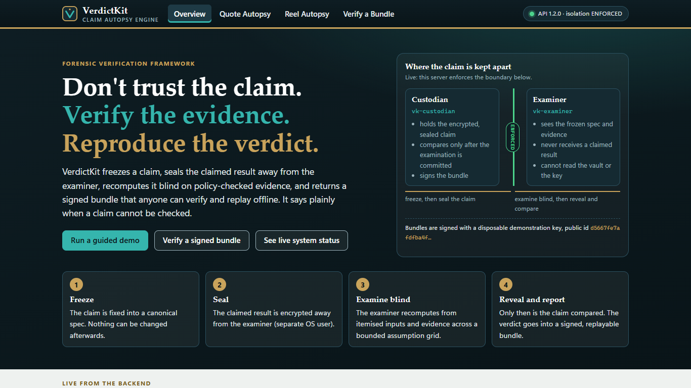
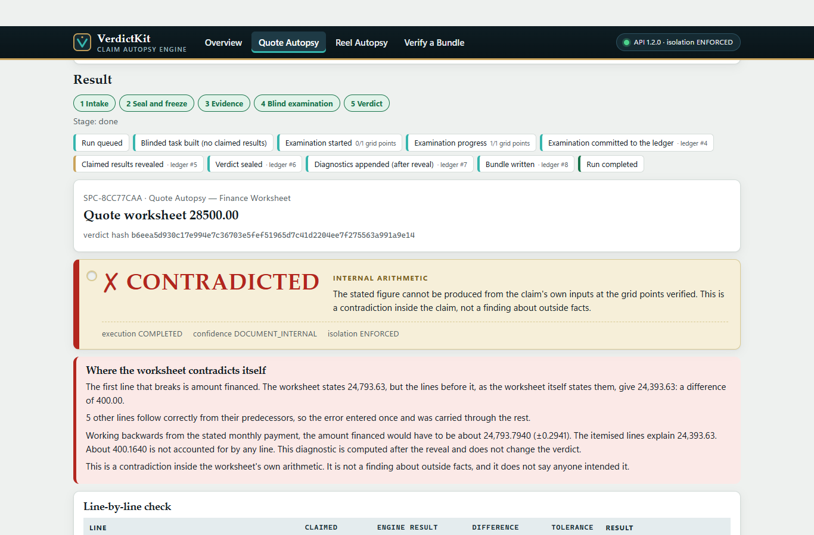
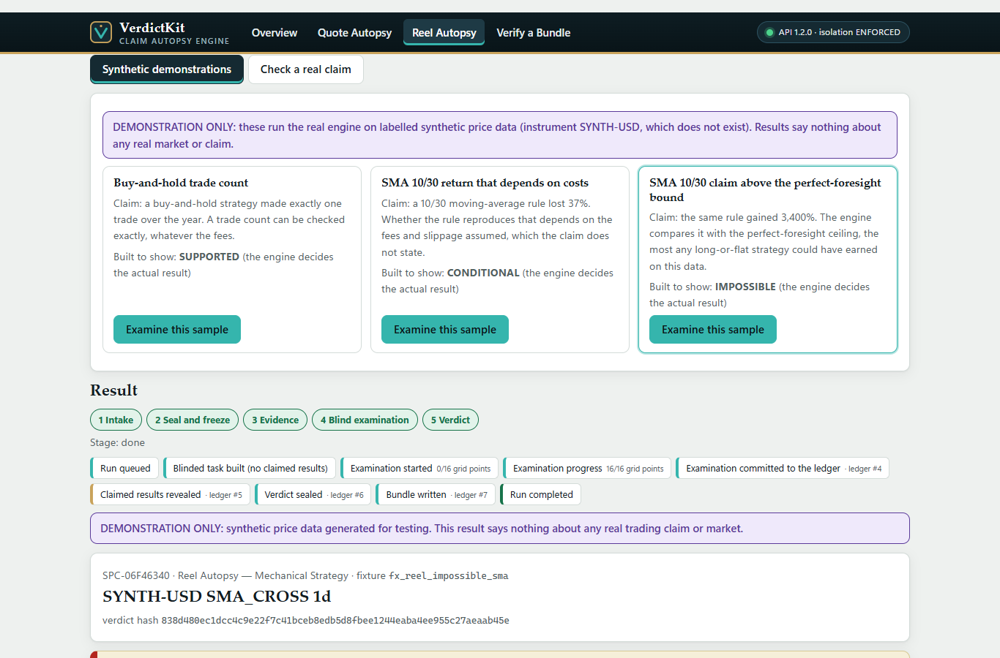
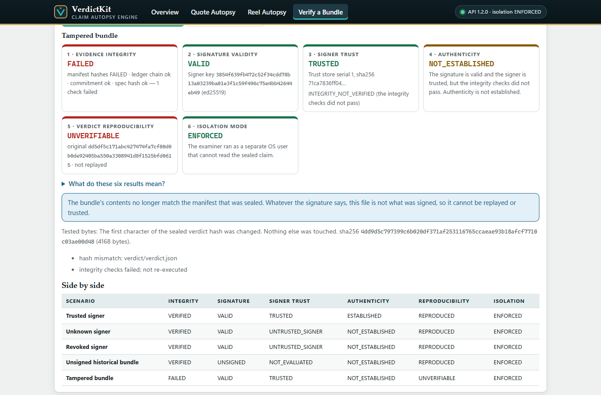

# VerdictKit: The Claim Autopsy Engine

> **Don't trust the claim. Verify the evidence. Reproduce the verdict.**

VerdictKit freezes a claim, seals the claimed answer away from the examiner, recomputes it blind on policy-checked evidence across a bounded assumption grid, and returns a **reproducible verdict bundle that anyone can verify and replay offline**, with Ed25519 signing in the demonstration configuration. It says plainly when a claim cannot be checked.

**One examination framework, three surfaces, no duplicated trust code.**



[Quickstart](#run-it) · [Product tour](docs/PRODUCT_TOUR.md) · [How it works](docs/HOW_IT_WORKS.md) · [Verified CI run](https://github.com/koushikark22/verdictkit/actions/runs/46057569703)

| Surface | What it examines | Try it |
|---|---|---|
| **Quote Autopsy** | Vehicle finance and lease worksheets. Recomputes every line, finds the first line that breaks. | `/quote/?demo=padded` |
| **Reel Autopsy** | Mechanical trading-strategy claims on labelled synthetic data. Tests a claim against a perfect-foresight ceiling. | `/reel/?demo=fx_reel_impossible_sma` |
| **Verify Lab** | Any signed bundle: five verifier scenarios side by side, then offline replay. | `/verify?auto=1&sample=lease-consistent&scenario=tampered-bundle` |

A third claim type (`examples/stub_claimtype`) runs through the same core with zero core edits. That is the reuse proof.

## See it in action

| Quote Autopsy | Reel Autopsy |
|---|---|
|  |  |
| Finds a $400 discrepancy in a constructed finance worksheet. | Tests a claimed 3,400% return against a 2,872.54% ceiling on labelled synthetic data. |



The Verify Lab separates integrity, signature validity, signer trust, authenticity, reproducibility and isolation. A valid signature is not proof that a claim is true.

## The journey

**Claim** → **Evidence** → **Deterministic examination** → **Verdict** → **Signed bundle** → **Independent verification** → **Offline replay**

1. The claim is frozen into a canonical spec. The claimed figures are sealed (AES-GCM) in a vault the examiner cannot read.
2. The examiner is a different OS user, reached over an authenticated Unix socket. It receives the spec and the evidence, never the claimed result.
3. It sweeps a bounded grid of assumptions and returns findings. Only then is the claim revealed and compared.
4. The verdict goes into a bundle (hash-chained ledger, commitment, spec hash), signed with Ed25519 when signing is enabled.
5. A verifier checks integrity, signature, signer trust, authenticity, reproducibility and isolation as six separate results, against a trust store **the verifier** configured. A key inside a bundle is never trusted.
6. `verdictkit replay` re-runs the examination from the bundle with no network.

Findings are labelled by kind: a contradiction inside a claim's own arithmetic (`CONTRADICTED`) is never confused with a refutation by outside evidence (`REFUTED`). `INDETERMINATE`, `CONDITIONAL` and `BLOCKED` are first-class answers. Results read "verified at N grid points", never "for all values".

## Run it

**Prerequisites:** Git, a running Docker engine (Docker Desktop on Windows/macOS), and Node.js 20 or newer with npm. No paid API key or Kiro account is needed to try the bundled samples. The first build requires internet access to fetch dependencies and container layers; offline replay is supported after setup.

Clone the repository:

```bash
git clone https://github.com/koushikark22/verdictkit.git
cd verdictkit
```

Start from the repository root. For the first run or after updating the code, rebuild to avoid stale cached artifacts.

**Windows (PowerShell)**

```powershell
powershell -ExecutionPolicy Bypass -File scripts\Start-VerdictKit.ps1 -Image verdictkit:batch3 -Rebuild
```

**Linux / macOS (Bash)**

```bash
bash scripts/start-verdictkit.sh --image verdictkit:batch3 --rebuild
```

Open the URL printed by the launcher (normally `http://127.0.0.1:5170/`). The launcher builds the backend and UI, checks health and starts a loopback-only gateway. Confirm the portal reports API 1.2.0, ENFORCED isolation and judge mode. Subsequent starts can omit the rebuild flag if the checkout has not changed, retaining the same image argument.

To stop, run `powershell -ExecutionPolicy Bypass -File scripts\Stop-VerdictKit.ps1` on Windows or `bash scripts/stop-verdictkit.sh` on Linux/macOS. If a port is occupied, use the URL printed by the launcher rather than stopping unrelated services.

Then follow the three-minute tour in [`docs/PRODUCT_TOUR.md`](docs/PRODUCT_TOUR.md). To verify a bundle offline, download the bundle and public trust store from Verify Lab, open a terminal in that download directory and replace `CASE_FILENAME.vkb` with the downloaded filename. On Bash:

```bash
docker run --rm --network none -v "$(pwd):/data:ro" verdictkit:batch3 verdictkit replay /data/CASE_FILENAME.vkb --trust-store /data/vk-demo-trust-store.json
```

On PowerShell:

```powershell
docker run --rm --network none -v "${PWD}:/data:ro" verdictkit:batch3 verdictkit replay /data/CASE_FILENAME.vkb --trust-store /data/vk-demo-trust-store.json
```

## What has been verified

From runs on 2026-11-27 (Windows 11 with Docker Desktop). Ledger with every record: [`docs/next-phase/EXECUTION_EVIDENCE.md`](docs/next-phase/EXECUTION_EVIDENCE.md).

| Check | Result |
|---|---|
| Python regression, Windows (`pytest -m "not isolation"`, CI Hypothesis profile) | 642 passed, 16 skipped, 4 deselected |
| Same suite inside the Linux image as the custodian user | 623 passed, 15 skipped, 6 deselected |
| Enforced-isolation gates (`--network none`): startup, isolation, signed bundles, judge-mode HTTP lifecycle, case and replay | all passed; the judge-mode scan found no vault key in 926 samples |
| Frontend: typecheck, unit tests, production build | clean; 53 tests |
| Browser end-to-end against the real backend (Chrome, no mocks) | 105 checks passed, 0 console errors |
| Dependency audits | `npm audit` and `pip-audit`: no known vulnerabilities |
| Final GitHub Actions run | [46057569703](https://github.com/koushikark22/verdictkit/actions/runs/46057569703): both jobs passed, 36 successful steps on commit `68e9cc24` |
| Independent security review | no blocker found; see [`docs/SECURITY_REVIEW_BATCH3.md`](docs/SECURITY_REVIEW_BATCH3.md) |

The same stub claim yields the same sealed verdict hash (`547fba0c…aaa79`) in-process on Windows and inside the enforced Linux container. The isolation mode is recorded and differs; the verdict does not.

## What it does not claim

* Not every claim is verifiable. A signature says who sealed a bundle, never that the claim is true.
* Reproducibility is claimed for a pinned environment. Blinding rests on OS-user separation, encryption and a type partition, not on hashes.
* The signing key in the demonstration is disposable and new at every start. It proves nothing about a real signer.
* Quote worksheets are constructed. Reel data is synthetic and labelled; real Reel claims are blocked until licensed data exists. External tax and fee checks cover Texas finance worksheets only, against a hash-pinned snapshot.
* It is a local demonstration, not a public service. Public deployment is not authorised and has not been done.

## How Kiro was used

Specs (`.kiro/specs/`: core, Reel, Quote, and the next-phase plan), steering (`.kiro/steering/`, six files that tests enforce), agent hooks (`.kiro/hooks/`) and an MCP server (`.kiro/settings/mcp.json`). What was actually observed inside Kiro, and what was not, is recorded without embellishment in [`docs/KIRO_USAGE.md`](docs/KIRO_USAGE.md). Genuine Kiro execution evidence includes an automatic LLM-fence hook (61 tests passed) and all four MCP tool calls on contract 1.2.0, with matching verdict hashes and reproducible replay. The Windows MCP run was UNENFORCED; enforced isolation is demonstrated by the Docker gates. Earlier implementation passes were done with Claude Code and are labelled as such.

## For developers

```bash
uv sync --frozen --all-packages --all-extras --group dev
HYPOTHESIS_PROFILE=ci uv run --no-sync pytest -q -m "not isolation"
uv run --no-sync verdictkit replay examples/stub_claimtype/golden.vkb
npm ci && npm run typecheck && npm test && npm run build:portal
docker build -t verdictkit . && docker run --rm --network none verdictkit gate-http
node tests/ui/e2e_product.cjs      # needs the stack running; see docs/PRODUCT_TOUR.md
```

* How it works in one page: [`docs/HOW_IT_WORKS.md`](docs/HOW_IT_WORKS.md). Architecture and decision log: [`docs/ARCHITECTURE.md`](docs/ARCHITECTURE.md). Signing and trust: [`docs/SIGNING.md`](docs/SIGNING.md). HTTP contract (1.2.0): [`docs/API_CONTRACT.md`](docs/API_CONTRACT.md), `api/openapi.yaml`.
* Judge reproduction: [`docs/PRODUCT_TOUR.md`](docs/PRODUCT_TOUR.md) (current); [`docs/JUDGE_DEMO.md`](docs/JUDGE_DEMO.md) (historical baseline). Competition text and demo plan: [`docs/DEVPOST.md`](docs/DEVPOST.md), [`docs/DEMO_STORYBOARD.md`](docs/DEMO_STORYBOARD.md).
* Layout: `core/src/verdictkit/` (custody, examiner, evidence, sweep, bundle, signing, API, MCP server), `apps/quote-autopsy`, `apps/reel-autopsy`, `ui/hub` (portal and Verify Lab), `ui-kit` (shared UI), `deploy/` (container entrypoint), `scripts/` (start, stop, gateway, gates).
* MCP server: `python -m verdictkit.mcp_server` (stdio; tools `list_claim_types`, `verify_claim`, `explain_verdict`, `replay_bundle`; file access limited to approved roots).
