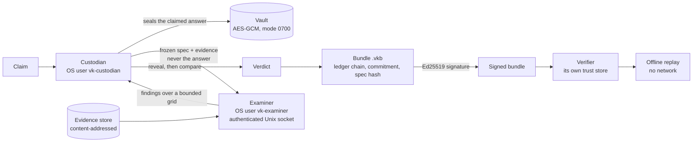

# How VerdictKit works, and why you can check it

One page for judges. The long form is `docs/ARCHITECTURE.md` (section 4 is the threat model) and `docs/SIGNING.md`.

**The idea.** A claim is checked by a program that never sees the claimed answer. Only after the check is committed is the answer revealed and compared. The result is written into a bundle that is signed, and anyone can verify the signature against keys *they* chose to trust and replay the check offline.

## Who can see what

| Principal | Claimed answer | Evidence | Vault key | Signing key |
|---|---|---|---|---|
| Custodian (API, vault, ledger, signing) | yes | yes | yes | yes |
| Examiner (the evaluator) | **never** | yes | no | no |
| Verifier (anyone, offline) | only after the reveal, inside the bundle | embedded in the bundle | no | no; checks the public key it already trusts |

## What each guarantee rests on

| Guarantee | Mechanism | Where it is checked |
|---|---|---|
| The examiner cannot read the claimed answer | the answer has no field in the task type; the vault is mode 0700 and AES-GCM encrypted; the examiner runs as another OS user with a scrubbed environment | contract tests; `gate-isolation`; as the examiner OS user the vault, signing key and the API's memory were refused (`SECURITY_REVIEW_BATCH3.md`); the judge-mode scan found no vault key in 926 process samples |
| The answer is revealed only after the examination | a ledger state machine; the UI shows "examination committed" before "claimed results revealed" | contract tests; browser end-to-end |
| Evidence cannot change silently | content-addressed store, hash recomputed on every read | contract tests |
| No language model decides a verdict | an import fence over every evaluator and custody module | `test_llm_fence.py`, also run by a Kiro hook |
| The verdict can be reproduced | `Decimal` only, canonical JSON, a pinned environment | the same sealed verdict hash on Windows and in the Linux container; offline replay `REPRODUCED` |
| The bundle was not altered | four integrity checks: manifest hashes, ledger chain, commitment, spec hash | the tampered scenario fails integrity and is not replayed |
| Who sealed the bundle | an Ed25519 signature over the manifest, accepted only if the signer is in the verifier's own trust store, active and in its validity window; a key found inside a bundle is never trusted | `gate-sign` (14 checks incl. unknown, revoked, three tampers); the five Verify Lab scenarios |

## What it does not guarantee

* A signature says who sealed a bundle, never that the claim is true. A verdict is "verified at N grid points", never "for all values".
* Isolation is within one host: a root compromise of the container defeats it. Reproducibility is for a pinned environment.
* Expiry is judged when verifying, because there is no trusted timestamp. The demonstration key is disposable and proves nothing about a real signer.
* Not every claim is verifiable: `INDETERMINATE`, `CONDITIONAL` and `BLOCKED` are answers. Real Reel claims are blocked without licensed data; Quote checks outside facts for Texas finance worksheets only.
* It is a local demonstration. A cross-site page can send blind writes to its local server, and plugin loading is not yet allow-listed, so a public deployment is not authorised (`SECURITY_REVIEW_BATCH3.md`, NB-1 and KL-1).

## Why one framework serves three screens

Custody, the blind examiner, the sweep, the bundle, signing and verification contain no domain logic. A claim type supplies only its schema, evaluator and presenter. Quote Autopsy and Reel Autopsy are two such types; `examples/stub_claimtype` is a third that runs with no core edit; the Verify Lab calls the same replay and authenticity code as the API.
